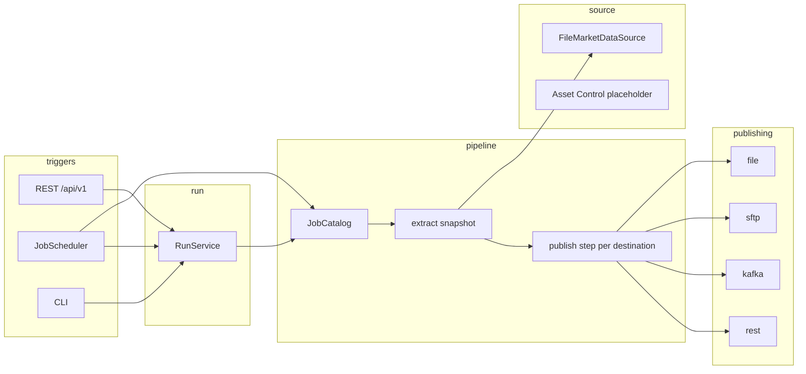

# Market Data Publisher

Extracts an end-of-day snapshot (instrument reference data and EOD prices) for one instrument family and one business date, validates it, and publishes it to the destinations enabled for that job. About 100k instruments per family is the design point: the snapshot is read once, staged, then each destination is its own Spring Batch step.

The Asset Control vendor API is not wired yet. `FileMarketDataSource` reads a CSV instead. See the TODO at the bottom.

Stack: Java 17, Spring Boot 3.5, Spring Batch 5, Spring Modulith, Maven. Run history lives only in Spring Batch metadata tables (H2 locally, Oracle in production).

## Architecture



`domain` and `infrastructure` are open shared modules used by every arrow above. Scheduling does not depend on the run module: it calls `ScheduledRunLauncher`, which `RunService` implements.

## Module map

| Module | Public types | Hidden under `internal` |
|---|---|---|
| `domain` (open) | `Instrument`, `EodPrice`, `MarketDataRecord`, `InstrumentType`, `BusinessDate`, `RunId`, `policy.MissingPricePolicy`, `policy.FailurePolicy` | none; the module is open |
| `source` | `MarketDataSource`, `AssetControlSource` | `file.FileMarketDataSource`, `assetcontrol.AssetControlMarketDataSource` (not a bean) |
| `pipeline` | `JobDefinition`, `JobCatalog`, `JobRuntime`, `ScheduledRunLauncher`, `RunParameters` | `jobs` (Fx futures, Fx forwards, CME futures), `extract`, `validate`, `transform` (`Transformer`, `Serializer`), `flow`, `listener` (MDC, metrics, startup recovery) |
| `publishing` | `Publication`, `FileDestination`, `SftpDestination`, `KafkaDestination`, `RestDestination`, `SinkWriter` | `file`, `sftp`, `kafka`, `rest` clients |
| `run` | `RunService`, `RunStatus` | `api` (`/api/v1`), `guard` (duplicate check, `runSequence`), `cli` |
| `scheduling` | none | `JobScheduler`, `ClusterLock` (no-op; ShedLock can replace it) |
| `infrastructure` (open) | `config.MdpProperties`, `config.Connections`, `config.JobExecutors`, `security` (JWT, `MDP_OPERATOR`, `MDP_VIEWER`), `observability` | the module is open |

Dependency direction enforced by `ApplicationModules.verify()`:

`scheduling` and `run` → `pipeline` → `source` and `publishing`. Any module may use `domain` and `infrastructure`. Nothing depends on `run` or `scheduling`. `domain` depends on nothing.

`./mvnw test -Dtest=ModularityTests` also writes Modulith docs to `target/spring-modulith-docs`.

## Jobs

Defined in Java (`pipeline/internal/jobs`). Each `JobDefinition` chooses its source and publications as typed objects (`connections.sftp().vendorA()`, not a string in YAML). Configuration supplies the cron and batch tuning only.

| Job | Instrument | Publications | Schedule in YAML |
|---|---|---|---|
| `fxFuturesEodJob` | `FX_FUTURE` | local file, SFTP `vendorA`, Kafka `main` | 16:00 weekdays, chunk 2000, 4 threads |
| `fxForwardsEodJob` | `FX_FORWARD` | local file, REST `riskApi` | 17:00 weekdays, batch defaults |
| `cmeFuturesEodJob` | `CME_FUTURE` | local file, SFTP `internal` | on demand (`schedule: none`), 3 threads |

A run's identity is `businessDate` + `runSequence` (both identifying). `triggeredBy` and `triggerSource` (`API`, `SCHEDULER`, `CLI`) are audit-only. Reruns allocate the next sequence and overwrite destination files. A second run of the same job and date is rejected with `409` while one is still running.

Flow for every job:

1. `extract` reads the source, validates, skips what the policy allows, and writes `work/<job>/<date>/seq-<n>/snapshot.csv`.
2. One `publish-<destination>` step per enabled destination reads that snapshot.
3. `FAIL_FAST` stops at the first destination failure. `CONTINUE_OTHER_DESTINATIONS` runs the other destinations, then `failureGate` fails the job if any destination failed. FX futures uses the latter.
4. Restart re-executes failed steps and skips completed ones, including the extract when it already staged a snapshot.

Missing prices are `SKIP_AND_ALERT` on the shipped jobs (logged at error, counted as `mdp.records.skipped` with reason `missing_price`, and they do not consume the invalid-record skip limit). `FAIL_RUN` fails the extract step. Other invalid rows are skipped until the job's skip limit (default 100). A remote publication whose connection is `enabled: false` is omitted and is not contacted.

## Run it locally

Requires JDK 17+. The Maven wrapper is included.

```bash
./mvnw verify
./mvnw spring-boot:run
```

`main` sets the default profile to `local`: in-memory H2, file sink only, and permit-all security. Every caller is the principal `local-operator` with both roles. Do not use that profile on a shared host.

```bash
curl -i -X POST localhost:8080/api/v1/runs -H 'Content-Type: application/json' \
  -d '{"jobName":"fxFuturesEodJob","businessDate":"2026-11-11"}'

curl localhost:8080/api/v1/runs/1
curl 'localhost:8080/api/v1/runs?job=fxFuturesEodJob&date=2026-11-11&status=COMPLETED'
cat output/FX_FUTURE_EOD_2026-11-11.csv
curl localhost:8080/actuator/health
```

OpenAPI is at `http://localhost:8080/swagger-ui.html`.

Input files live in `sample-data/input/<INSTRUMENT_TYPE>_<yyyy-MM-dd>.csv` with header `instrumentId,instrumentType,symbol,currency,maturityDate,closePrice`. The FX future sample contains a blank price, a negative price, and a non-numeric price on purpose.

CLI fallback (the process stays up when the run succeeds; a failed run aborts startup):

```bash
./mvnw spring-boot:run -Dspring-boot.run.arguments="--mdp.cli.job=fxFuturesEodJob --mdp.cli.business-date=2026-11-11 --mdp.cli.triggered-by=alice"
```

## API

| Method | Path | Role | Result |
|---|---|---|---|
| `POST` | `/api/v1/runs` | `MDP_OPERATOR` | `202` and `executionId`, `Location: /api/v1/runs/{id}` |
| `GET` | `/api/v1/runs/{id}` | `MDP_VIEWER` or `MDP_OPERATOR` | step-level counts |
| `GET` | `/api/v1/runs?job&date&status` | viewer or operator | up to 200 matching executions |
| `POST` | `/api/v1/runs/{id}/restart` | operator | `202`, same `runSequence`, failed steps run again |
| `POST` | `/api/v1/runs/{id}/stop` | operator | `202`, status moves to `STOPPING` |

`triggeredBy` is the authenticated principal. Errors are RFC 7807 `application/problem+json` (`400` validation, `401`/`403` when JWT is on, `404` unknown job or run, `409` duplicate active run or a restart/stop in the wrong state).

With the `prod` or `dev` profile the API is an OAuth2 resource server. Put `MDP_OPERATOR` or `MDP_VIEWER` in the `roles` claim, in Keycloak `realm_access.roles`, or in `scope`.

```bash
curl -H "Authorization: Bearer $TOKEN" -H 'Content-Type: application/json' \
  -d '{"jobName":"fxForwardsEodJob","businessDate":"2026-11-11"}' \
  http://localhost:8080/api/v1/runs
```

Autosys and Airflow should call the same endpoint. See `docs/adr/0004-api-triggered-scheduling.md`.

## Configuration

Secrets are `${ENV}` placeholders only. A Vault agent, systemd `EnvironmentFile`, or `spring.config.import: vault://` (Spring Cloud Vault, not a dependency of this build) injects them. Nothing secret is committed. Changing connections or tuning requires a restart. The run API cannot override them.

Profiles are Java fields on `Connections` (`sftp.vendorA`, `sftp.internal`, `kafka.main`, `rest.riskApi`, `source.assetControl`). Referencing one that is not declared does not compile.

| Key | Env | Default |
|---|---|---|
| `mdp.connections.source.asset-control.input-dir` | `MDP_INPUT_DIR` | `sample-data/input` |
| `mdp.output-dir` | `MDP_OUTPUT_DIR` | `output` |
| `mdp.work-dir` | `MDP_WORK_DIR` | `work` |
| `mdp.batch.defaults.chunk-size` | | `1000` |
| `mdp.batch.defaults.threads` | | `1` (per-job pool `mdp-<job>-N`) |
| `mdp.batch.defaults.skip-limit` | | `100` |
| `mdp.batch.defaults.retry-limit` | | `0` |
| `mdp.batch.defaults.fetch-size` | | `1000` |
| `mdp.jobs.<job>.batch.*` | | overrides the defaults for that job |
| `mdp.jobs.<job>.schedule` | | Spring 6-field cron, or `none` / absent for on-demand |
| `mdp.jobs.<job>.enabled` | | `true`; `false` skips the cron, the API can still launch |
| `mdp.schedule-zone` | `MDP_SCHEDULE_ZONE` | JVM zone |
| `mdp.security.mode` | | `permit-all` (local), `jwt` (dev/prod) |
| `mdp.connections.sftp.vendor-a.*` | `MDP_SFTP_VENDOR_A_HOST`, `MDP_SFTP_VENDOR_A_PASSWORD`, `MDP_SFTP_VENDOR_A_ENABLED` | host `sftp-vendor-a`, disabled |
| `mdp.connections.sftp.internal.*` | `MDP_SFTP_INTERNAL_*` | host `sftp-internal`, disabled |
| `mdp.connections.kafka.main.*` | `MDP_KAFKA_BOOTSTRAP`, `MDP_KAFKA_ENABLED` | `localhost:9092`, disabled, idempotent producer |
| `mdp.connections.rest.risk-api.*` | `MDP_REST_URL`, `MDP_REST_CLIENT_ID`, `MDP_REST_CLIENT_SECRET`, `MDP_REST_ENABLED` | `http://localhost:8081`, disabled |

An `mdp.jobs` key that is not a `JobDefinition` fails startup. Clients are created on first use and cached; `enabled: false` means that profile is never contacted.

Profiles:

| Profile | Database | Security |
|---|---|---|
| `local` (default) | H2, Batch schema created | permit-all, principal `local-operator` |
| `dev` | H2 unless `MDP_DB_*` is set | JWT, `MDP_JWT_ISSUER` required |
| `oracle` | Oracle via `MDP_DB_URL`, `MDP_DB_USER`, `MDP_DB_PASSWORD` | leaves security to the other profile |
| `prod` | Oracle | JWT |

Oracle Batch DDL is documented in `docs/batch-schema.md`. Do not point production at `local`.

## Observability

Console logs are ECS JSON (`logging.structured.format.console=ecs`) and include MDC `jobName`, `businessDate`, `executionId`, `runSequence`, `triggeredBy`.

Prometheus metrics (prefix `mdp`): `records.read`, `records.written` (tagged by destination), `records.skipped` (tagged by reason), `destination.duration`, `destination.failures`. Actuator exposes `health`, `info`, `prometheus`, and `metrics`. Custom health indicators check the work directory and the Batch metadata store. Liveness and readiness probes are enabled.

Tracing uses Micrometer's OpenTelemetry bridge. Export is off until `OTEL_EXPORT_ENABLED=true`. Set `OTEL_EXPORTER_OTLP_ENDPOINT` and `MDP_TRACING_PROBABILITY` (default `1.0` locally, `0.1` in prod).

On startup, executions still marked running are set to `FAILED` so they can be restarted. Shutdown is graceful (`server.shutdown=graceful`, 30s budget, the run executor waits for in-flight tasks).

## Operations

```bash
docker build -f deploy/Dockerfile -t market-data-publisher .
docker compose -f deploy/docker-compose.yml up -d                 # Kafka + SFTP
docker compose -f deploy/docker-compose.yml --profile oracle up -d
docker compose -f deploy/docker-compose.yml --profile app up -d --build
```

The image is a layered Temurin 17 JRE running as uid `10001`. `deploy/mdp.service` is the systemd unit (`EnvironmentFile=/etc/mdp/mdp.env`, `SIGTERM`, 40s stop timeout). Kubernetes notes, including the single-replica limit, are in `deploy/k8s/README.md`.

SFTP uploads `<remote>/<TYPE>_EOD_<date>.csv` by writing a `.tmp` object and renaming it. The file sink does the same with an atomic move on the local disk. Kafka values are JSON; a restarted publish step sends the snapshot again and consumers should treat the instrument id as the key. REST posts each chunk with an `Idempotency-Key` of `job:date:sequence:chunk`.

## Build

`./mvnw verify` runs tests, Spotless (google-java-format), Checkstyle, and JaCoCo (`target/site/jacoco`). GitHub Actions does the same on Java 17.

Kafka and SFTP tests use Testcontainers and are skipped when Docker is not available. The REST sink is tested with WireMock.

## Decisions

- [Modulith over Maven modules](docs/adr/0001-modulith-over-maven-modules.md)
- [Batch metadata only](docs/adr/0002-batch-metadata-only.md)
- [Jobs in Java](docs/adr/0003-jobs-in-java.md)
- [API-triggered scheduling](docs/adr/0004-api-triggered-scheduling.md)
- [Type-safe job wiring](docs/adr/0005-type-safe-job-wiring.md)

## TODO

- Replace `AssetControlMarketDataSource` with the vendor Java API (page instrument ids, store the resume cursor in the step execution context) and select it with `mdp.source.type=asset-control`.
- Add a ShedLock implementation of `scheduling.internal.ClusterLock` before running more than one node.
- Oracle Free in Compose is not part of CI. The Oracle profile has not been executed against a live database in this repository.
- Kafka restart is last-write-wins on instrument id, not a transactional outbox.
