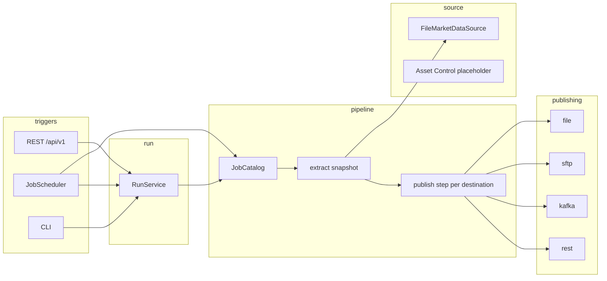

# Market Data Publisher — complete source bundle

Archive of commit `3fadf78c7185abbbc9b1e7f070dede9fec7beed2` on `cursor/modulith-restructure-17e8`.
File count: 147.

Each archived file is one section. The section header is a single line of the form
`===== FILE: <relative-path> =====` and the section closer is a single line
`===== END FILE =====`. Bytes between the header newline and the closer are the
file contents, including that file's own trailing newline. Do not reformat them.

Not stored as their own files, because they are not in the branch:

- No `.mvn/wrapper/maven-wrapper.jar`. `maven-wrapper.properties` sets
  `distributionType=only-script` and `wrapperVersion=3.3.4`. `./mvnw` downloads
  Apache Maven 3.9.9 from the `distributionUrl` in that properties file.
  Regenerate the scripts with
  `mvn wrapper:wrapper -Dmaven=3.9.9 -Dtype=only-script`
  (plugin `org.apache.maven.plugins:maven-wrapper-plugin`). Do not add the jar.
- No Logback XML. Console JSON is `logging.structured.format.console=ecs` in
  `src/main/resources/application.yml`.
- No SQL and no Flyway migration. Batch metadata DDL is the script inside
  `spring-batch-core` (`org/springframework/batch/core/schema-oracle.sql`).
  See `docs/batch-schema.md`.
- No standalone Spotless file. Google Java Format is the `spotless-maven-plugin`
  block in `pom.xml`. Checkstyle rules are `config/checkstyle/checkstyle.xml`.

`mvnw` must be executable (mode `0755`) after extraction. `mvnw.cmd` is CRLF.

## Table of contents

### Build

1. `pom.xml`
2. `mvnw`
3. `mvnw.cmd`
4. `.mvn/wrapper/maven-wrapper.properties`
5. `config/checkstyle/checkstyle.xml`
6. `.gitignore`

### Application

7. `src/main/java/com/praxis/mdp/MarketDataPublisherApplication.java`

### Module: domain

8. `src/main/java/com/praxis/mdp/domain/BusinessDate.java`
9. `src/main/java/com/praxis/mdp/domain/EodPrice.java`
10. `src/main/java/com/praxis/mdp/domain/Instrument.java`
11. `src/main/java/com/praxis/mdp/domain/InstrumentType.java`
12. `src/main/java/com/praxis/mdp/domain/MarketDataRecord.java`
13. `src/main/java/com/praxis/mdp/domain/RunId.java`
14. `src/main/java/com/praxis/mdp/domain/package-info.java`
15. `src/main/java/com/praxis/mdp/domain/policy/FailurePolicy.java`
16. `src/main/java/com/praxis/mdp/domain/policy/MissingPricePolicy.java`

### Module: source

17. `src/main/java/com/praxis/mdp/source/AssetControlSource.java`
18. `src/main/java/com/praxis/mdp/source/MarketDataSource.java`
19. `src/main/java/com/praxis/mdp/source/internal/assetcontrol/AssetControlMarketDataSource.java`
20. `src/main/java/com/praxis/mdp/source/internal/file/FileMarketDataSource.java`
21. `src/main/java/com/praxis/mdp/source/package-info.java`

### Module: pipeline

22. `src/main/java/com/praxis/mdp/pipeline/BatchSettings.java`
23. `src/main/java/com/praxis/mdp/pipeline/JobCatalog.java`
24. `src/main/java/com/praxis/mdp/pipeline/JobDefinition.java`
25. `src/main/java/com/praxis/mdp/pipeline/JobRuntime.java`
26. `src/main/java/com/praxis/mdp/pipeline/RunParameters.java`
27. `src/main/java/com/praxis/mdp/pipeline/ScheduleSettings.java`
28. `src/main/java/com/praxis/mdp/pipeline/ScheduledRunLauncher.java`
29. `src/main/java/com/praxis/mdp/pipeline/internal/extract/SnapshotStore.java`
30. `src/main/java/com/praxis/mdp/pipeline/internal/flow/EodJobFactory.java`
31. `src/main/java/com/praxis/mdp/pipeline/internal/flow/PublicationWriter.java`
32. `src/main/java/com/praxis/mdp/pipeline/internal/flow/SnapshotReader.java`
33. `src/main/java/com/praxis/mdp/pipeline/internal/flow/SourceReader.java`
34. `src/main/java/com/praxis/mdp/pipeline/internal/flow/StagingWriter.java`
35. `src/main/java/com/praxis/mdp/pipeline/internal/jobs/CmeFuturesJob.java`
36. `src/main/java/com/praxis/mdp/pipeline/internal/jobs/DefaultJobCatalog.java`
37. `src/main/java/com/praxis/mdp/pipeline/internal/jobs/FxForwardsJob.java`
38. `src/main/java/com/praxis/mdp/pipeline/internal/jobs/FxFuturesJob.java`
39. `src/main/java/com/praxis/mdp/pipeline/internal/jobs/JobStartupValidator.java`
40. `src/main/java/com/praxis/mdp/pipeline/internal/listener/MetricsStepListener.java`
41. `src/main/java/com/praxis/mdp/pipeline/internal/listener/RunLoggingListener.java`
42. `src/main/java/com/praxis/mdp/pipeline/internal/listener/SkipLoggingListener.java`
43. `src/main/java/com/praxis/mdp/pipeline/internal/listener/StartupRecovery.java`
44. `src/main/java/com/praxis/mdp/pipeline/internal/transform/CsvSerializer.java`
45. `src/main/java/com/praxis/mdp/pipeline/internal/transform/IdentityTransformer.java`
46. `src/main/java/com/praxis/mdp/pipeline/internal/transform/Serializer.java`
47. `src/main/java/com/praxis/mdp/pipeline/internal/transform/Transformer.java`
48. `src/main/java/com/praxis/mdp/pipeline/internal/validate/InvalidRecordException.java`
49. `src/main/java/com/praxis/mdp/pipeline/internal/validate/MarketDataValidator.java`
50. `src/main/java/com/praxis/mdp/pipeline/internal/validate/MdpSkipPolicy.java`
51. `src/main/java/com/praxis/mdp/pipeline/internal/validate/MissingPriceException.java`
52. `src/main/java/com/praxis/mdp/pipeline/package-info.java`

### Module: publishing

53. `src/main/java/com/praxis/mdp/publishing/FileDestination.java`
54. `src/main/java/com/praxis/mdp/publishing/Format.java`
55. `src/main/java/com/praxis/mdp/publishing/KafkaDestination.java`
56. `src/main/java/com/praxis/mdp/publishing/MarketDataSink.java`
57. `src/main/java/com/praxis/mdp/publishing/OutputNames.java`
58. `src/main/java/com/praxis/mdp/publishing/Publication.java`
59. `src/main/java/com/praxis/mdp/publishing/PublishRequest.java`
60. `src/main/java/com/praxis/mdp/publishing/PublishingClients.java`
61. `src/main/java/com/praxis/mdp/publishing/RestDestination.java`
62. `src/main/java/com/praxis/mdp/publishing/SftpDestination.java`
63. `src/main/java/com/praxis/mdp/publishing/SinkWriter.java`
64. `src/main/java/com/praxis/mdp/publishing/internal/DefaultPublishingClients.java`
65. `src/main/java/com/praxis/mdp/publishing/internal/file/CsvCodec.java`
66. `src/main/java/com/praxis/mdp/publishing/internal/file/FileMarketDataSink.java`
67. `src/main/java/com/praxis/mdp/publishing/internal/file/LocalCsvWriter.java`
68. `src/main/java/com/praxis/mdp/publishing/internal/kafka/KafkaMarketDataSink.java`
69. `src/main/java/com/praxis/mdp/publishing/internal/kafka/KafkaProducerConfig.java`
70. `src/main/java/com/praxis/mdp/publishing/internal/kafka/KafkaProducers.java`
71. `src/main/java/com/praxis/mdp/publishing/internal/rest/RestClients.java`
72. `src/main/java/com/praxis/mdp/publishing/internal/rest/RestMarketDataSink.java`
73. `src/main/java/com/praxis/mdp/publishing/internal/sftp/SftpMarketDataSink.java`
74. `src/main/java/com/praxis/mdp/publishing/internal/sftp/SftpSessions.java`
75. `src/main/java/com/praxis/mdp/publishing/package-info.java`

### Module: run

76. `src/main/java/com/praxis/mdp/run/RunService.java`
77. `src/main/java/com/praxis/mdp/run/RunStatus.java`
78. `src/main/java/com/praxis/mdp/run/internal/api/ApiExceptionHandler.java`
79. `src/main/java/com/praxis/mdp/run/internal/api/OpenApiConfig.java`
80. `src/main/java/com/praxis/mdp/run/internal/api/RunController.java`
81. `src/main/java/com/praxis/mdp/run/internal/api/RunRequest.java`
82. `src/main/java/com/praxis/mdp/run/internal/cli/CliRunner.java`
83. `src/main/java/com/praxis/mdp/run/internal/guard/ActiveRunGuard.java`
84. `src/main/java/com/praxis/mdp/run/internal/guard/PerJobJobLauncher.java`
85. `src/main/java/com/praxis/mdp/run/internal/guard/RunExceptions.java`
86. `src/main/java/com/praxis/mdp/run/internal/guard/RunLauncherConfig.java`
87. `src/main/java/com/praxis/mdp/run/package-info.java`

### Module: scheduling

88. `src/main/java/com/praxis/mdp/scheduling/internal/ClusterLock.java`
89. `src/main/java/com/praxis/mdp/scheduling/internal/JobScheduler.java`
90. `src/main/java/com/praxis/mdp/scheduling/internal/NoOpClusterLock.java`
91. `src/main/java/com/praxis/mdp/scheduling/package-info.java`

### Module: infrastructure

92. `src/main/java/com/praxis/mdp/infrastructure/config/BatchInfrastructureConfig.java`
93. `src/main/java/com/praxis/mdp/infrastructure/config/Connections.java`
94. `src/main/java/com/praxis/mdp/infrastructure/config/JobExecutors.java`
95. `src/main/java/com/praxis/mdp/infrastructure/config/MdpProperties.java`
96. `src/main/java/com/praxis/mdp/infrastructure/observability/BatchMetadataHealthIndicator.java`
97. `src/main/java/com/praxis/mdp/infrastructure/observability/PublishMetrics.java`
98. `src/main/java/com/praxis/mdp/infrastructure/observability/RunMdc.java`
99. `src/main/java/com/praxis/mdp/infrastructure/observability/WorkDirectoryHealthIndicator.java`
100. `src/main/java/com/praxis/mdp/infrastructure/package-info.java`
101. `src/main/java/com/praxis/mdp/infrastructure/security/JwtRolesConverter.java`
102. `src/main/java/com/praxis/mdp/infrastructure/security/SecurityConfig.java`

### Resources and sample data

103. `sample-data/input/CME_FUTURE_2026-11-11.csv`
104. `sample-data/input/FX_FORWARD_2026-11-11.csv`
105. `sample-data/input/FX_FUTURE_2026-11-11.csv`
106. `src/main/resources/application-dev.yml`
107. `src/main/resources/application-local.yml`
108. `src/main/resources/application-oracle.yml`
109. `src/main/resources/application-prod.yml`
110. `src/main/resources/application.properties`
111. `src/main/resources/application.yml`

### Tests

112. `src/test/java/com/praxis/mdp/CliRunTest.java`
113. `src/test/java/com/praxis/mdp/ConnectionWiringTest.java`
114. `src/test/java/com/praxis/mdp/ContinuePolicyTest.java`
115. `src/test/java/com/praxis/mdp/FxFuturesJobIntegrationTest.java`
116. `src/test/java/com/praxis/mdp/MissingPriceFailRunTest.java`
117. `src/test/java/com/praxis/mdp/ModularityTests.java`
118. `src/test/java/com/praxis/mdp/RunApiSecurityTest.java`
119. `src/test/java/com/praxis/mdp/RunApiTest.java`
120. `src/test/java/com/praxis/mdp/RunConflictTest.java`
121. `src/test/java/com/praxis/mdp/StartupRecoveryTest.java`
122. `src/test/java/com/praxis/mdp/TestDirs.java`
123. `src/test/java/com/praxis/mdp/pipeline/JobSettingsTest.java`
124. `src/test/java/com/praxis/mdp/pipeline/internal/validate/MarketDataValidatorTest.java`
125. `src/test/java/com/praxis/mdp/pipeline/internal/validate/MdpSkipPolicyTest.java`
126. `src/test/java/com/praxis/mdp/publishing/internal/file/FileMarketDataSinkTest.java`
127. `src/test/java/com/praxis/mdp/publishing/internal/kafka/KafkaMarketDataSinkTest.java`
128. `src/test/java/com/praxis/mdp/publishing/internal/kafka/KafkaProducerConfigTest.java`
129. `src/test/java/com/praxis/mdp/publishing/internal/rest/RestMarketDataSinkTest.java`
130. `src/test/java/com/praxis/mdp/publishing/internal/sftp/SftpMarketDataSinkTest.java`
131. `src/test/java/com/praxis/mdp/run/internal/guard/ActiveRunGuardTest.java`
132. `src/test/resources/application-test.yml`
133. `src/test/resources/application.properties`
134. `src/test/resources/input/FX_FUTURE_2026-11-11.csv`

### Operations

135. `.dockerignore`
136. `.github/workflows/ci.yml`
137. `deploy/Dockerfile`
138. `deploy/docker-compose.yml`
139. `deploy/mdp.service`
140. `deploy/k8s/README.md`

### Documentation

141. `README.md`
142. `docs/adr/0001-modulith-over-maven-modules.md`
143. `docs/adr/0002-batch-metadata-only.md`
144. `docs/adr/0003-jobs-in-java.md`
145. `docs/adr/0004-api-triggered-scheduling.md`
146. `docs/adr/0005-type-safe-job-wiring.md`
147. `docs/batch-schema.md`
===== FILE: pom.xml =====
<?xml version="1.0" encoding="UTF-8"?>
<project xmlns="http://maven.apache.org/POM/4.0.0" xmlns:xsi="http://www.w3.org/2001/XMLSchema-instance"
         xsi:schemaLocation="http://maven.apache.org/POM/4.0.0 https://maven.apache.org/xsd/maven-4.0.0.xsd">
    <modelVersion>4.0.0</modelVersion>

    <parent>
        <groupId>org.springframework.boot</groupId>
        <artifactId>spring-boot-starter-parent</artifactId>
        <version>3.5.16</version>
        <relativePath/>
    </parent>

    <groupId>com.praxis</groupId>
    <artifactId>market-data-publisher</artifactId>
    <version>0.2.0-SNAPSHOT</version>
    <name>market-data-publisher</name>
    <description>End-of-day market data publisher (Spring Modulith, Spring Batch)</description>

    <properties>
        <java.version>17</java.version>
        <spring-modulith.version>1.4.14</spring-modulith.version>
        <springdoc.version>2.8.17</springdoc.version>
        <resilience4j.version>2.2.0</resilience4j.version>
        <wiremock.version>3.13.2</wiremock.version>
        <spotless.version>2.44.5</spotless.version>
        <google-java-format.version>1.25.2</google-java-format.version>
        <checkstyle.plugin.version>3.6.0</checkstyle.plugin.version>
        <jacoco.version>0.8.16</jacoco.version>
    </properties>

    <dependencyManagement>
        <dependencies>
            <dependency>
                <groupId>org.springframework.modulith</groupId>
                <artifactId>spring-modulith-bom</artifactId>
                <version>${spring-modulith.version}</version>
                <type>pom</type>
                <scope>import</scope>
            </dependency>
            <dependency>
                <groupId>io.github.resilience4j</groupId>
                <artifactId>resilience4j-bom</artifactId>
                <version>${resilience4j.version}</version>
                <type>pom</type>
                <scope>import</scope>
            </dependency>
        </dependencies>
    </dependencyManagement>

    <dependencies>
        <dependency>
            <groupId>org.springframework.boot</groupId>
            <artifactId>spring-boot-starter-batch</artifactId>
        </dependency>
        <dependency>
            <groupId>org.springframework.boot</groupId>
            <artifactId>spring-boot-starter-web</artifactId>
        </dependency>
        <dependency>
            <groupId>org.springframework.boot</groupId>
            <artifactId>spring-boot-starter-validation</artifactId>
        </dependency>
        <dependency>
            <groupId>org.springframework.boot</groupId>
            <artifactId>spring-boot-starter-actuator</artifactId>
        </dependency>
        <dependency>
            <groupId>org.springframework.boot</groupId>
            <artifactId>spring-boot-starter-oauth2-resource-server</artifactId>
        </dependency>
        <dependency>
            <groupId>org.springframework.modulith</groupId>
            <artifactId>spring-modulith-starter-core</artifactId>
        </dependency>
        <dependency>
            <groupId>org.springdoc</groupId>
            <artifactId>springdoc-openapi-starter-webmvc-ui</artifactId>
            <version>${springdoc.version}</version>
        </dependency>
        <dependency>
            <groupId>org.springframework.integration</groupId>
            <artifactId>spring-integration-sftp</artifactId>
        </dependency>
        <dependency>
            <groupId>org.springframework.kafka</groupId>
            <artifactId>spring-kafka</artifactId>
        </dependency>
        <dependency>
            <groupId>io.github.resilience4j</groupId>
            <artifactId>resilience4j-retry</artifactId>
        </dependency>
        <dependency>
            <groupId>io.github.resilience4j</groupId>
            <artifactId>resilience4j-circuitbreaker</artifactId>
        </dependency>
        <dependency>
            <groupId>io.micrometer</groupId>
            <artifactId>micrometer-registry-prometheus</artifactId>
        </dependency>
        <dependency>
            <groupId>io.micrometer</groupId>
            <artifactId>micrometer-tracing-bridge-otel</artifactId>
        </dependency>
        <dependency>
            <groupId>io.opentelemetry</groupId>
            <artifactId>opentelemetry-exporter-otlp</artifactId>
        </dependency>

        <dependency>
            <groupId>com.h2database</groupId>
            <artifactId>h2</artifactId>
            <scope>runtime</scope>
        </dependency>
        <dependency>
            <groupId>com.oracle.database.jdbc</groupId>
            <artifactId>ojdbc11</artifactId>
            <scope>runtime</scope>
        </dependency>

        <dependency>
            <groupId>org.springframework.boot</groupId>
            <artifactId>spring-boot-starter-test</artifactId>
            <scope>test</scope>
        </dependency>
        <dependency>
            <groupId>org.springframework.batch</groupId>
            <artifactId>spring-batch-test</artifactId>
            <scope>test</scope>
        </dependency>
        <dependency>
            <groupId>org.springframework.security</groupId>
            <artifactId>spring-security-test</artifactId>
            <scope>test</scope>
        </dependency>
        <dependency>
            <groupId>org.springframework.modulith</groupId>
            <artifactId>spring-modulith-starter-test</artifactId>
            <scope>test</scope>
        </dependency>
        <dependency>
            <groupId>org.testcontainers</groupId>
            <artifactId>junit-jupiter</artifactId>
            <scope>test</scope>
        </dependency>
        <dependency>
            <groupId>org.testcontainers</groupId>
            <artifactId>kafka</artifactId>
            <scope>test</scope>
        </dependency>
        <dependency>
            <groupId>org.wiremock</groupId>
            <artifactId>wiremock-standalone</artifactId>
            <version>${wiremock.version}</version>
            <scope>test</scope>
        </dependency>
    </dependencies>

    <build>
        <plugins>
            <plugin>
                <groupId>org.springframework.boot</groupId>
                <artifactId>spring-boot-maven-plugin</artifactId>
                <configuration>
                    <layers>
                        <enabled>true</enabled>
                    </layers>
                    <profiles>
                        <profile>local</profile>
                    </profiles>
                </configuration>
            </plugin>
            <plugin>
                <groupId>com.diffplug.spotless</groupId>
                <artifactId>spotless-maven-plugin</artifactId>
                <version>${spotless.version}</version>
                <configuration>
                    <java>
                        <googleJavaFormat>
                            <version>${google-java-format.version}</version>
                            <style>GOOGLE</style>
                        </googleJavaFormat>
                        <removeUnusedImports/>
                        <trimTrailingWhitespace/>
                        <endWithNewline/>
                    </java>
                </configuration>
                <executions>
                    <execution>
                        <id>spotless-check</id>
                        <phase>verify</phase>
                        <goals>
                            <goal>check</goal>
                        </goals>
                    </execution>
                </executions>
            </plugin>
            <plugin>
                <groupId>org.apache.maven.plugins</groupId>
                <artifactId>maven-checkstyle-plugin</artifactId>
                <version>${checkstyle.plugin.version}</version>
                <configuration>
                    <configLocation>config/checkstyle/checkstyle.xml</configLocation>
                    <consoleOutput>true</consoleOutput>
                    <failsOnError>true</failsOnError>
                    <includeTestSourceDirectory>true</includeTestSourceDirectory>
                    <violationSeverity>error</violationSeverity>
                </configuration>
                <executions>
                    <execution>
                        <id>checkstyle</id>
                        <phase>verify</phase>
                        <goals>
                            <goal>check</goal>
                        </goals>
                    </execution>
                </executions>
            </plugin>
            <plugin>
                <groupId>org.jacoco</groupId>
                <artifactId>jacoco-maven-plugin</artifactId>
                <version>${jacoco.version}</version>
                <executions>
                    <execution>
                        <id>prepare-agent</id>
                        <goals>
                            <goal>prepare-agent</goal>
                        </goals>
                    </execution>
                    <execution>
                        <id>report</id>
                        <phase>verify</phase>
                        <goals>
                            <goal>report</goal>
                        </goals>
                    </execution>
                </executions>
            </plugin>
        </plugins>
    </build>
</project>
===== END FILE =====

===== FILE: mvnw =====
#!/bin/sh
# ----------------------------------------------------------------------------
# Licensed to the Apache Software Foundation (ASF) under one
# or more contributor license agreements.  See the NOTICE file
# distributed with this work for additional information
# regarding copyright ownership.  The ASF licenses this file
# to you under the Apache License, Version 2.0 (the
# "License"); you may not use this file except in compliance
# with the License.  You may obtain a copy of the License at
#
#    http://www.apache.org/licenses/LICENSE-2.0
#
# Unless required by applicable law or agreed to in writing,
# software distributed under the License is distributed on an
# "AS IS" BASIS, WITHOUT WARRANTIES OR CONDITIONS OF ANY
# KIND, either express or implied.  See the License for the
# specific language governing permissions and limitations
# under the License.
# ----------------------------------------------------------------------------

# ----------------------------------------------------------------------------
# Apache Maven Wrapper startup batch script, version 3.3.4
#
# Optional ENV vars
# -----------------
#   JAVA_HOME - location of a JDK home dir, required when download maven via java source
#   MVNW_REPOURL - repo url base for downloading maven distribution
#   MVNW_USERNAME/MVNW_PASSWORD - user and password for downloading maven
#   MVNW_VERBOSE - true: enable verbose log; debug: trace the mvnw script; others: silence the output
# ----------------------------------------------------------------------------

set -euf
[ "${MVNW_VERBOSE-}" != debug ] || set -x

# OS specific support.
native_path() { printf %s\\n "$1"; }
case "$(uname)" in
CYGWIN* | MINGW*)
  [ -z "${JAVA_HOME-}" ] || JAVA_HOME="$(cygpath --unix "$JAVA_HOME")"
  native_path() { cygpath --path --windows "$1"; }
  ;;
esac

# set JAVACMD and JAVACCMD
set_java_home() {
  # For Cygwin and MinGW, ensure paths are in Unix format before anything is touched
  if [ -n "${JAVA_HOME-}" ]; then
    if [ -x "$JAVA_HOME/jre/sh/java" ]; then
      # IBM's JDK on AIX uses strange locations for the executables
      JAVACMD="$JAVA_HOME/jre/sh/java"
      JAVACCMD="$JAVA_HOME/jre/sh/javac"
    else
      JAVACMD="$JAVA_HOME/bin/java"
      JAVACCMD="$JAVA_HOME/bin/javac"

      if [ ! -x "$JAVACMD" ] || [ ! -x "$JAVACCMD" ]; then
        echo "The JAVA_HOME environment variable is not defined correctly, so mvnw cannot run." >&2
        echo "JAVA_HOME is set to \"$JAVA_HOME\", but \"\$JAVA_HOME/bin/java\" or \"\$JAVA_HOME/bin/javac\" does not exist." >&2
        return 1
      fi
    fi
  else
    JAVACMD="$(
      'set' +e
      'unset' -f command 2>/dev/null
      'command' -v java
    )" || :
    JAVACCMD="$(
      'set' +e
      'unset' -f command 2>/dev/null
      'command' -v javac
    )" || :

    if [ ! -x "${JAVACMD-}" ] || [ ! -x "${JAVACCMD-}" ]; then
      echo "The java/javac command does not exist in PATH nor is JAVA_HOME set, so mvnw cannot run." >&2
      return 1
    fi
  fi
}

# hash string like Java String::hashCode
hash_string() {
  str="${1:-}" h=0
  while [ -n "$str" ]; do
    char="${str%"${str#?}"}"
    h=$(((h * 31 + $(LC_CTYPE=C printf %d "'$char")) % 4294967296))
    str="${str#?}"
  done
  printf %x\\n $h
}

verbose() { :; }
[ "${MVNW_VERBOSE-}" != true ] || verbose() { printf %s\\n "${1-}"; }

die() {
  printf %s\\n "$1" >&2
  exit 1
}

trim() {
  # MWRAPPER-139:
  #   Trims trailing and leading whitespace, carriage returns, tabs, and linefeeds.
  #   Needed for removing poorly interpreted newline sequences when running in more
  #   exotic environments such as mingw bash on Windows.
  printf "%s" "${1}" | tr -d '[:space:]'
}

scriptDir="$(dirname "$0")"
scriptName="$(basename "$0")"

# parse distributionUrl and optional distributionSha256Sum, requires .mvn/wrapper/maven-wrapper.properties
while IFS="=" read -r key value; do
  case "${key-}" in
  distributionUrl) distributionUrl=$(trim "${value-}") ;;
  distributionSha256Sum) distributionSha256Sum=$(trim "${value-}") ;;
  esac
done <"$scriptDir/.mvn/wrapper/maven-wrapper.properties"
[ -n "${distributionUrl-}" ] || die "cannot read distributionUrl property in $scriptDir/.mvn/wrapper/maven-wrapper.properties"

case "${distributionUrl##*/}" in
maven-mvnd-*bin.*)
  MVN_CMD=mvnd.sh _MVNW_REPO_PATTERN=/maven/mvnd/
  case "${PROCESSOR_ARCHITECTURE-}${PROCESSOR_ARCHITEW6432-}:$(uname -a)" in
  *AMD64:CYGWIN* | *AMD64:MINGW*) distributionPlatform=windows-amd64 ;;
  :Darwin*x86_64) distributionPlatform=darwin-amd64 ;;
  :Darwin*arm64) distributionPlatform=darwin-aarch64 ;;
  :Linux*x86_64*) distributionPlatform=linux-amd64 ;;
  *)
    echo "Cannot detect native platform for mvnd on $(uname)-$(uname -m), use pure java version" >&2
    distributionPlatform=linux-amd64
    ;;
  esac
  distributionUrl="${distributionUrl%-bin.*}-$distributionPlatform.zip"
  ;;
maven-mvnd-*) MVN_CMD=mvnd.sh _MVNW_REPO_PATTERN=/maven/mvnd/ ;;
*) MVN_CMD="mvn${scriptName#mvnw}" _MVNW_REPO_PATTERN=/org/apache/maven/ ;;
esac

# apply MVNW_REPOURL and calculate MAVEN_HOME
# maven home pattern: ~/.m2/wrapper/dists/{apache-maven-<version>,maven-mvnd-<version>-<platform>}/<hash>
[ -z "${MVNW_REPOURL-}" ] || distributionUrl="$MVNW_REPOURL$_MVNW_REPO_PATTERN${distributionUrl#*"$_MVNW_REPO_PATTERN"}"
distributionUrlName="${distributionUrl##*/}"
distributionUrlNameMain="${distributionUrlName%.*}"
distributionUrlNameMain="${distributionUrlNameMain%-bin}"
MAVEN_USER_HOME="${MAVEN_USER_HOME:-${HOME}/.m2}"
MAVEN_HOME="${MAVEN_USER_HOME}/wrapper/dists/${distributionUrlNameMain-}/$(hash_string "$distributionUrl")"

exec_maven() {
  unset MVNW_VERBOSE MVNW_USERNAME MVNW_PASSWORD MVNW_REPOURL || :
  exec "$MAVEN_HOME/bin/$MVN_CMD" "$@" || die "cannot exec $MAVEN_HOME/bin/$MVN_CMD"
}

if [ -d "$MAVEN_HOME" ]; then
  verbose "found existing MAVEN_HOME at $MAVEN_HOME"
  exec_maven "$@"
fi

case "${distributionUrl-}" in
*?-bin.zip | *?maven-mvnd-?*-?*.zip) ;;
*) die "distributionUrl is not valid, must match *-bin.zip or maven-mvnd-*.zip, but found '${distributionUrl-}'" ;;
esac

# prepare tmp dir
if TMP_DOWNLOAD_DIR="$(mktemp -d)" && [ -d "$TMP_DOWNLOAD_DIR" ]; then
  clean() { rm -rf -- "$TMP_DOWNLOAD_DIR"; }
  trap clean HUP INT TERM EXIT
else
  die "cannot create temp dir"
fi

mkdir -p -- "${MAVEN_HOME%/*}"

# Download and Install Apache Maven
verbose "Couldn't find MAVEN_HOME, downloading and installing it ..."
verbose "Downloading from: $distributionUrl"
verbose "Downloading to: $TMP_DOWNLOAD_DIR/$distributionUrlName"

# select .zip or .tar.gz
if ! command -v unzip >/dev/null; then
  distributionUrl="${distributionUrl%.zip}.tar.gz"
  distributionUrlName="${distributionUrl##*/}"
fi

# verbose opt
__MVNW_QUIET_WGET=--quiet __MVNW_QUIET_CURL=--silent __MVNW_QUIET_UNZIP=-q __MVNW_QUIET_TAR=''
[ "${MVNW_VERBOSE-}" != true ] || __MVNW_QUIET_WGET='' __MVNW_QUIET_CURL='' __MVNW_QUIET_UNZIP='' __MVNW_QUIET_TAR=v

# normalize http auth
case "${MVNW_PASSWORD:+has-password}" in
'') MVNW_USERNAME='' MVNW_PASSWORD='' ;;
has-password) [ -n "${MVNW_USERNAME-}" ] || MVNW_USERNAME='' MVNW_PASSWORD='' ;;
esac

if [ -z "${MVNW_USERNAME-}" ] && command -v wget >/dev/null; then
  verbose "Found wget ... using wget"
  wget ${__MVNW_QUIET_WGET:+"$__MVNW_QUIET_WGET"} "$distributionUrl" -O "$TMP_DOWNLOAD_DIR/$distributionUrlName" || die "wget: Failed to fetch $distributionUrl"
elif [ -z "${MVNW_USERNAME-}" ] && command -v curl >/dev/null; then
  verbose "Found curl ... using curl"
  curl ${__MVNW_QUIET_CURL:+"$__MVNW_QUIET_CURL"} -f -L -o "$TMP_DOWNLOAD_DIR/$distributionUrlName" "$distributionUrl" || die "curl: Failed to fetch $distributionUrl"
elif set_java_home; then
  verbose "Falling back to use Java to download"
  javaSource="$TMP_DOWNLOAD_DIR/Downloader.java"
  targetZip="$TMP_DOWNLOAD_DIR/$distributionUrlName"
  cat >"$javaSource" <<-END
	public class Downloader extends java.net.Authenticator
	{
	  protected java.net.PasswordAuthentication getPasswordAuthentication()
	  {
	    return new java.net.PasswordAuthentication( System.getenv( "MVNW_USERNAME" ), System.getenv( "MVNW_PASSWORD" ).toCharArray() );
	  }
	  public static void main( String[] args ) throws Exception
	  {
	    setDefault( new Downloader() );
	    java.nio.file.Files.copy( java.net.URI.create( args[0] ).toURL().openStream(), java.nio.file.Paths.get( args[1] ).toAbsolutePath().normalize() );
	  }
	}
	END
  # For Cygwin/MinGW, switch paths to Windows format before running javac and java
  verbose " - Compiling Downloader.java ..."
  "$(native_path "$JAVACCMD")" "$(native_path "$javaSource")" || die "Failed to compile Downloader.java"
  verbose " - Running Downloader.java ..."
  "$(native_path "$JAVACMD")" -cp "$(native_path "$TMP_DOWNLOAD_DIR")" Downloader "$distributionUrl" "$(native_path "$targetZip")"
fi

# If specified, validate the SHA-256 sum of the Maven distribution zip file
if [ -n "${distributionSha256Sum-}" ]; then
  distributionSha256Result=false
  if [ "$MVN_CMD" = mvnd.sh ]; then
    echo "Checksum validation is not supported for maven-mvnd." >&2
    echo "Please disable validation by removing 'distributionSha256Sum' from your maven-wrapper.properties." >&2
    exit 1
  elif command -v sha256sum >/dev/null; then
    if echo "$distributionSha256Sum  $TMP_DOWNLOAD_DIR/$distributionUrlName" | sha256sum -c - >/dev/null 2>&1; then
      distributionSha256Result=true
    fi
  elif command -v shasum >/dev/null; then
    if echo "$distributionSha256Sum  $TMP_DOWNLOAD_DIR/$distributionUrlName" | shasum -a 256 -c >/dev/null 2>&1; then
      distributionSha256Result=true
    fi
  else
    echo "Checksum validation was requested but neither 'sha256sum' or 'shasum' are available." >&2
    echo "Please install either command, or disable validation by removing 'distributionSha256Sum' from your maven-wrapper.properties." >&2
    exit 1
  fi
  if [ $distributionSha256Result = false ]; then
    echo "Error: Failed to validate Maven distribution SHA-256, your Maven distribution might be compromised." >&2
    echo "If you updated your Maven version, you need to update the specified distributionSha256Sum property." >&2
    exit 1
  fi
fi

# unzip and move
if command -v unzip >/dev/null; then
  unzip ${__MVNW_QUIET_UNZIP:+"$__MVNW_QUIET_UNZIP"} "$TMP_DOWNLOAD_DIR/$distributionUrlName" -d "$TMP_DOWNLOAD_DIR" || die "failed to unzip"
else
  tar xzf${__MVNW_QUIET_TAR:+"$__MVNW_QUIET_TAR"} "$TMP_DOWNLOAD_DIR/$distributionUrlName" -C "$TMP_DOWNLOAD_DIR" || die "failed to untar"
fi

# Find the actual extracted directory name (handles snapshots where filename != directory name)
actualDistributionDir=""

# First try the expected directory name (for regular distributions)
if [ -d "$TMP_DOWNLOAD_DIR/$distributionUrlNameMain" ]; then
  if [ -f "$TMP_DOWNLOAD_DIR/$distributionUrlNameMain/bin/$MVN_CMD" ]; then
    actualDistributionDir="$distributionUrlNameMain"
  fi
fi

# If not found, search for any directory with the Maven executable (for snapshots)
if [ -z "$actualDistributionDir" ]; then
  # enable globbing to iterate over items
  set +f
  for dir in "$TMP_DOWNLOAD_DIR"/*; do
    if [ -d "$dir" ]; then
      if [ -f "$dir/bin/$MVN_CMD" ]; then
        actualDistributionDir="$(basename "$dir")"
        break
      fi
    fi
  done
  set -f
fi

if [ -z "$actualDistributionDir" ]; then
  verbose "Contents of $TMP_DOWNLOAD_DIR:"
  verbose "$(ls -la "$TMP_DOWNLOAD_DIR")"
  die "Could not find Maven distribution directory in extracted archive"
fi

verbose "Found extracted Maven distribution directory: $actualDistributionDir"
printf %s\\n "$distributionUrl" >"$TMP_DOWNLOAD_DIR/$actualDistributionDir/mvnw.url"
mv -- "$TMP_DOWNLOAD_DIR/$actualDistributionDir" "$MAVEN_HOME" || [ -d "$MAVEN_HOME" ] || die "fail to move MAVEN_HOME"

clean || :
exec_maven "$@"
===== END FILE =====

===== FILE: mvnw.cmd =====
<# : batch portion
@REM ----------------------------------------------------------------------------
@REM Licensed to the Apache Software Foundation (ASF) under one
@REM or more contributor license agreements.  See the NOTICE file
@REM distributed with this work for additional information
@REM regarding copyright ownership.  The ASF licenses this file
@REM to you under the Apache License, Version 2.0 (the
@REM "License"); you may not use this file except in compliance
@REM with the License.  You may obtain a copy of the License at
@REM
@REM    http://www.apache.org/licenses/LICENSE-2.0
@REM
@REM Unless required by applicable law or agreed to in writing,
@REM software distributed under the License is distributed on an
@REM "AS IS" BASIS, WITHOUT WARRANTIES OR CONDITIONS OF ANY
@REM KIND, either express or implied.  See the License for the
@REM specific language governing permissions and limitations
@REM under the License.
@REM ----------------------------------------------------------------------------

@REM ----------------------------------------------------------------------------
@REM Apache Maven Wrapper startup batch script, version 3.3.4
@REM
@REM Optional ENV vars
@REM   MVNW_REPOURL - repo url base for downloading maven distribution
@REM   MVNW_USERNAME/MVNW_PASSWORD - user and password for downloading maven
@REM   MVNW_VERBOSE - true: enable verbose log; others: silence the output
@REM ----------------------------------------------------------------------------

@IF "%__MVNW_ARG0_NAME__%"=="" (SET __MVNW_ARG0_NAME__=%~nx0)
@SET __MVNW_CMD__=
@SET __MVNW_ERROR__=
@SET __MVNW_PSMODULEP_SAVE=%PSModulePath%
@SET PSModulePath=
@FOR /F "usebackq tokens=1* delims==" %%A IN (`powershell -noprofile "& {$scriptDir='%~dp0'; $script='%__MVNW_ARG0_NAME__%'; icm -ScriptBlock ([Scriptblock]::Create((Get-Content -Raw '%~f0'))) -NoNewScope}"`) DO @(
  IF "%%A"=="MVN_CMD" (set __MVNW_CMD__=%%B) ELSE IF "%%B"=="" (echo %%A) ELSE (echo %%A=%%B)
)
@SET PSModulePath=%__MVNW_PSMODULEP_SAVE%
@SET __MVNW_PSMODULEP_SAVE=
@SET __MVNW_ARG0_NAME__=
@SET MVNW_USERNAME=
@SET MVNW_PASSWORD=
@IF NOT "%__MVNW_CMD__%"=="" ("%__MVNW_CMD__%" %*)
@echo Cannot start maven from wrapper >&2 && exit /b 1
@GOTO :EOF
: end batch / begin powershell #>

$ErrorActionPreference = "Stop"
if ($env:MVNW_VERBOSE -eq "true") {
  $VerbosePreference = "Continue"
}

# calculate distributionUrl, requires .mvn/wrapper/maven-wrapper.properties
$distributionUrl = (Get-Content -Raw "$scriptDir/.mvn/wrapper/maven-wrapper.properties" | ConvertFrom-StringData).distributionUrl
if (!$distributionUrl) {
  Write-Error "cannot read distributionUrl property in $scriptDir/.mvn/wrapper/maven-wrapper.properties"
}

switch -wildcard -casesensitive ( $($distributionUrl -replace '^.*/','') ) {
  "maven-mvnd-*" {
    $USE_MVND = $true
    $distributionUrl = $distributionUrl -replace '-bin\.[^.]*$',"-windows-amd64.zip"
    $MVN_CMD = "mvnd.cmd"
    break
  }
  default {
    $USE_MVND = $false
    $MVN_CMD = $script -replace '^mvnw','mvn'
    break
  }
}

# apply MVNW_REPOURL and calculate MAVEN_HOME
# maven home pattern: ~/.m2/wrapper/dists/{apache-maven-<version>,maven-mvnd-<version>-<platform>}/<hash>
if ($env:MVNW_REPOURL) {
  $MVNW_REPO_PATTERN = if ($USE_MVND -eq $False) { "/org/apache/maven/" } else { "/maven/mvnd/" }
  $distributionUrl = "$env:MVNW_REPOURL$MVNW_REPO_PATTERN$($distributionUrl -replace "^.*$MVNW_REPO_PATTERN",'')"
}
$distributionUrlName = $distributionUrl -replace '^.*/',''
$distributionUrlNameMain = $distributionUrlName -replace '\.[^.]*$','' -replace '-bin$',''

$MAVEN_M2_PATH = "$HOME/.m2"
if ($env:MAVEN_USER_HOME) {
  $MAVEN_M2_PATH = "$env:MAVEN_USER_HOME"
}

if (-not (Test-Path -Path $MAVEN_M2_PATH)) {
    New-Item -Path $MAVEN_M2_PATH -ItemType Directory | Out-Null
}

$MAVEN_WRAPPER_DISTS = $null
if ((Get-Item $MAVEN_M2_PATH).Target[0] -eq $null) {
  $MAVEN_WRAPPER_DISTS = "$MAVEN_M2_PATH/wrapper/dists"
} else {
  $MAVEN_WRAPPER_DISTS = (Get-Item $MAVEN_M2_PATH).Target[0] + "/wrapper/dists"
}

$MAVEN_HOME_PARENT = "$MAVEN_WRAPPER_DISTS/$distributionUrlNameMain"
$MAVEN_HOME_NAME = ([System.Security.Cryptography.SHA256]::Create().ComputeHash([byte[]][char[]]$distributionUrl) | ForEach-Object {$_.ToString("x2")}) -join ''
$MAVEN_HOME = "$MAVEN_HOME_PARENT/$MAVEN_HOME_NAME"

if (Test-Path -Path "$MAVEN_HOME" -PathType Container) {
  Write-Verbose "found existing MAVEN_HOME at $MAVEN_HOME"
  Write-Output "MVN_CMD=$MAVEN_HOME/bin/$MVN_CMD"
  exit $?
}

if (! $distributionUrlNameMain -or ($distributionUrlName -eq $distributionUrlNameMain)) {
  Write-Error "distributionUrl is not valid, must end with *-bin.zip, but found $distributionUrl"
}

# prepare tmp dir
$TMP_DOWNLOAD_DIR_HOLDER = New-TemporaryFile
$TMP_DOWNLOAD_DIR = New-Item -Itemtype Directory -Path "$TMP_DOWNLOAD_DIR_HOLDER.dir"
$TMP_DOWNLOAD_DIR_HOLDER.Delete() | Out-Null
trap {
  if ($TMP_DOWNLOAD_DIR.Exists) {
    try { Remove-Item $TMP_DOWNLOAD_DIR -Recurse -Force | Out-Null }
    catch { Write-Warning "Cannot remove $TMP_DOWNLOAD_DIR" }
  }
}

New-Item -Itemtype Directory -Path "$MAVEN_HOME_PARENT" -Force | Out-Null

# Download and Install Apache Maven
Write-Verbose "Couldn't find MAVEN_HOME, downloading and installing it ..."
Write-Verbose "Downloading from: $distributionUrl"
Write-Verbose "Downloading to: $TMP_DOWNLOAD_DIR/$distributionUrlName"

$webclient = New-Object System.Net.WebClient
if ($env:MVNW_USERNAME -and $env:MVNW_PASSWORD) {
  $webclient.Credentials = New-Object System.Net.NetworkCredential($env:MVNW_USERNAME, $env:MVNW_PASSWORD)
}
[Net.ServicePointManager]::SecurityProtocol = [Net.SecurityProtocolType]::Tls12
$webclient.DownloadFile($distributionUrl, "$TMP_DOWNLOAD_DIR/$distributionUrlName") | Out-Null

# If specified, validate the SHA-256 sum of the Maven distribution zip file
$distributionSha256Sum = (Get-Content -Raw "$scriptDir/.mvn/wrapper/maven-wrapper.properties" | ConvertFrom-StringData).distributionSha256Sum
if ($distributionSha256Sum) {
  if ($USE_MVND) {
    Write-Error "Checksum validation is not supported for maven-mvnd. `nPlease disable validation by removing 'distributionSha256Sum' from your maven-wrapper.properties."
  }
  Import-Module $PSHOME\Modules\Microsoft.PowerShell.Utility -Function Get-FileHash
  if ((Get-FileHash "$TMP_DOWNLOAD_DIR/$distributionUrlName" -Algorithm SHA256).Hash.ToLower() -ne $distributionSha256Sum) {
    Write-Error "Error: Failed to validate Maven distribution SHA-256, your Maven distribution might be compromised. If you updated your Maven version, you need to update the specified distributionSha256Sum property."
  }
}

# unzip and move
Expand-Archive "$TMP_DOWNLOAD_DIR/$distributionUrlName" -DestinationPath "$TMP_DOWNLOAD_DIR" | Out-Null

# Find the actual extracted directory name (handles snapshots where filename != directory name)
$actualDistributionDir = ""

# First try the expected directory name (for regular distributions)
$expectedPath = Join-Path "$TMP_DOWNLOAD_DIR" "$distributionUrlNameMain"
$expectedMvnPath = Join-Path "$expectedPath" "bin/$MVN_CMD"
if ((Test-Path -Path $expectedPath -PathType Container) -and (Test-Path -Path $expectedMvnPath -PathType Leaf)) {
  $actualDistributionDir = $distributionUrlNameMain
}

# If not found, search for any directory with the Maven executable (for snapshots)
if (!$actualDistributionDir) {
  Get-ChildItem -Path "$TMP_DOWNLOAD_DIR" -Directory | ForEach-Object {
    $testPath = Join-Path $_.FullName "bin/$MVN_CMD"
    if (Test-Path -Path $testPath -PathType Leaf) {
      $actualDistributionDir = $_.Name
    }
  }
}

if (!$actualDistributionDir) {
  Write-Error "Could not find Maven distribution directory in extracted archive"
}

Write-Verbose "Found extracted Maven distribution directory: $actualDistributionDir"
Rename-Item -Path "$TMP_DOWNLOAD_DIR/$actualDistributionDir" -NewName $MAVEN_HOME_NAME | Out-Null
try {
  Move-Item -Path "$TMP_DOWNLOAD_DIR/$MAVEN_HOME_NAME" -Destination $MAVEN_HOME_PARENT | Out-Null
} catch {
  if (! (Test-Path -Path "$MAVEN_HOME" -PathType Container)) {
    Write-Error "fail to move MAVEN_HOME"
  }
} finally {
  try { Remove-Item $TMP_DOWNLOAD_DIR -Recurse -Force | Out-Null }
  catch { Write-Warning "Cannot remove $TMP_DOWNLOAD_DIR" }
}

Write-Output "MVN_CMD=$MAVEN_HOME/bin/$MVN_CMD"
===== END FILE =====

===== FILE: .mvn/wrapper/maven-wrapper.properties =====
wrapperVersion=3.3.4
distributionType=only-script
distributionUrl=https://repo.maven.apache.org/maven2/org/apache/maven/apache-maven/3.9.9/apache-maven-3.9.9-bin.zip
===== END FILE =====

===== FILE: config/checkstyle/checkstyle.xml =====
<?xml version="1.0"?>
<!DOCTYPE module PUBLIC
        "-//Checkstyle//DTD Checkstyle Configuration 1.3//EN"
        "https://checkstyle.org/dtds/configuration_1_3.dtd">
<module name="Checker">
    <property name="severity" value="error"/>
    <property name="fileExtensions" value="java"/>
    <module name="NewlineAtEndOfFile"/>
    <module name="FileTabCharacter"/>
    <module name="TreeWalker">
        <module name="UnusedImports"/>
        <module name="AvoidStarImport"/>
        <module name="NeedBraces"/>
        <module name="OneTopLevelClass"/>
    </module>
</module>
===== END FILE =====

===== FILE: .gitignore =====
target/
output/
work/
.idea/
*.iml
.vscode/
===== END FILE =====

===== FILE: src/main/java/com/praxis/mdp/MarketDataPublisherApplication.java =====
package com.praxis.mdp;

import org.springframework.boot.SpringApplication;
import org.springframework.boot.autoconfigure.SpringBootApplication;
import org.springframework.boot.autoconfigure.kafka.KafkaAutoConfiguration;
import org.springframework.boot.context.properties.ConfigurationPropertiesScan;
import org.springframework.modulith.Modulithic;

@Modulithic(
    systemName = "Market Data Publisher",
    sharedModules = {"domain", "infrastructure"})
@SpringBootApplication(exclude = KafkaAutoConfiguration.class)
@ConfigurationPropertiesScan
public class MarketDataPublisherApplication {

  public static void main(String[] args) {
    SpringApplication.run(MarketDataPublisherApplication.class, args);
  }
}
===== END FILE =====

===== FILE: src/main/java/com/praxis/mdp/domain/BusinessDate.java =====
package com.praxis.mdp.domain;

import java.time.LocalDate;
import java.util.Objects;

/** A business date (ISO-8601 calendar date). Any past or current date is allowed. */
public record BusinessDate(LocalDate value) {

  public BusinessDate {
    Objects.requireNonNull(value, "value");
  }

  public static BusinessDate parse(String iso) {
    return new BusinessDate(LocalDate.parse(iso));
  }

  @Override
  public String toString() {
    return value.toString();
  }
}
===== END FILE =====

===== FILE: src/main/java/com/praxis/mdp/domain/EodPrice.java =====
package com.praxis.mdp.domain;

import java.math.BigDecimal;
import java.time.LocalDate;

/** End-of-day price. {@code closePrice} may be null when the source had none. */
public record EodPrice(LocalDate businessDate, BigDecimal closePrice) {}
===== END FILE =====

===== FILE: src/main/java/com/praxis/mdp/domain/Instrument.java =====
package com.praxis.mdp.domain;

import java.time.LocalDate;

/** Reference data for one instrument. */
public record Instrument(
    String id, InstrumentType type, String symbol, String currency, LocalDate maturityDate) {}
===== END FILE =====

===== FILE: src/main/java/com/praxis/mdp/domain/InstrumentType.java =====
package com.praxis.mdp.domain;

/** Instrument families published by the application. The name is used in file names. */
public enum InstrumentType {
  FX_FUTURE,
  FX_FORWARD,
  CME_FUTURE
}
===== END FILE =====

===== FILE: src/main/java/com/praxis/mdp/domain/MarketDataRecord.java =====
package com.praxis.mdp.domain;

/** Canonical record flowing through a run: reference data plus its EOD price. */
public record MarketDataRecord(Instrument instrument, EodPrice price) {}
===== END FILE =====

===== FILE: src/main/java/com/praxis/mdp/domain/RunId.java =====
package com.praxis.mdp.domain;

import java.time.LocalDate;
import java.util.Objects;

/**
 * Identity of one logical run. Identifying job parameters are {@code businessDate} and {@code
 * runSequence}. An overwrite rerun of the same date allocates the next sequence.
 */
public record RunId(BusinessDate businessDate, long runSequence) {

  public RunId {
    Objects.requireNonNull(businessDate, "businessDate");
    if (runSequence < 1) {
      throw new IllegalArgumentException("runSequence must be >= 1");
    }
  }

  public static RunId of(LocalDate businessDate, long runSequence) {
    return new RunId(new BusinessDate(businessDate), runSequence);
  }
}
===== END FILE =====

===== FILE: src/main/java/com/praxis/mdp/domain/package-info.java =====
@org.springframework.modulith.ApplicationModule(
    displayName = "Domain",
    type = org.springframework.modulith.ApplicationModule.Type.OPEN,
    allowedDependencies = {})
package com.praxis.mdp.domain;
===== END FILE =====

===== FILE: src/main/java/com/praxis/mdp/domain/policy/FailurePolicy.java =====
package com.praxis.mdp.domain.policy;

/** What to do when one publish destination fails. Chosen in the Java job definition. */
public enum FailurePolicy {
  /** Stop the job at the first destination failure. Later destinations are not attempted. */
  FAIL_FAST,
  /** Publish the remaining destinations, then fail the job if any destination failed. */
  CONTINUE_OTHER_DESTINATIONS
}
===== END FILE =====

===== FILE: src/main/java/com/praxis/mdp/domain/policy/MissingPricePolicy.java =====
package com.praxis.mdp.domain.policy;

/** What to do when a source row has no end-of-day price. Configurable per job. */
public enum MissingPricePolicy {
  /** Skip the row, log an alert, and keep going. Does not consume the invalid-record skip limit. */
  SKIP_AND_ALERT,
  /** Fail the extract step (and therefore the job) on the first missing price. */
  FAIL_RUN
}
===== END FILE =====

===== FILE: src/main/java/com/praxis/mdp/source/AssetControlSource.java =====
package com.praxis.mdp.source;

/**
 * Source of instrument reference data and EOD prices. The file implementation is the stand-in until
 * the vendor Asset Control client is wired.
 */
public interface AssetControlSource extends MarketDataSource {}
===== END FILE =====

===== FILE: src/main/java/com/praxis/mdp/source/MarketDataSource.java =====
package com.praxis.mdp.source;

import com.praxis.mdp.domain.InstrumentType;
import com.praxis.mdp.domain.MarketDataRecord;
import java.time.LocalDate;
import org.springframework.batch.item.ItemStreamReader;

/**
 * Where a full end-of-day snapshot comes from. {@code fetchSize} is the page size for adapters that
 * read in pages. The file adapter reads the whole file.
 */
public interface MarketDataSource {

  ItemStreamReader<MarketDataRecord> reader(
      InstrumentType type, LocalDate businessDate, int fetchSize);
}
===== END FILE =====

===== FILE: src/main/java/com/praxis/mdp/source/internal/assetcontrol/AssetControlMarketDataSource.java =====
package com.praxis.mdp.source.internal.assetcontrol;

/**
 * Placeholder for the Asset Control vendor Java API adapter.
 *
 * <p>Not a Spring bean and not a {@code MarketDataSource} yet. When the vendor client is available,
 * implement the SPI here: page instrument ids, keep the resume cursor in the step {@code
 * ExecutionContext}, and register the bean in place of {@code FileMarketDataSource} ({@code
 * mdp.source.type=asset-control}).
 */
public final class AssetControlMarketDataSource {

  public static final String STATUS = "NOT_IMPLEMENTED";

  private AssetControlMarketDataSource() {}
}
===== END FILE =====

===== FILE: src/main/java/com/praxis/mdp/source/internal/file/FileMarketDataSource.java =====
package com.praxis.mdp.source.internal.file;

import com.praxis.mdp.domain.EodPrice;
import com.praxis.mdp.domain.Instrument;
import com.praxis.mdp.domain.InstrumentType;
import com.praxis.mdp.domain.MarketDataRecord;
import com.praxis.mdp.infrastructure.config.Connections;
import com.praxis.mdp.source.AssetControlSource;
import java.math.BigDecimal;
import java.nio.file.Path;
import java.time.LocalDate;
import org.springframework.batch.item.ItemStreamReader;
import org.springframework.batch.item.file.builder.FlatFileItemReaderBuilder;
import org.springframework.batch.item.file.transform.FieldSet;
import org.springframework.core.io.FileSystemResource;
import org.springframework.stereotype.Component;

/**
 * File stand-in for Asset Control. Reads {@code <inputDir>/<pattern>} from the {@code assetControl}
 * source profile. A missing file fails the step.
 */
@Component
public class FileMarketDataSource implements AssetControlSource {

  static final String[] COLUMNS = {
    "instrumentId", "instrumentType", "symbol", "currency", "maturityDate", "closePrice"
  };

  private final Connections.SourceConnection connection;

  public FileMarketDataSource(Connections connections) {
    this.connection = connections.source().assetControl();
  }

  public Path fileFor(InstrumentType type, LocalDate businessDate) {
    String name =
        connection
            .filePattern()
            .replace("{type}", type.name())
            .replace("{businessDate}", businessDate.toString())
            .replace("{date}", businessDate.toString());
    return connection.inputDir().resolve(name);
  }

  @Override
  public ItemStreamReader<MarketDataRecord> reader(
      InstrumentType type, LocalDate businessDate, int fetchSize) {
    return new FlatFileItemReaderBuilder<MarketDataRecord>()
        .name("fileMarketDataReader-" + type + "-" + fetchSize)
        .resource(new FileSystemResource(fileFor(type, businessDate)))
        .linesToSkip(1)
        .delimited()
        .names(COLUMNS)
        .fieldSetMapper(fs -> map(fs, businessDate))
        .strict(true)
        .saveState(false)
        .build();
  }

  private static MarketDataRecord map(FieldSet fs, LocalDate businessDate) {
    String maturity = fs.readString("maturityDate");
    String price = fs.readString("closePrice");
    Instrument instrument =
        new Instrument(
            fs.readString("instrumentId"),
            InstrumentType.valueOf(fs.readString("instrumentType")),
            fs.readString("symbol"),
            fs.readString("currency"),
            maturity.isBlank() ? null : LocalDate.parse(maturity));
    BigDecimal closePrice = price.isBlank() ? null : new BigDecimal(price);
    return new MarketDataRecord(instrument, new EodPrice(businessDate, closePrice));
  }
}
===== END FILE =====

===== FILE: src/main/java/com/praxis/mdp/source/package-info.java =====
@org.springframework.modulith.ApplicationModule(
    displayName = "Source",
    allowedDependencies = {"domain", "infrastructure"})
package com.praxis.mdp.source;
===== END FILE =====

===== FILE: src/main/java/com/praxis/mdp/pipeline/BatchSettings.java =====
package com.praxis.mdp.pipeline;

/** Resolved batch tuning for one job: defaults overlaid with {@code mdp.jobs.<name>.batch}. */
public record BatchSettings(
    int chunkSize, int threads, int skipLimit, int retryLimit, int fetchSize) {

  public BatchSettings {
    require(chunkSize >= 1, "chunkSize", chunkSize);
    require(threads >= 1, "threads", threads);
    require(skipLimit >= 0, "skipLimit", skipLimit);
    require(retryLimit >= 0, "retryLimit", retryLimit);
    require(fetchSize >= 1, "fetchSize", fetchSize);
  }

  private static void require(boolean ok, String field, int value) {
    if (!ok) {
      throw new IllegalArgumentException("batch." + field + " is invalid: " + value);
    }
  }
}
===== END FILE =====

===== FILE: src/main/java/com/praxis/mdp/pipeline/JobCatalog.java =====
package com.praxis.mdp.pipeline;

import java.util.List;
import java.util.Optional;
import org.springframework.batch.core.Job;

/** Java-defined jobs. The bean name of each {@link Job} is {@link JobDefinition#name()}. */
public interface JobCatalog {

  List<JobDefinition> all();

  Optional<JobDefinition> find(String jobName);

  Job requireJob(String jobName);
}
===== END FILE =====

===== FILE: src/main/java/com/praxis/mdp/pipeline/JobDefinition.java =====
package com.praxis.mdp.pipeline;

import com.praxis.mdp.domain.InstrumentType;
import com.praxis.mdp.domain.policy.FailurePolicy;
import com.praxis.mdp.domain.policy.MissingPricePolicy;
import com.praxis.mdp.publishing.Publication;
import com.praxis.mdp.source.MarketDataSource;
import java.util.ArrayList;
import java.util.List;

/**
 * One end-of-day job. Source, destinations, formats, and policies are fixed here. Cron and batch
 * tuning come from configuration at startup.
 */
public final class JobDefinition {

  private final String name;
  private final InstrumentType instrumentType;
  private final MarketDataSource source;
  private final MissingPricePolicy missingPrices;
  private final FailurePolicy onFailure;
  private final List<Publication> publications;

  private JobDefinition(Builder builder) {
    this.name = builder.name;
    this.instrumentType = builder.instrumentType;
    this.source = builder.source;
    this.missingPrices = builder.missingPrices;
    this.onFailure = builder.onFailure;
    this.publications = List.copyOf(builder.publications);
  }

  public static Builder builder(String name) {
    return new Builder(name);
  }

  public String name() {
    return name;
  }

  public InstrumentType instrumentType() {
    return instrumentType;
  }

  public MarketDataSource source() {
    return source;
  }

  public MissingPricePolicy missingPrices() {
    return missingPrices;
  }

  public FailurePolicy onFailure() {
    return onFailure;
  }

  public List<Publication> publications() {
    return publications;
  }

  public static final class Builder {
    private final String name;
    private InstrumentType instrumentType;
    private MarketDataSource source;
    private MissingPricePolicy missingPrices = MissingPricePolicy.SKIP_AND_ALERT;
    private FailurePolicy onFailure = FailurePolicy.FAIL_FAST;
    private final List<Publication> publications = new ArrayList<>();

    private Builder(String name) {
      if (name == null || name.isBlank()) {
        throw new IllegalArgumentException("job name is required");
      }
      this.name = name;
    }

    public Builder instrumentType(InstrumentType instrumentType) {
      this.instrumentType = instrumentType;
      return this;
    }

    public Builder source(MarketDataSource source) {
      this.source = source;
      return this;
    }

    public Builder missingPrices(MissingPricePolicy missingPrices) {
      this.missingPrices = missingPrices;
      return this;
    }

    public Builder onFailure(FailurePolicy onFailure) {
      this.onFailure = onFailure;
      return this;
    }

    public Builder publishTo(Publication publication) {
      if (publication == null) {
        throw new IllegalArgumentException("publication is required");
      }
      this.publications.add(publication);
      return this;
    }

    public JobDefinition build() {
      if (instrumentType == null) {
        throw new IllegalStateException("Job " + name + " has no instrument type");
      }
      if (source == null) {
        throw new IllegalStateException("Job " + name + " has no source");
      }
      if (publications.isEmpty()) {
        throw new IllegalStateException("Job " + name + " publishes nowhere");
      }
      return new JobDefinition(this);
    }
  }
}
===== END FILE =====

===== FILE: src/main/java/com/praxis/mdp/pipeline/JobRuntime.java =====
package com.praxis.mdp.pipeline;

import com.praxis.mdp.infrastructure.config.MdpProperties;
import org.springframework.stereotype.Component;

/** Merges {@code mdp.batch.defaults} with {@code mdp.jobs.<name>.batch} and reads the schedule. */
@Component
public class JobRuntime {

  private final MdpProperties props;

  public JobRuntime(MdpProperties props) {
    this.props = props;
  }

  public BatchSettings batch(String jobName) {
    MdpProperties.Defaults defaults = props.getBatch().getDefaults();
    MdpProperties.JobConfig cfg = props.getJobs().get(jobName);
    MdpProperties.Tuning override = cfg == null ? null : cfg.getBatch();
    try {
      return new BatchSettings(
          pick(override == null ? null : override.getChunkSize(), defaults.getChunkSize()),
          pick(override == null ? null : override.getThreads(), defaults.getThreads()),
          pick(override == null ? null : override.getSkipLimit(), defaults.getSkipLimit()),
          pick(override == null ? null : override.getRetryLimit(), defaults.getRetryLimit()),
          pick(override == null ? null : override.getFetchSize(), defaults.getFetchSize()));
    } catch (IllegalArgumentException e) {
      throw new IllegalStateException("Job " + jobName + ": " + e.getMessage(), e);
    }
  }

  public ScheduleSettings schedule(String jobName) {
    MdpProperties.JobConfig cfg = props.getJobs().get(jobName);
    if (cfg == null) {
      return new ScheduleSettings(null, true);
    }
    String cron = cfg.getSchedule();
    if (cron != null && (cron.isBlank() || cron.equalsIgnoreCase("none"))) {
      cron = null;
    }
    boolean enabled = cfg.getEnabled() == null || cfg.getEnabled();
    return new ScheduleSettings(cron, enabled);
  }

  private static int pick(Integer override, int fallback) {
    return override == null ? fallback : override;
  }
}
===== END FILE =====

===== FILE: src/main/java/com/praxis/mdp/pipeline/RunParameters.java =====
package com.praxis.mdp.pipeline;

import com.praxis.mdp.domain.RunId;
import java.time.LocalDate;
import org.springframework.batch.core.JobParameters;
import org.springframework.batch.core.JobParametersBuilder;

/** Identifying parameters: businessDate + runSequence. Audit-only: triggeredBy, triggerSource. */
public final class RunParameters {

  public static final String BUSINESS_DATE = "businessDate";
  public static final String RUN_SEQUENCE = "runSequence";
  public static final String TRIGGERED_BY = "triggeredBy";
  public static final String TRIGGER_SOURCE = "triggerSource";

  private RunParameters() {}

  public static JobParameters of(
      LocalDate businessDate, long runSequence, String triggeredBy, String triggerSource) {
    return new JobParametersBuilder()
        .addString(BUSINESS_DATE, businessDate.toString(), true)
        .addLong(RUN_SEQUENCE, runSequence, true)
        .addString(TRIGGERED_BY, triggeredBy == null ? "" : triggeredBy, false)
        .addString(TRIGGER_SOURCE, triggerSource == null ? "" : triggerSource, false)
        .toJobParameters();
  }

  public static LocalDate businessDate(JobParameters params) {
    return LocalDate.parse(params.getString(BUSINESS_DATE));
  }

  public static RunId runId(JobParameters params) {
    Long sequence = params.getLong(RUN_SEQUENCE);
    if (sequence == null) {
      throw new IllegalStateException("Job parameters are missing runSequence");
    }
    return RunId.of(businessDate(params), sequence);
  }
}
===== END FILE =====

===== FILE: src/main/java/com/praxis/mdp/pipeline/ScheduleSettings.java =====
package com.praxis.mdp.pipeline;

/** Cron from {@code mdp.jobs.<name>.schedule}. Null cron means on-demand. */
public record ScheduleSettings(String cron, boolean enabled) {

  public boolean scheduled() {
    return enabled && cron != null && !cron.isBlank();
  }
}
===== END FILE =====

===== FILE: src/main/java/com/praxis/mdp/pipeline/ScheduledRunLauncher.java =====
package com.praxis.mdp.pipeline;

import java.time.LocalDate;

/**
 * Port the scheduling module calls to start a run. Implemented by the run module so scheduling does
 * not depend on it.
 */
public interface ScheduledRunLauncher {

  /**
   * Launches a scheduled run for {@code businessDate}. A duplicate active run is logged and
   * ignored.
   */
  void launchScheduled(String jobName, LocalDate businessDate);
}
===== END FILE =====

===== FILE: src/main/java/com/praxis/mdp/pipeline/internal/extract/SnapshotStore.java =====
package com.praxis.mdp.pipeline.internal.extract;

import com.praxis.mdp.domain.MarketDataRecord;
import com.praxis.mdp.domain.RunId;
import com.praxis.mdp.infrastructure.config.MdpProperties;
import com.praxis.mdp.pipeline.internal.transform.CsvSerializer;
import java.io.BufferedWriter;
import java.io.IOException;
import java.io.UncheckedIOException;
import java.nio.charset.StandardCharsets;
import java.nio.file.AtomicMoveNotSupportedException;
import java.nio.file.Files;
import java.nio.file.Path;
import java.nio.file.StandardCopyOption;
import org.slf4j.Logger;
import org.slf4j.LoggerFactory;
import org.springframework.batch.item.Chunk;
import org.springframework.batch.item.ExecutionContext;
import org.springframework.batch.item.ItemStreamWriter;
import org.springframework.stereotype.Component;

/**
 * Per-run staging file. Publish steps read it back so each destination sees the same validated
 * snapshot.
 */
@Component
public class SnapshotStore {

  private static final Logger log = LoggerFactory.getLogger(SnapshotStore.class);

  private final MdpProperties props;
  private final CsvSerializer serializer;

  public SnapshotStore(MdpProperties props, CsvSerializer serializer) {
    this.props = props;
    this.serializer = serializer;
  }

  public Path snapshot(String jobName, RunId runId) {
    return props
        .getWorkDir()
        .resolve(jobName)
        .resolve(runId.businessDate().toString())
        .resolve("seq-" + runId.runSequence())
        .resolve("snapshot.csv");
  }

  public SnapshotWriter writer(Path snapshot) {
    return new SnapshotWriter(snapshot, serializer);
  }

  public static final class SnapshotWriter implements ItemStreamWriter<MarketDataRecord> {

    private final Path target;
    private final Path temp;
    private final CsvSerializer serializer;
    private BufferedWriter out;
    private boolean opened;
    private long written;

    SnapshotWriter(Path target, CsvSerializer serializer) {
      this.target = target;
      this.temp = target.resolveSibling(target.getFileName() + ".tmp");
      this.serializer = serializer;
    }

    @Override
    public void open(ExecutionContext executionContext) {
      try {
        Files.createDirectories(target.getParent());
        out = Files.newBufferedWriter(temp, StandardCharsets.UTF_8);
        out.write(serializer.header());
        out.newLine();
        opened = true;
      } catch (IOException e) {
        throw new UncheckedIOException("Cannot open snapshot " + temp, e);
      }
    }

    @Override
    public void write(Chunk<? extends MarketDataRecord> chunk) {
      try {
        for (MarketDataRecord record : chunk) {
          out.write(serializer.serialize(record));
          out.newLine();
          written++;
        }
        out.flush();
      } catch (IOException e) {
        throw new UncheckedIOException("Cannot write snapshot " + temp, e);
      }
    }

    @Override
    public void update(ExecutionContext executionContext) {}

    @Override
    public void close() {
      if (out != null) {
        try {
          out.close();
        } catch (IOException e) {
          throw new UncheckedIOException(e);
        } finally {
          out = null;
        }
      }
    }

    public void finish(boolean success) {
      close();
      if (!opened) {
        return;
      }
      try {
        if (!success) {
          Files.deleteIfExists(temp);
          log.warn("Extract failed; discarded partial snapshot {}", temp);
          return;
        }
        move(temp, target);
        log.info("Staged {} records at {}", written, target);
      } catch (IOException e) {
        throw new UncheckedIOException("Cannot publish snapshot " + target, e);
      }
    }

    private static void move(Path from, Path to) throws IOException {
      try {
        Files.move(from, to, StandardCopyOption.ATOMIC_MOVE, StandardCopyOption.REPLACE_EXISTING);
      } catch (AtomicMoveNotSupportedException e) {
        Files.move(from, to, StandardCopyOption.REPLACE_EXISTING);
      }
    }
  }
}
===== END FILE =====

===== FILE: src/main/java/com/praxis/mdp/pipeline/internal/flow/EodJobFactory.java =====
package com.praxis.mdp.pipeline.internal.flow;

import com.praxis.mdp.domain.MarketDataRecord;
import com.praxis.mdp.domain.policy.FailurePolicy;
import com.praxis.mdp.pipeline.BatchSettings;
import com.praxis.mdp.pipeline.JobDefinition;
import com.praxis.mdp.pipeline.JobRuntime;
import com.praxis.mdp.pipeline.internal.extract.SnapshotStore;
import com.praxis.mdp.pipeline.internal.listener.MetricsStepListener;
import com.praxis.mdp.pipeline.internal.listener.RunLoggingListener;
import com.praxis.mdp.pipeline.internal.listener.SkipLoggingListener;
import com.praxis.mdp.pipeline.internal.transform.CsvSerializer;
import com.praxis.mdp.pipeline.internal.transform.Transformer;
import com.praxis.mdp.pipeline.internal.validate.MarketDataValidator;
import com.praxis.mdp.pipeline.internal.validate.MdpSkipPolicy;
import com.praxis.mdp.publishing.Publication;
import com.praxis.mdp.publishing.PublishingClients;
import java.io.IOException;
import java.util.ArrayList;
import java.util.List;
import org.slf4j.Logger;
import org.slf4j.LoggerFactory;
import org.springframework.batch.core.BatchStatus;
import org.springframework.batch.core.ExitStatus;
import org.springframework.batch.core.Job;
import org.springframework.batch.core.Step;
import org.springframework.batch.core.job.builder.FlowBuilder;
import org.springframework.batch.core.job.builder.JobBuilder;
import org.springframework.batch.core.job.builder.SimpleJobBuilder;
import org.springframework.batch.core.job.flow.Flow;
import org.springframework.batch.core.repository.JobRepository;
import org.springframework.batch.core.step.builder.StepBuilder;
import org.springframework.batch.repeat.RepeatStatus;
import org.springframework.stereotype.Component;
import org.springframework.transaction.PlatformTransactionManager;
import org.springframework.web.client.ResourceAccessException;

/**
 * Extract once into a staging snapshot, then one publish step per enabled destination. {@link
 * FailurePolicy#FAIL_FAST} stops at the first destination failure. {@link
 * FailurePolicy#CONTINUE_OTHER_DESTINATIONS} runs every destination and fails the job afterwards if
 * any of them failed. Restart re-executes failed steps and skips completed ones.
 */
@Component
public class EodJobFactory {

  public static final String EXTRACT_STEP = "extract";
  public static final String FAILURE_GATE = "failureGate";

  private static final Logger log = LoggerFactory.getLogger(EodJobFactory.class);

  private final JobRepository jobRepository;
  private final PlatformTransactionManager txManager;
  private final SnapshotStore snapshots;
  private final CsvSerializer serializer;
  private final Transformer transformer;
  private final PublishingClients clients;
  private final JobRuntime runtime;
  private final RunLoggingListener runLoggingListener;
  private final SkipLoggingListener skipLoggingListener;
  private final MetricsStepListener metricsStepListener;

  public EodJobFactory(
      JobRepository jobRepository,
      PlatformTransactionManager txManager,
      SnapshotStore snapshots,
      CsvSerializer serializer,
      Transformer transformer,
      PublishingClients clients,
      JobRuntime runtime,
      RunLoggingListener runLoggingListener,
      SkipLoggingListener skipLoggingListener,
      MetricsStepListener metricsStepListener) {
    this.jobRepository = jobRepository;
    this.txManager = txManager;
    this.snapshots = snapshots;
    this.serializer = serializer;
    this.transformer = transformer;
    this.clients = clients;
    this.runtime = runtime;
    this.runLoggingListener = runLoggingListener;
    this.skipLoggingListener = skipLoggingListener;
    this.metricsStepListener = metricsStepListener;
  }

  public Job create(JobDefinition def) {
    BatchSettings batch = runtime.batch(def.name());
    Step extract = extractStep(def, batch);
    List<Publication> selected = def.publications().stream().filter(Publication::active).toList();
    List<Step> publish = new ArrayList<>();
    for (Publication publication : selected) {
      publish.add(publishStep(def, publication, batch));
    }
    log.info(
        "Job {} instrument={} failurePolicy={} missingPrices={} chunkSize={} threads={} destinations={}",
        def.name(),
        def.instrumentType(),
        def.onFailure(),
        def.missingPrices(),
        batch.chunkSize(),
        batch.threads(),
        selected.stream().map(Publication::stepName).toList());
    if (def.onFailure() == FailurePolicy.CONTINUE_OTHER_DESTINATIONS && !publish.isEmpty()) {
      return continueJob(def, extract, publish);
    }
    return failFastJob(def, extract, publish);
  }

  private Step extractStep(JobDefinition def, BatchSettings batch) {
    SourceReader reader = new SourceReader(def.source(), def.instrumentType(), batch.fetchSize());
    StagingWriter writer = new StagingWriter(snapshots, def.name());
    var builder =
        new StepBuilder(EXTRACT_STEP, jobRepository)
            .<MarketDataRecord, MarketDataRecord>chunk(batch.chunkSize(), txManager)
            .reader(reader)
            .processor(new MarketDataValidator(def.instrumentType()))
            .writer(writer)
            .faultTolerant()
            .skipPolicy(new MdpSkipPolicy(def.missingPrices(), batch.skipLimit()));
    if (batch.retryLimit() > 0) {
      builder
          .retryLimit(batch.retryLimit())
          .retry(IOException.class)
          .retry(ResourceAccessException.class);
    }
    return builder.listener(skipLoggingListener).listener(metricsStepListener).build();
  }

  private Step publishStep(JobDefinition def, Publication publication, BatchSettings batch) {
    String stepName = "publish-" + publication.stepName();
    SnapshotReader reader = new SnapshotReader(snapshots, serializer, def.name(), stepName);
    PublicationWriter writer =
        new PublicationWriter(publication, clients, def.name(), def.instrumentType());
    return new StepBuilder(stepName, jobRepository)
        .<MarketDataRecord, MarketDataRecord>chunk(batch.chunkSize(), txManager)
        .reader(reader)
        .processor(item -> transformer.transform(item))
        .writer(writer)
        .listener(metricsStepListener)
        .build();
  }

  private Step failureGate(List<String> publishStepNames) {
    return new StepBuilder(FAILURE_GATE, jobRepository)
        .tasklet(
            (contribution, chunkContext) -> {
              var execution = chunkContext.getStepContext().getStepExecution().getJobExecution();
              List<String> failed = new ArrayList<>();
              for (var se : execution.getStepExecutions()) {
                if (!publishStepNames.contains(se.getStepName())) {
                  continue;
                }
                // A continued failure is upgraded to ABANDONED when the next step starts.
                // Put it back to FAILED so a restart re-runs that destination.
                if (se.getStatus() == BatchStatus.ABANDONED) {
                  se.setStatus(BatchStatus.FAILED);
                  jobRepository.update(se);
                }
                if (se.getStatus() == BatchStatus.FAILED) {
                  failed.add(se.getStepName());
                }
              }
              if (!failed.isEmpty()) {
                contribution.setExitStatus(
                    ExitStatus.FAILED.addExitDescription("Destinations failed: " + failed));
                throw new IllegalStateException("Destinations failed: " + failed);
              }
              return RepeatStatus.FINISHED;
            },
            txManager)
        .build();
  }

  private Job failFastJob(JobDefinition def, Step extract, List<Step> publish) {
    SimpleJobBuilder builder =
        new JobBuilder(def.name(), jobRepository).listener(runLoggingListener).start(extract);
    for (Step step : publish) {
      builder.next(step);
    }
    return builder.build();
  }

  private Job continueJob(JobDefinition def, Step extract, List<Step> publish) {
    Step gate = failureGate(publish.stream().map(Step::getName).toList());
    FlowBuilder<Flow> flow = new FlowBuilder<>("eod-" + def.name());
    flow.start(extract).on("FAILED").fail();
    flow.from(extract).on("*").to(publish.get(0));
    for (int i = 0; i < publish.size() - 1; i++) {
      flow.from(publish.get(i)).on("*").to(publish.get(i + 1));
    }
    Step last = publish.get(publish.size() - 1);
    flow.from(last).on("*").to(gate);
    flow.from(gate).on("FAILED").fail();
    flow.from(gate).on("*").end();
    return new JobBuilder(def.name(), jobRepository)
        .listener(runLoggingListener)
        .start(flow.build())
        .end()
        .build();
  }
}
===== END FILE =====

===== FILE: src/main/java/com/praxis/mdp/pipeline/internal/flow/PublicationWriter.java =====
package com.praxis.mdp.pipeline.internal.flow;

import com.praxis.mdp.domain.InstrumentType;
import com.praxis.mdp.domain.MarketDataRecord;
import com.praxis.mdp.pipeline.RunParameters;
import com.praxis.mdp.publishing.Publication;
import com.praxis.mdp.publishing.PublishRequest;
import com.praxis.mdp.publishing.PublishingClients;
import com.praxis.mdp.publishing.SinkWriter;
import org.springframework.batch.core.BatchStatus;
import org.springframework.batch.core.ExitStatus;
import org.springframework.batch.core.StepExecution;
import org.springframework.batch.core.StepExecutionListener;
import org.springframework.batch.item.Chunk;
import org.springframework.batch.item.ExecutionContext;
import org.springframework.batch.item.ItemStreamWriter;

final class PublicationWriter implements ItemStreamWriter<MarketDataRecord>, StepExecutionListener {

  private final Publication publication;
  private final PublishingClients clients;
  private final String jobName;
  private final InstrumentType type;
  private SinkWriter delegate;

  PublicationWriter(
      Publication publication, PublishingClients clients, String jobName, InstrumentType type) {
    this.publication = publication;
    this.clients = clients;
    this.jobName = jobName;
    this.type = type;
  }

  @Override
  public void beforeStep(StepExecution stepExecution) {
    delegate =
        publication.open(
            new PublishRequest(
                jobName,
                type,
                RunParameters.runId(stepExecution.getJobParameters()),
                publication.format()),
            clients);
  }

  @Override
  public void open(ExecutionContext executionContext) {
    delegate.open(executionContext);
  }

  @Override
  public void write(Chunk<? extends MarketDataRecord> chunk) throws Exception {
    delegate.write(chunk);
  }

  @Override
  public void update(ExecutionContext executionContext) {
    delegate.update(executionContext);
  }

  @Override
  public void close() {
    if (delegate != null) {
      delegate.close();
    }
  }

  @Override
  public ExitStatus afterStep(StepExecution stepExecution) {
    if (delegate == null) {
      return null;
    }
    try {
      delegate.finish(stepExecution.getStatus() == BatchStatus.COMPLETED);
    } catch (RuntimeException e) {
      stepExecution.addFailureException(e);
      stepExecution.setStatus(BatchStatus.FAILED);
      return ExitStatus.FAILED.addExitDescription(e);
    }
    return null;
  }
}
===== END FILE =====

===== FILE: src/main/java/com/praxis/mdp/pipeline/internal/flow/SnapshotReader.java =====
package com.praxis.mdp.pipeline.internal.flow;

import com.praxis.mdp.domain.MarketDataRecord;
import com.praxis.mdp.pipeline.RunParameters;
import com.praxis.mdp.pipeline.internal.extract.SnapshotStore;
import com.praxis.mdp.pipeline.internal.transform.CsvSerializer;
import org.springframework.batch.core.ExitStatus;
import org.springframework.batch.core.StepExecution;
import org.springframework.batch.core.StepExecutionListener;
import org.springframework.batch.item.ExecutionContext;
import org.springframework.batch.item.ItemStreamReader;

final class SnapshotReader implements ItemStreamReader<MarketDataRecord>, StepExecutionListener {

  private final SnapshotStore snapshots;
  private final CsvSerializer serializer;
  private final String jobName;
  private final String stepName;
  private ItemStreamReader<MarketDataRecord> delegate;

  SnapshotReader(
      SnapshotStore snapshots, CsvSerializer serializer, String jobName, String stepName) {
    this.snapshots = snapshots;
    this.serializer = serializer;
    this.jobName = jobName;
    this.stepName = stepName;
  }

  @Override
  public void beforeStep(StepExecution stepExecution) {
    var path = snapshots.snapshot(jobName, RunParameters.runId(stepExecution.getJobParameters()));
    delegate = serializer.reader(path, stepName + "-snapshot");
  }

  @Override
  public void open(ExecutionContext executionContext) {
    delegate.open(executionContext);
  }

  @Override
  public MarketDataRecord read() throws Exception {
    return delegate.read();
  }

  @Override
  public void update(ExecutionContext executionContext) {
    delegate.update(executionContext);
  }

  @Override
  public void close() {
    if (delegate != null) {
      delegate.close();
    }
  }

  @Override
  public ExitStatus afterStep(StepExecution stepExecution) {
    return null;
  }
}
===== END FILE =====

===== FILE: src/main/java/com/praxis/mdp/pipeline/internal/flow/SourceReader.java =====
package com.praxis.mdp.pipeline.internal.flow;

import com.praxis.mdp.domain.InstrumentType;
import com.praxis.mdp.domain.MarketDataRecord;
import com.praxis.mdp.pipeline.RunParameters;
import com.praxis.mdp.source.MarketDataSource;
import org.springframework.batch.core.ExitStatus;
import org.springframework.batch.core.StepExecution;
import org.springframework.batch.core.StepExecutionListener;
import org.springframework.batch.item.ExecutionContext;
import org.springframework.batch.item.ItemStreamReader;

/** Opens the source reader once the business date is known from the job parameters. */
final class SourceReader implements ItemStreamReader<MarketDataRecord>, StepExecutionListener {

  private final MarketDataSource source;
  private final InstrumentType type;
  private final int fetchSize;
  private ItemStreamReader<MarketDataRecord> delegate;

  SourceReader(MarketDataSource source, InstrumentType type, int fetchSize) {
    this.source = source;
    this.type = type;
    this.fetchSize = fetchSize;
  }

  @Override
  public void beforeStep(StepExecution stepExecution) {
    delegate =
        source.reader(
            type, RunParameters.businessDate(stepExecution.getJobParameters()), fetchSize);
  }

  @Override
  public void open(ExecutionContext executionContext) {
    delegate.open(executionContext);
  }

  @Override
  public MarketDataRecord read() throws Exception {
    return delegate.read();
  }

  @Override
  public void update(ExecutionContext executionContext) {
    delegate.update(executionContext);
  }

  @Override
  public void close() {
    if (delegate != null) {
      delegate.close();
    }
  }

  @Override
  public ExitStatus afterStep(StepExecution stepExecution) {
    return null;
  }
}
===== END FILE =====

===== FILE: src/main/java/com/praxis/mdp/pipeline/internal/flow/StagingWriter.java =====
package com.praxis.mdp.pipeline.internal.flow;

import com.praxis.mdp.domain.MarketDataRecord;
import com.praxis.mdp.pipeline.RunParameters;
import com.praxis.mdp.pipeline.internal.extract.SnapshotStore;
import org.springframework.batch.core.BatchStatus;
import org.springframework.batch.core.ExitStatus;
import org.springframework.batch.core.StepExecution;
import org.springframework.batch.core.StepExecutionListener;
import org.springframework.batch.item.Chunk;
import org.springframework.batch.item.ExecutionContext;
import org.springframework.batch.item.ItemStreamWriter;

final class StagingWriter implements ItemStreamWriter<MarketDataRecord>, StepExecutionListener {

  private final SnapshotStore snapshots;
  private final String jobName;
  private SnapshotStore.SnapshotWriter delegate;

  StagingWriter(SnapshotStore snapshots, String jobName) {
    this.snapshots = snapshots;
    this.jobName = jobName;
  }

  @Override
  public void beforeStep(StepExecution stepExecution) {
    delegate =
        snapshots.writer(
            snapshots.snapshot(jobName, RunParameters.runId(stepExecution.getJobParameters())));
  }

  @Override
  public void open(ExecutionContext executionContext) {
    delegate.open(executionContext);
  }

  @Override
  public void write(Chunk<? extends MarketDataRecord> chunk) throws Exception {
    delegate.write(chunk);
  }

  @Override
  public void update(ExecutionContext executionContext) {
    delegate.update(executionContext);
  }

  @Override
  public void close() {
    if (delegate != null) {
      delegate.close();
    }
  }

  @Override
  public ExitStatus afterStep(StepExecution stepExecution) {
    if (delegate == null) {
      return null;
    }
    try {
      delegate.finish(stepExecution.getStatus() == BatchStatus.COMPLETED);
    } catch (RuntimeException e) {
      stepExecution.addFailureException(e);
      stepExecution.setStatus(BatchStatus.FAILED);
      return ExitStatus.FAILED.addExitDescription(e);
    }
    return null;
  }
}
===== END FILE =====

===== FILE: src/main/java/com/praxis/mdp/pipeline/internal/jobs/CmeFuturesJob.java =====
package com.praxis.mdp.pipeline.internal.jobs;

import com.praxis.mdp.domain.InstrumentType;
import com.praxis.mdp.domain.policy.FailurePolicy;
import com.praxis.mdp.domain.policy.MissingPricePolicy;
import com.praxis.mdp.infrastructure.config.Connections;
import com.praxis.mdp.pipeline.JobDefinition;
import com.praxis.mdp.pipeline.internal.flow.EodJobFactory;
import com.praxis.mdp.publishing.FileDestination;
import com.praxis.mdp.publishing.Format;
import com.praxis.mdp.publishing.SftpDestination;
import com.praxis.mdp.source.AssetControlSource;
import org.springframework.batch.core.Job;
import org.springframework.context.annotation.Bean;
import org.springframework.context.annotation.Configuration;

/** CME futures. On-demand. Publishes a local file and the internal SFTP profile. */
@Configuration
public class CmeFuturesJob {

  public static final String NAME = "cmeFuturesEodJob";

  @Bean
  JobDefinition cmeFuturesEodJob(AssetControlSource source, Connections connections) {
    return JobDefinition.builder(NAME)
        .instrumentType(InstrumentType.CME_FUTURE)
        .source(source)
        .missingPrices(MissingPricePolicy.SKIP_AND_ALERT)
        .onFailure(FailurePolicy.FAIL_FAST)
        .publishTo(
            FileDestination.local().fileName("{type}_EOD_{businessDate}.csv").format(Format.CSV))
        .publishTo(
            SftpDestination.to(connections.sftp().internal())
                .remoteDir("/inbound/cme")
                .fileName("cme_{businessDate}_{runSequence}.csv")
                .format(Format.CSV))
        .build();
  }

  @Bean
  Job cmeFuturesEodBatchJob(EodJobFactory factory, JobDefinition cmeFuturesEodJob) {
    return factory.create(cmeFuturesEodJob);
  }
}
===== END FILE =====

===== FILE: src/main/java/com/praxis/mdp/pipeline/internal/jobs/DefaultJobCatalog.java =====
package com.praxis.mdp.pipeline.internal.jobs;

import com.praxis.mdp.pipeline.JobCatalog;
import com.praxis.mdp.pipeline.JobDefinition;
import java.util.Comparator;
import java.util.HashMap;
import java.util.List;
import java.util.Map;
import java.util.Optional;
import org.springframework.batch.core.Job;
import org.springframework.stereotype.Component;

@Component
public class DefaultJobCatalog implements JobCatalog {

  private final List<JobDefinition> definitions;
  private final Map<String, Job> jobs;

  public DefaultJobCatalog(List<JobDefinition> definitions, List<Job> jobs) {
    this.definitions =
        definitions.stream().sorted(Comparator.comparing(JobDefinition::name)).toList();
    Map<String, Job> byName = new HashMap<>();
    for (Job job : jobs) {
      byName.put(job.getName(), job);
    }
    this.jobs = Map.copyOf(byName);
  }

  @Override
  public List<JobDefinition> all() {
    return definitions;
  }

  @Override
  public Optional<JobDefinition> find(String jobName) {
    return definitions.stream().filter(def -> def.name().equals(jobName)).findFirst();
  }

  @Override
  public Job requireJob(String jobName) {
    Job job = jobs.get(jobName);
    if (job == null) {
      throw new IllegalArgumentException("No Job bean named " + jobName);
    }
    return job;
  }
}
===== END FILE =====

===== FILE: src/main/java/com/praxis/mdp/pipeline/internal/jobs/FxForwardsJob.java =====
package com.praxis.mdp.pipeline.internal.jobs;

import com.praxis.mdp.domain.InstrumentType;
import com.praxis.mdp.domain.policy.FailurePolicy;
import com.praxis.mdp.domain.policy.MissingPricePolicy;
import com.praxis.mdp.infrastructure.config.Connections;
import com.praxis.mdp.pipeline.JobDefinition;
import com.praxis.mdp.pipeline.internal.flow.EodJobFactory;
import com.praxis.mdp.publishing.FileDestination;
import com.praxis.mdp.publishing.Format;
import com.praxis.mdp.publishing.RestDestination;
import com.praxis.mdp.source.AssetControlSource;
import org.springframework.batch.core.Job;
import org.springframework.context.annotation.Bean;
import org.springframework.context.annotation.Configuration;

/** FX forwards. Publishes a local file and the risk API. Batch tuning stays on the defaults. */
@Configuration
public class FxForwardsJob {

  public static final String NAME = "fxForwardsEodJob";

  @Bean
  JobDefinition fxForwardsEodJob(AssetControlSource source, Connections connections) {
    return JobDefinition.builder(NAME)
        .instrumentType(InstrumentType.FX_FORWARD)
        .source(source)
        .missingPrices(MissingPricePolicy.SKIP_AND_ALERT)
        .onFailure(FailurePolicy.FAIL_FAST)
        .publishTo(
            FileDestination.local().fileName("{type}_EOD_{businessDate}.csv").format(Format.CSV))
        .publishTo(
            RestDestination.to(connections.rest().riskApi())
                .path("/api/fx-forwards")
                .format(Format.JSON))
        .build();
  }

  @Bean
  Job fxForwardsEodBatchJob(EodJobFactory factory, JobDefinition fxForwardsEodJob) {
    return factory.create(fxForwardsEodJob);
  }
}
===== END FILE =====

===== FILE: src/main/java/com/praxis/mdp/pipeline/internal/jobs/FxFuturesJob.java =====
package com.praxis.mdp.pipeline.internal.jobs;

import com.praxis.mdp.domain.InstrumentType;
import com.praxis.mdp.domain.policy.FailurePolicy;
import com.praxis.mdp.domain.policy.MissingPricePolicy;
import com.praxis.mdp.infrastructure.config.Connections;
import com.praxis.mdp.pipeline.JobDefinition;
import com.praxis.mdp.pipeline.internal.flow.EodJobFactory;
import com.praxis.mdp.publishing.FileDestination;
import com.praxis.mdp.publishing.Format;
import com.praxis.mdp.publishing.KafkaDestination;
import com.praxis.mdp.publishing.SftpDestination;
import com.praxis.mdp.source.AssetControlSource;
import org.springframework.batch.core.Job;
import org.springframework.context.annotation.Bean;
import org.springframework.context.annotation.Configuration;

/** FX futures. Publishes a local file, SFTP vendor A, and the main Kafka profile. */
@Configuration
public class FxFuturesJob {

  public static final String NAME = "fxFuturesEodJob";

  @Bean
  JobDefinition fxFuturesEodJob(AssetControlSource source, Connections connections) {
    return JobDefinition.builder(NAME)
        .instrumentType(InstrumentType.FX_FUTURE)
        .source(source)
        .missingPrices(MissingPricePolicy.SKIP_AND_ALERT)
        .onFailure(FailurePolicy.CONTINUE_OTHER_DESTINATIONS)
        .publishTo(
            FileDestination.local().fileName("{type}_EOD_{businessDate}.csv").format(Format.CSV))
        .publishTo(
            SftpDestination.to(connections.sftp().vendorA())
                .remoteDir("/inbound/fx-futures")
                .fileName("fx_futures_{businessDate}_{runSequence}.csv")
                .format(Format.CSV))
        .publishTo(
            KafkaDestination.to(connections.kafka().main())
                .topic("mdp.fx-futures.eod")
                .format(Format.JSON))
        .build();
  }

  @Bean
  Job fxFuturesEodBatchJob(EodJobFactory factory, JobDefinition fxFuturesEodJob) {
    return factory.create(fxFuturesEodJob);
  }
}
===== END FILE =====

===== FILE: src/main/java/com/praxis/mdp/pipeline/internal/jobs/JobStartupValidator.java =====
package com.praxis.mdp.pipeline.internal.jobs;

import com.praxis.mdp.infrastructure.config.JobExecutors;
import com.praxis.mdp.infrastructure.config.MdpProperties;
import com.praxis.mdp.pipeline.JobCatalog;
import com.praxis.mdp.pipeline.JobDefinition;
import com.praxis.mdp.pipeline.JobRuntime;
import com.praxis.mdp.pipeline.ScheduleSettings;
import java.util.TreeSet;
import java.util.stream.Collectors;
import org.springframework.beans.factory.SmartInitializingSingleton;
import org.springframework.scheduling.support.CronTrigger;
import org.springframework.stereotype.Component;

/**
 * Fails startup when YAML names an unknown job, a cron is invalid, or batch tuning does not merge.
 */
@Component
public class JobStartupValidator implements SmartInitializingSingleton {

  private final MdpProperties props;
  private final JobCatalog catalog;
  private final JobRuntime runtime;
  private final JobExecutors executors;

  public JobStartupValidator(
      MdpProperties props, JobCatalog catalog, JobRuntime runtime, JobExecutors executors) {
    this.props = props;
    this.catalog = catalog;
    this.runtime = runtime;
    this.executors = executors;
  }

  @Override
  public void afterSingletonsInstantiated() {
    validate();
  }

  public void validate() {
    var defined =
        catalog.all().stream()
            .map(JobDefinition::name)
            .collect(Collectors.toCollection(TreeSet::new));
    for (String key : props.getJobs().keySet()) {
      if (!defined.contains(key)) {
        throw new IllegalStateException(
            "mdp.jobs." + key + " does not match a JobDefinition. Defined jobs: " + defined);
      }
    }
    for (JobDefinition job : catalog.all()) {
      runtime.batch(job.name());
      ScheduleSettings schedule = runtime.schedule(job.name());
      if (schedule.cron() != null) {
        try {
          new CronTrigger(schedule.cron());
        } catch (IllegalArgumentException e) {
          throw new IllegalStateException(
              "Job " + job.name() + " has an invalid schedule '" + schedule.cron() + "'", e);
        }
      }
      executors.forJob(job.name(), runtime.batch(job.name()).threads());
    }
  }
}
===== END FILE =====

===== FILE: src/main/java/com/praxis/mdp/pipeline/internal/listener/MetricsStepListener.java =====
package com.praxis.mdp.pipeline.internal.listener;

import com.praxis.mdp.infrastructure.observability.PublishMetrics;
import com.praxis.mdp.infrastructure.observability.RunMdc;
import java.time.Duration;
import org.springframework.batch.core.ExitStatus;
import org.springframework.batch.core.StepExecution;
import org.springframework.batch.core.StepExecutionListener;
import org.springframework.stereotype.Component;

@Component
public class MetricsStepListener implements StepExecutionListener {

  static final String EXTRACT = "extract";
  static final String PUBLISH_PREFIX = "publish-";

  private final PublishMetrics metrics;

  public MetricsStepListener(PublishMetrics metrics) {
    this.metrics = metrics;
  }

  @Override
  public ExitStatus afterStep(StepExecution stepExecution) {
    String job = RunMdc.jobName();
    String name = stepExecution.getStepName();
    if (EXTRACT.equals(name)) {
      metrics.recordsRead(job, stepExecution.getReadCount());
      return null;
    }
    if (name.startsWith(PUBLISH_PREFIX)) {
      String destination = name.substring(PUBLISH_PREFIX.length());
      metrics.recordsWritten(job, destination, stepExecution.getWriteCount());
      if (stepExecution.getStartTime() != null && stepExecution.getEndTime() != null) {
        metrics.destinationDuration(
            job,
            destination,
            Duration.between(stepExecution.getStartTime(), stepExecution.getEndTime()));
      }
      if (stepExecution.getStatus().isUnsuccessful()) {
        metrics.destinationFailure(job, destination);
      }
    }
    return null;
  }
}
===== END FILE =====

===== FILE: src/main/java/com/praxis/mdp/pipeline/internal/listener/RunLoggingListener.java =====
package com.praxis.mdp.pipeline.internal.listener;

import com.praxis.mdp.infrastructure.observability.RunMdc;
import com.praxis.mdp.pipeline.RunParameters;
import org.slf4j.Logger;
import org.slf4j.LoggerFactory;
import org.springframework.batch.core.JobExecution;
import org.springframework.batch.core.JobExecutionListener;
import org.springframework.batch.core.StepExecution;
import org.springframework.stereotype.Component;

@Component
public class RunLoggingListener implements JobExecutionListener {

  private static final Logger log = LoggerFactory.getLogger(RunLoggingListener.class);

  @Override
  public void beforeJob(JobExecution jobExecution) {
    var params = jobExecution.getJobParameters();
    RunMdc.put(
        jobExecution.getJobInstance().getJobName(),
        params.getString(RunParameters.BUSINESS_DATE),
        String.valueOf(jobExecution.getId()),
        String.valueOf(params.getLong(RunParameters.RUN_SEQUENCE)),
        params.getString(RunParameters.TRIGGERED_BY));
    log.info(
        "Run started (runSequence={}, triggeredBy={}, triggerSource={})",
        params.getLong(RunParameters.RUN_SEQUENCE),
        params.getString(RunParameters.TRIGGERED_BY),
        params.getString(RunParameters.TRIGGER_SOURCE));
  }

  @Override
  public void afterJob(JobExecution jobExecution) {
    try {
      for (StepExecution step : jobExecution.getStepExecutions()) {
        log.info(
            "Step {}: {} read={} written={} skipped={}",
            step.getStepName(),
            step.getStatus(),
            step.getReadCount(),
            step.getWriteCount(),
            step.getSkipCount());
      }
      log.info("Run finished with status {}", jobExecution.getStatus());
      jobExecution
          .getAllFailureExceptions()
          .forEach(t -> log.error("Run failure: {}", t.toString()));
    } finally {
      RunMdc.clear();
    }
  }
}
===== END FILE =====

===== FILE: src/main/java/com/praxis/mdp/pipeline/internal/listener/SkipLoggingListener.java =====
package com.praxis.mdp.pipeline.internal.listener;

import com.praxis.mdp.domain.MarketDataRecord;
import com.praxis.mdp.infrastructure.observability.PublishMetrics;
import com.praxis.mdp.infrastructure.observability.RunMdc;
import com.praxis.mdp.pipeline.internal.validate.MissingPriceException;
import org.slf4j.Logger;
import org.slf4j.LoggerFactory;
import org.springframework.batch.core.SkipListener;
import org.springframework.stereotype.Component;

@Component
public class SkipLoggingListener implements SkipListener<MarketDataRecord, MarketDataRecord> {

  private static final Logger log = LoggerFactory.getLogger(SkipLoggingListener.class);

  private final PublishMetrics metrics;

  public SkipLoggingListener(PublishMetrics metrics) {
    this.metrics = metrics;
  }

  @Override
  public void onSkipInRead(Throwable t) {
    log.warn("Skipped unreadable input line: {}", t.getMessage());
    metrics.recordsSkipped(RunMdc.jobName(), "parse");
  }

  @Override
  public void onSkipInProcess(MarketDataRecord item, Throwable t) {
    if (t instanceof MissingPriceException) {
      log.error("ALERT missing EOD price for instrument {}", item.instrument().id());
      metrics.recordsSkipped(RunMdc.jobName(), "missing_price");
      return;
    }
    log.warn("Skipped invalid record: {}", t.getMessage());
    metrics.recordsSkipped(RunMdc.jobName(), "invalid");
  }

  @Override
  public void onSkipInWrite(MarketDataRecord item, Throwable t) {
    log.warn(
        "Skipped record that could not be written ({}): {}",
        item.instrument().id(),
        t.getMessage());
    metrics.recordsSkipped(RunMdc.jobName(), "write");
  }
}
===== END FILE =====

===== FILE: src/main/java/com/praxis/mdp/pipeline/internal/listener/StartupRecovery.java =====
package com.praxis.mdp.pipeline.internal.listener;

import java.time.LocalDateTime;
import org.slf4j.Logger;
import org.slf4j.LoggerFactory;
import org.springframework.batch.core.BatchStatus;
import org.springframework.batch.core.ExitStatus;
import org.springframework.batch.core.JobExecution;
import org.springframework.batch.core.StepExecution;
import org.springframework.batch.core.explore.JobExplorer;
import org.springframework.batch.core.repository.JobRepository;
import org.springframework.boot.ApplicationArguments;
import org.springframework.boot.ApplicationRunner;
import org.springframework.core.annotation.Order;
import org.springframework.stereotype.Component;
import org.springframework.transaction.PlatformTransactionManager;
import org.springframework.transaction.support.TransactionTemplate;

/**
 * A crashed JVM leaves executions in STARTED, which blocks that job and date and cannot be
 * restarted. Mark them FAILED so an operator can restart them.
 */
@Component
@Order(0)
public class StartupRecovery implements ApplicationRunner {

  static final String REASON =
      "Marked FAILED on startup because the previous process exited while this execution was running. "
          + "Restart it with POST /api/v1/runs/{id}/restart.";

  private static final Logger log = LoggerFactory.getLogger(StartupRecovery.class);

  private final JobExplorer explorer;
  private final JobRepository repository;
  private final TransactionTemplate tx;

  public StartupRecovery(
      JobExplorer explorer,
      JobRepository repository,
      PlatformTransactionManager transactionManager) {
    this.explorer = explorer;
    this.repository = repository;
    this.tx = new TransactionTemplate(transactionManager);
  }

  @Override
  public void run(ApplicationArguments args) {
    recover();
  }

  public int recover() {
    int recovered = 0;
    for (String jobName : explorer.getJobNames()) {
      for (JobExecution running : explorer.findRunningJobExecutions(jobName)) {
        JobExecution execution = explorer.getJobExecution(running.getId());
        if (execution == null || !execution.isRunning()) {
          continue;
        }
        tx.executeWithoutResult(status -> markFailed(execution));
        recovered++;
        log.warn("Recovered interrupted execution {} of {} as FAILED", execution.getId(), jobName);
      }
    }
    return recovered;
  }

  private void markFailed(JobExecution execution) {
    LocalDateTime now = LocalDateTime.now();
    for (StepExecution step : execution.getStepExecutions()) {
      if (step.getStatus().isRunning()) {
        step.setStatus(BatchStatus.FAILED);
        step.setExitStatus(ExitStatus.FAILED.addExitDescription(REASON));
        step.setEndTime(now);
        repository.update(step);
      }
    }
    execution.setStatus(BatchStatus.FAILED);
    execution.setExitStatus(ExitStatus.FAILED.addExitDescription(REASON));
    execution.setEndTime(now);
    repository.update(execution);
  }
}
===== END FILE =====

===== FILE: src/main/java/com/praxis/mdp/pipeline/internal/transform/CsvSerializer.java =====
package com.praxis.mdp.pipeline.internal.transform;

import com.praxis.mdp.domain.EodPrice;
import com.praxis.mdp.domain.Instrument;
import com.praxis.mdp.domain.InstrumentType;
import com.praxis.mdp.domain.MarketDataRecord;
import java.math.BigDecimal;
import java.nio.file.Path;
import java.time.LocalDate;
import org.springframework.batch.item.ItemStreamReader;
import org.springframework.batch.item.file.builder.FlatFileItemReaderBuilder;
import org.springframework.batch.item.file.transform.FieldSet;
import org.springframework.core.io.FileSystemResource;
import org.springframework.stereotype.Component;

@Component
public class CsvSerializer implements Serializer {

  public static final String[] COLUMNS = {
    "businessDate",
    "instrumentId",
    "instrumentType",
    "symbol",
    "currency",
    "maturityDate",
    "closePrice"
  };

  @Override
  public String format() {
    return "csv";
  }

  @Override
  public String header() {
    return String.join(",", COLUMNS);
  }

  @Override
  public String serialize(MarketDataRecord record) {
    return String.join(
        ",",
        csv(record.price().businessDate()),
        csv(record.instrument().id()),
        csv(record.instrument().type()),
        csv(record.instrument().symbol()),
        csv(record.instrument().currency()),
        csv(record.instrument().maturityDate()),
        csv(record.price().closePrice()));
  }

  public ItemStreamReader<MarketDataRecord> reader(Path snapshot, String name) {
    return new FlatFileItemReaderBuilder<MarketDataRecord>()
        .name(name)
        .resource(new FileSystemResource(snapshot))
        .linesToSkip(1)
        .delimited()
        .names(COLUMNS)
        .fieldSetMapper(CsvSerializer::parse)
        .strict(true)
        .saveState(false)
        .build();
  }

  static MarketDataRecord parse(FieldSet fs) {
    String maturity = fs.readString("maturityDate");
    String price = fs.readString("closePrice");
    LocalDate businessDate = LocalDate.parse(fs.readString("businessDate"));
    Instrument instrument =
        new Instrument(
            fs.readString("instrumentId"),
            InstrumentType.valueOf(fs.readString("instrumentType")),
            fs.readString("symbol"),
            fs.readString("currency"),
            maturity.isBlank() ? null : LocalDate.parse(maturity));
    BigDecimal close = price.isBlank() ? null : new BigDecimal(price);
    return new MarketDataRecord(instrument, new EodPrice(businessDate, close));
  }

  static String csv(Object value) {
    if (value == null) {
      return "";
    }
    String text = value.toString();
    if (text.contains(",") || text.contains("\"") || text.contains("\n")) {
      return "\"" + text.replace("\"", "\"\"") + "\"";
    }
    return text;
  }
}
===== END FILE =====

===== FILE: src/main/java/com/praxis/mdp/pipeline/internal/transform/IdentityTransformer.java =====
package com.praxis.mdp.pipeline.internal.transform;

import com.praxis.mdp.domain.MarketDataRecord;
import org.springframework.stereotype.Component;

@Component
public class IdentityTransformer implements Transformer {

  @Override
  public MarketDataRecord transform(MarketDataRecord record) {
    return record;
  }
}
===== END FILE =====

===== FILE: src/main/java/com/praxis/mdp/pipeline/internal/transform/Serializer.java =====
package com.praxis.mdp.pipeline.internal.transform;

import com.praxis.mdp.domain.MarketDataRecord;

/** Line-oriented snapshot format used by the extract step. */
public interface Serializer {

  String format();

  String header();

  String serialize(MarketDataRecord record);
}
===== END FILE =====

===== FILE: src/main/java/com/praxis/mdp/pipeline/internal/transform/Transformer.java =====
package com.praxis.mdp.pipeline.internal.transform;

import com.praxis.mdp.domain.MarketDataRecord;

/** Optional enrichment applied before each destination write. The default is identity. */
public interface Transformer {

  MarketDataRecord transform(MarketDataRecord record);
}
===== END FILE =====

===== FILE: src/main/java/com/praxis/mdp/pipeline/internal/validate/InvalidRecordException.java =====
package com.praxis.mdp.pipeline.internal.validate;

/** A record that must not be published. Skipped up to the job's skip limit. */
public class InvalidRecordException extends RuntimeException {

  public InvalidRecordException(String message) {
    super(message);
  }
}
===== END FILE =====

===== FILE: src/main/java/com/praxis/mdp/pipeline/internal/validate/MarketDataValidator.java =====
package com.praxis.mdp.pipeline.internal.validate;

import com.praxis.mdp.domain.Instrument;
import com.praxis.mdp.domain.InstrumentType;
import com.praxis.mdp.domain.MarketDataRecord;
import java.math.BigDecimal;
import org.springframework.batch.item.ItemProcessor;

/**
 * Structural checks. A missing price throws {@link MissingPriceException}; {@link MdpSkipPolicy}
 * decides whether that fails the run or is skipped and alerted.
 */
public class MarketDataValidator implements ItemProcessor<MarketDataRecord, MarketDataRecord> {

  private final InstrumentType expectedType;

  public MarketDataValidator(InstrumentType expectedType) {
    this.expectedType = expectedType;
  }

  @Override
  public MarketDataRecord process(MarketDataRecord record) {
    Instrument instrument = record.instrument();
    String id = instrument.id();
    if (id == null || id.isBlank()) {
      throw new InvalidRecordException("missing instrumentId");
    }
    if (instrument.type() != expectedType) {
      throw new InvalidRecordException(
          "instrument " + id + " has type " + instrument.type() + ", expected " + expectedType);
    }
    if (instrument.symbol() == null || instrument.symbol().isBlank()) {
      throw new InvalidRecordException("instrument " + id + " has no symbol");
    }
    String ccy = instrument.currency();
    if (ccy == null || !ccy.matches("[A-Z]{3}")) {
      throw new InvalidRecordException("instrument " + id + " has invalid currency '" + ccy + "'");
    }
    BigDecimal price = record.price().closePrice();
    if (price == null) {
      throw new MissingPriceException(id);
    }
    if (price.signum() <= 0) {
      throw new InvalidRecordException("instrument " + id + " has non-positive price " + price);
    }
    return record;
  }
}
===== END FILE =====

===== FILE: src/main/java/com/praxis/mdp/pipeline/internal/validate/MdpSkipPolicy.java =====
package com.praxis.mdp.pipeline.internal.validate;

import com.praxis.mdp.domain.policy.MissingPricePolicy;
import org.springframework.batch.core.step.skip.SkipPolicy;
import org.springframework.batch.item.file.FlatFileParseException;

/**
 * Missing prices are skipped only for {@link MissingPricePolicy#SKIP_AND_ALERT} and do not consume
 * the invalid-record budget. Other invalid or unreadable rows are skipped until {@code skipLimit}.
 */
public class MdpSkipPolicy implements SkipPolicy {

  private final MissingPricePolicy missingPricePolicy;
  private final int skipLimit;
  private int invalidSkips;

  public MdpSkipPolicy(MissingPricePolicy missingPricePolicy, int skipLimit) {
    this.missingPricePolicy = missingPricePolicy;
    this.skipLimit = skipLimit;
  }

  @Override
  public boolean shouldSkip(Throwable t, long skipCount) {
    Throwable cause = unwrap(t);
    if (cause instanceof MissingPriceException) {
      return missingPricePolicy == MissingPricePolicy.SKIP_AND_ALERT;
    }
    if (cause instanceof InvalidRecordException || cause instanceof FlatFileParseException) {
      if (invalidSkips >= skipLimit) {
        return false;
      }
      invalidSkips++;
      return true;
    }
    return false;
  }

  private static Throwable unwrap(Throwable t) {
    Throwable current = t;
    while (current.getCause() != null && current.getCause() != current) {
      if (current instanceof MissingPriceException
          || current instanceof InvalidRecordException
          || current instanceof FlatFileParseException) {
        return current;
      }
      current = current.getCause();
    }
    return current;
  }
}
===== END FILE =====

===== FILE: src/main/java/com/praxis/mdp/pipeline/internal/validate/MissingPriceException.java =====
package com.praxis.mdp.pipeline.internal.validate;

/** The source row has no end-of-day price. Handling depends on {@code MissingPricePolicy}. */
public class MissingPriceException extends RuntimeException {

  public MissingPriceException(String instrumentId) {
    super("instrument " + instrumentId + " has no EOD price");
  }
}
===== END FILE =====

===== FILE: src/main/java/com/praxis/mdp/pipeline/package-info.java =====
@org.springframework.modulith.ApplicationModule(
    displayName = "Pipeline",
    allowedDependencies = {"domain", "infrastructure", "source", "publishing"})
package com.praxis.mdp.pipeline;
===== END FILE =====

===== FILE: src/main/java/com/praxis/mdp/publishing/FileDestination.java =====
package com.praxis.mdp.publishing;

import com.praxis.mdp.publishing.internal.file.FileMarketDataSink;
import java.nio.file.Path;

/**
 * Local file publication. The directory is the process output dir, resolved when the step opens.
 */
public final class FileDestination {

  private FileDestination() {}

  public static Builder local() {
    return new Builder();
  }

  public static final class Builder implements Publication {
    private String fileName = "{type}_EOD_{businessDate}.csv";
    private Format format = Format.CSV;

    public Builder fileName(String fileName) {
      this.fileName = fileName;
      return this;
    }

    public Builder format(Format format) {
      this.format = format;
      return this;
    }

    @Override
    public String stepName() {
      return "file";
    }

    @Override
    public Format format() {
      return format;
    }

    @Override
    public boolean active() {
      return true;
    }

    @Override
    public SinkWriter open(PublishRequest request, PublishingClients clients) {
      String name = OutputNames.apply(fileName, request.jobName(), request.type(), request.runId());
      Path target = clients.outputDir().resolve(name);
      return new FileMarketDataSink(clients.outputDir()).writerFor(target);
    }
  }
}
===== END FILE =====

===== FILE: src/main/java/com/praxis/mdp/publishing/Format.java =====
package com.praxis.mdp.publishing;

/** Wire format chosen by the Java publication, not by YAML. */
public enum Format {
  CSV,
  JSON
}
===== END FILE =====

===== FILE: src/main/java/com/praxis/mdp/publishing/KafkaDestination.java =====
package com.praxis.mdp.publishing;

import com.praxis.mdp.infrastructure.config.Connections.KafkaConnection;
import com.praxis.mdp.publishing.internal.kafka.KafkaMarketDataSink;

/** Kafka publication bound to one {@link KafkaConnection} profile. The topic is fixed in Java. */
public final class KafkaDestination {

  private KafkaDestination() {}

  public static Builder to(KafkaConnection connection) {
    return new Builder(connection);
  }

  public static final class Builder implements Publication {
    private final KafkaConnection connection;
    private String topic = "mdp.eod";
    private Format format = Format.JSON;

    private Builder(KafkaConnection connection) {
      if (connection == null) {
        throw new IllegalArgumentException("Kafka connection is required");
      }
      this.connection = connection;
    }

    public Builder topic(String topic) {
      this.topic = topic;
      return this;
    }

    public Builder format(Format format) {
      this.format = format;
      return this;
    }

    public KafkaConnection connection() {
      return connection;
    }

    public String topic() {
      return topic;
    }

    @Override
    public String stepName() {
      return "kafka";
    }

    @Override
    public Format format() {
      return format;
    }

    @Override
    public boolean active() {
      return connection.enabled();
    }

    @Override
    public SinkWriter open(PublishRequest request, PublishingClients clients) {
      var producers = clients.kafka();
      return new KafkaMarketDataSink(topic, producers.template(connection), producers.json())
          .open(request.jobName(), request.type(), request.runId());
    }
  }
}
===== END FILE =====

===== FILE: src/main/java/com/praxis/mdp/publishing/MarketDataSink.java =====
package com.praxis.mdp.publishing;

import com.praxis.mdp.domain.InstrumentType;
import com.praxis.mdp.domain.RunId;

/** Writes one run's snapshot to a single downstream. */
public interface MarketDataSink {

  SinkWriter open(String jobName, InstrumentType type, RunId runId);
}
===== END FILE =====

===== FILE: src/main/java/com/praxis/mdp/publishing/OutputNames.java =====
package com.praxis.mdp.publishing;

import com.praxis.mdp.domain.InstrumentType;
import com.praxis.mdp.domain.RunId;

/** Substitutes {@code {type}}, {@code {job}}, {@code {businessDate}}, and {@code {runSequence}}. */
public final class OutputNames {

  private OutputNames() {}

  public static String apply(String pattern, String jobName, InstrumentType type, RunId runId) {
    return pattern
        .replace("{job}", jobName)
        .replace("{type}", type.name())
        .replace("{businessDate}", runId.businessDate().toString())
        .replace("{date}", runId.businessDate().toString())
        .replace("{runSequence}", Long.toString(runId.runSequence()));
  }
}
===== END FILE =====

===== FILE: src/main/java/com/praxis/mdp/publishing/Publication.java =====
package com.praxis.mdp.publishing;

/** One destination a job publishes to. Built in Java from a typed connection. */
public interface Publication {

  /** Step suffix: the batch step is {@code publish-<stepName>}. */
  String stepName();

  Format format();

  /** False when the connection profile is disabled. Disabled profiles are not contacted. */
  boolean active();

  SinkWriter open(PublishRequest request, PublishingClients clients);
}
===== END FILE =====

===== FILE: src/main/java/com/praxis/mdp/publishing/PublishRequest.java =====
package com.praxis.mdp.publishing;

import com.praxis.mdp.domain.InstrumentType;
import com.praxis.mdp.domain.RunId;

/** Identity of the run a publication is writing. */
public record PublishRequest(String jobName, InstrumentType type, RunId runId, Format format) {}
===== END FILE =====

===== FILE: src/main/java/com/praxis/mdp/publishing/PublishingClients.java =====
package com.praxis.mdp.publishing;

import com.praxis.mdp.publishing.internal.kafka.KafkaProducers;
import com.praxis.mdp.publishing.internal.rest.RestClients;
import com.praxis.mdp.publishing.internal.sftp.SftpSessions;
import java.nio.file.Path;

/** Lazy, cached clients. Callers must not ask for a client whose profile is disabled. */
public interface PublishingClients {

  SftpSessions sftp();

  KafkaProducers kafka();

  RestClients rest();

  Path outputDir();

  Path workDir();
}
===== END FILE =====

===== FILE: src/main/java/com/praxis/mdp/publishing/RestDestination.java =====
package com.praxis.mdp.publishing;

import com.praxis.mdp.infrastructure.config.Connections.RestConnection;

/** REST publication bound to one {@link RestConnection} profile. The path is fixed in Java. */
public final class RestDestination {

  private RestDestination() {}

  public static Builder to(RestConnection connection) {
    return new Builder(connection);
  }

  public static final class Builder implements Publication {
    private final RestConnection connection;
    private String path = "/api/eod";
    private Format format = Format.JSON;

    private Builder(RestConnection connection) {
      if (connection == null) {
        throw new IllegalArgumentException("REST connection is required");
      }
      this.connection = connection;
    }

    public Builder path(String path) {
      this.path = path;
      return this;
    }

    public Builder format(Format format) {
      this.format = format;
      return this;
    }

    public RestConnection connection() {
      return connection;
    }

    public String path() {
      return path;
    }

    @Override
    public String stepName() {
      return "rest";
    }

    @Override
    public Format format() {
      return format;
    }

    @Override
    public boolean active() {
      return connection.enabled();
    }

    @Override
    public SinkWriter open(PublishRequest request, PublishingClients clients) {
      return clients
          .rest()
          .sink(connection, path)
          .open(request.jobName(), request.type(), request.runId());
    }
  }
}
===== END FILE =====

===== FILE: src/main/java/com/praxis/mdp/publishing/SftpDestination.java =====
package com.praxis.mdp.publishing;

import com.praxis.mdp.infrastructure.config.Connections.SftpConnection;
import com.praxis.mdp.publishing.internal.sftp.SftpMarketDataSink;

/** SFTP publication bound to one {@link SftpConnection} profile. */
public final class SftpDestination {

  private SftpDestination() {}

  public static Builder to(SftpConnection connection) {
    return new Builder(connection);
  }

  public static final class Builder implements Publication {
    private final SftpConnection connection;
    private String remoteDir = "upload";
    private String fileName = "{type}_EOD_{businessDate}_{runSequence}.csv";
    private Format format = Format.CSV;

    private Builder(SftpConnection connection) {
      if (connection == null) {
        throw new IllegalArgumentException("SFTP connection is required");
      }
      this.connection = connection;
    }

    public Builder remoteDir(String remoteDir) {
      this.remoteDir = remoteDir;
      return this;
    }

    public String remoteDir() {
      return remoteDir;
    }

    public Builder fileName(String fileName) {
      this.fileName = fileName;
      return this;
    }

    public Builder format(Format format) {
      this.format = format;
      return this;
    }

    public SftpConnection connection() {
      return connection;
    }

    @Override
    public String stepName() {
      return "sftp";
    }

    @Override
    public Format format() {
      return format;
    }

    @Override
    public boolean active() {
      return connection.enabled();
    }

    @Override
    public SinkWriter open(PublishRequest request, PublishingClients clients) {
      return new SftpMarketDataSink(
              connection, clients.workDir(), remoteDir, fileName, clients.sftp())
          .open(request.jobName(), request.type(), request.runId());
    }
  }
}
===== END FILE =====

===== FILE: src/main/java/com/praxis/mdp/publishing/SinkWriter.java =====
package com.praxis.mdp.publishing;

import com.praxis.mdp.domain.MarketDataRecord;
import org.springframework.batch.item.ItemStreamWriter;

/** Chunk writer that publishes (or discards) its output when the step ends. */
public interface SinkWriter extends ItemStreamWriter<MarketDataRecord> {

  /**
   * Called once when the step ends. On success the output becomes visible. On failure it is
   * discarded. Must be safe to call more than once and must close resources.
   */
  void finish(boolean success);
}
===== END FILE =====

===== FILE: src/main/java/com/praxis/mdp/publishing/internal/DefaultPublishingClients.java =====
package com.praxis.mdp.publishing.internal;

import com.praxis.mdp.infrastructure.config.MdpProperties;
import com.praxis.mdp.publishing.PublishingClients;
import com.praxis.mdp.publishing.internal.kafka.KafkaProducers;
import com.praxis.mdp.publishing.internal.rest.RestClients;
import com.praxis.mdp.publishing.internal.sftp.SftpSessions;
import java.nio.file.Path;
import org.springframework.stereotype.Component;

@Component
public class DefaultPublishingClients implements PublishingClients {

  private final SftpSessions sftp;
  private final KafkaProducers kafka;
  private final RestClients rest;
  private final MdpProperties props;

  public DefaultPublishingClients(
      SftpSessions sftp, KafkaProducers kafka, RestClients rest, MdpProperties props) {
    this.sftp = sftp;
    this.kafka = kafka;
    this.rest = rest;
    this.props = props;
  }

  @Override
  public SftpSessions sftp() {
    return sftp;
  }

  @Override
  public KafkaProducers kafka() {
    return kafka;
  }

  @Override
  public RestClients rest() {
    return rest;
  }

  @Override
  public Path outputDir() {
    return props.getOutputDir();
  }

  @Override
  public Path workDir() {
    return props.getWorkDir();
  }
}
===== END FILE =====

===== FILE: src/main/java/com/praxis/mdp/publishing/internal/file/CsvCodec.java =====
package com.praxis.mdp.publishing.internal.file;

import com.praxis.mdp.domain.MarketDataRecord;

/** CSV layout shared by the file and SFTP sinks. Matches the staged snapshot columns. */
public final class CsvCodec {

  public static final String HEADER =
      "businessDate,instrumentId,instrumentType,symbol,currency,maturityDate,closePrice";

  private CsvCodec() {}

  public static String line(MarketDataRecord record) {
    return String.join(
        ",",
        csv(record.price().businessDate()),
        csv(record.instrument().id()),
        csv(record.instrument().type()),
        csv(record.instrument().symbol()),
        csv(record.instrument().currency()),
        csv(record.instrument().maturityDate()),
        csv(record.price().closePrice()));
  }

  private static String csv(Object value) {
    if (value == null) {
      return "";
    }
    String text = value.toString();
    if (text.contains(",") || text.contains("\"") || text.contains("\n")) {
      return "\"" + text.replace("\"", "\"\"") + "\"";
    }
    return text;
  }
}
===== END FILE =====

===== FILE: src/main/java/com/praxis/mdp/publishing/internal/file/FileMarketDataSink.java =====
package com.praxis.mdp.publishing.internal.file;

import com.praxis.mdp.domain.InstrumentType;
import com.praxis.mdp.domain.RunId;
import com.praxis.mdp.publishing.MarketDataSink;
import com.praxis.mdp.publishing.SinkWriter;
import java.io.IOException;
import java.nio.file.AtomicMoveNotSupportedException;
import java.nio.file.Files;
import java.nio.file.Path;
import java.nio.file.StandardCopyOption;

/**
 * Writes {@code <outputDir>/<TYPE>_EOD_<date>.csv} via a temp file and an atomic rename. Reruns
 * overwrite.
 */
public class FileMarketDataSink implements MarketDataSink {

  private final Path outputDir;

  public FileMarketDataSink(Path outputDir) {
    this.outputDir = outputDir;
  }

  public Path finalFile(InstrumentType type, RunId runId) {
    return outputDir.resolve(type.name() + "_EOD_" + runId.businessDate() + ".csv");
  }

  public SinkWriter writerFor(Path target) {
    return new LocalCsvWriter(target, FileMarketDataSink::move);
  }

  @Override
  public SinkWriter open(String jobName, InstrumentType type, RunId runId) {
    return writerFor(finalFile(type, runId));
  }

  static void move(Path temp, Path target) throws IOException {
    try {
      Files.move(temp, target, StandardCopyOption.ATOMIC_MOVE, StandardCopyOption.REPLACE_EXISTING);
    } catch (AtomicMoveNotSupportedException e) {
      Files.move(temp, target, StandardCopyOption.REPLACE_EXISTING);
    }
  }
}
===== END FILE =====

===== FILE: src/main/java/com/praxis/mdp/publishing/internal/file/LocalCsvWriter.java =====
package com.praxis.mdp.publishing.internal.file;

import com.praxis.mdp.domain.MarketDataRecord;
import com.praxis.mdp.publishing.SinkWriter;
import java.io.BufferedWriter;
import java.io.IOException;
import java.io.UncheckedIOException;
import java.nio.charset.StandardCharsets;
import java.nio.file.Files;
import java.nio.file.Path;
import org.slf4j.Logger;
import org.slf4j.LoggerFactory;
import org.springframework.batch.item.Chunk;
import org.springframework.batch.item.ExecutionContext;

/**
 * Writes a CSV to a temp file and, on success, hands that file to {@link Publisher}. The publisher
 * either renames it into place or uploads it.
 */
public final class LocalCsvWriter implements SinkWriter {

  private static final Logger log = LoggerFactory.getLogger(LocalCsvWriter.class);

  @FunctionalInterface
  public interface Publisher {
    void publish(Path tempFile, Path target) throws IOException;
  }

  private final Path target;
  private final Path temp;
  private final Publisher publisher;
  private BufferedWriter out;
  private boolean opened;
  private long written;

  public LocalCsvWriter(Path target, Publisher publisher) {
    this.target = target;
    this.temp = target.resolveSibling(target.getFileName() + ".tmp");
    this.publisher = publisher;
  }

  @Override
  public void open(ExecutionContext executionContext) {
    try {
      if (target.getParent() != null) {
        Files.createDirectories(target.getParent());
      }
      out = Files.newBufferedWriter(temp, StandardCharsets.UTF_8);
      out.write(CsvCodec.HEADER);
      out.newLine();
      opened = true;
    } catch (IOException e) {
      throw new UncheckedIOException("Cannot open " + temp, e);
    }
  }

  @Override
  public void write(Chunk<? extends MarketDataRecord> chunk) {
    try {
      for (MarketDataRecord record : chunk) {
        out.write(CsvCodec.line(record));
        out.newLine();
        written++;
      }
      out.flush();
    } catch (IOException e) {
      throw new UncheckedIOException("Cannot write " + temp, e);
    }
  }

  @Override
  public void update(ExecutionContext executionContext) {}

  @Override
  public void close() {
    if (out != null) {
      try {
        out.close();
      } catch (IOException e) {
        throw new UncheckedIOException(e);
      } finally {
        out = null;
      }
    }
  }

  @Override
  public void finish(boolean success) {
    close();
    if (!opened) {
      return;
    }
    try {
      if (!success) {
        Files.deleteIfExists(temp);
        log.warn("Discarded partial output {}", temp);
        return;
      }
      publisher.publish(temp, target);
      log.info("Published {} records to {}", written, target);
    } catch (IOException e) {
      throw new UncheckedIOException("Cannot publish " + target, e);
    }
  }
}
===== END FILE =====

===== FILE: src/main/java/com/praxis/mdp/publishing/internal/kafka/KafkaMarketDataSink.java =====
package com.praxis.mdp.publishing.internal.kafka;

import com.fasterxml.jackson.core.JsonProcessingException;
import com.fasterxml.jackson.databind.ObjectMapper;
import com.praxis.mdp.domain.InstrumentType;
import com.praxis.mdp.domain.MarketDataRecord;
import com.praxis.mdp.domain.RunId;
import com.praxis.mdp.publishing.MarketDataSink;
import com.praxis.mdp.publishing.SinkWriter;
import java.nio.charset.StandardCharsets;
import java.util.ArrayList;
import java.util.List;
import java.util.concurrent.ExecutionException;
import java.util.concurrent.TimeUnit;
import java.util.concurrent.TimeoutException;
import org.apache.kafka.clients.producer.ProducerRecord;
import org.apache.kafka.common.header.internals.RecordHeader;
import org.slf4j.Logger;
import org.slf4j.LoggerFactory;
import org.springframework.batch.item.Chunk;
import org.springframework.batch.item.ExecutionContext;
import org.springframework.kafka.core.KafkaTemplate;
import org.springframework.kafka.support.SendResult;

/** Publishes one JSON record per instrument, keyed by instrument id, on an idempotent producer. */
public class KafkaMarketDataSink implements MarketDataSink {

  private final String topic;
  private final KafkaTemplate<String, String> kafka;
  private final ObjectMapper json;

  public KafkaMarketDataSink(String topic, KafkaTemplate<String, String> kafka, ObjectMapper json) {
    this.topic = topic;
    this.kafka = kafka;
    this.json = json;
  }

  @Override
  public SinkWriter open(String jobName, InstrumentType type, RunId runId) {
    return new KafkaWriter(topic, kafka, json, jobName, type, runId);
  }

  record KafkaEodMessage(
      String jobName, String businessDate, long runSequence, MarketDataRecord record) {}

  static final class KafkaWriter implements SinkWriter {

    private static final Logger log = LoggerFactory.getLogger(KafkaWriter.class);

    private final String topic;
    private final KafkaTemplate<String, String> kafka;
    private final ObjectMapper json;
    private final String jobName;
    private final InstrumentType type;
    private final RunId runId;
    private long written;

    KafkaWriter(
        String topic,
        KafkaTemplate<String, String> kafka,
        ObjectMapper json,
        String jobName,
        InstrumentType type,
        RunId runId) {
      this.topic = topic;
      this.kafka = kafka;
      this.json = json;
      this.jobName = jobName;
      this.type = type;
      this.runId = runId;
    }

    @Override
    public void open(ExecutionContext executionContext) {}

    @Override
    public void write(Chunk<? extends MarketDataRecord> chunk) {
      List<java.util.concurrent.Future<SendResult<String, String>>> futures = new ArrayList<>();
      for (MarketDataRecord record : chunk) {
        futures.add(kafka.send(record(record)));
        written++;
      }
      kafka.flush();
      for (var future : futures) {
        try {
          future.get(60, TimeUnit.SECONDS);
        } catch (InterruptedException e) {
          Thread.currentThread().interrupt();
          throw new IllegalStateException("Interrupted sending to " + topic, e);
        } catch (ExecutionException | TimeoutException e) {
          throw new IllegalStateException("Failed to send to " + topic, e);
        }
      }
    }

    private ProducerRecord<String, String> record(MarketDataRecord record) {
      try {
        String payload =
            json.writeValueAsString(
                new KafkaEodMessage(
                    jobName, runId.businessDate().toString(), runId.runSequence(), record));
        ProducerRecord<String, String> produced =
            new ProducerRecord<>(topic, record.instrument().id(), payload);
        produced.headers().add(header("jobName", jobName));
        produced.headers().add(header("businessDate", runId.businessDate().toString()));
        produced.headers().add(header("runSequence", Long.toString(runId.runSequence())));
        produced.headers().add(header("instrumentType", type.name()));
        return produced;
      } catch (JsonProcessingException e) {
        throw new IllegalStateException("Cannot serialize " + record.instrument().id(), e);
      }
    }

    private static RecordHeader header(String key, String value) {
      return new RecordHeader(key, value.getBytes(StandardCharsets.UTF_8));
    }

    @Override
    public void update(ExecutionContext executionContext) {}

    @Override
    public void close() {}

    @Override
    public void finish(boolean success) {
      if (success) {
        log.info("Published {} records to Kafka topic {}", written, topic);
      } else {
        log.warn(
            "Kafka publish for {} {} did not complete; {} records may already have been sent",
            jobName,
            runId,
            written);
      }
    }
  }
}
===== END FILE =====

===== FILE: src/main/java/com/praxis/mdp/publishing/internal/kafka/KafkaProducerConfig.java =====
package com.praxis.mdp.publishing.internal.kafka;

import com.praxis.mdp.infrastructure.config.Connections.KafkaConnection;
import java.util.HashMap;
import java.util.Map;
import org.apache.kafka.clients.CommonClientConfigs;
import org.apache.kafka.clients.producer.ProducerConfig;
import org.apache.kafka.common.config.SslConfigs;
import org.apache.kafka.common.serialization.StringSerializer;

/** Idempotent producer settings. Records are keyed by instrument id so a replay last-write-wins. */
public final class KafkaProducerConfig {

  private KafkaProducerConfig() {}

  public static Map<String, Object> producerConfig(KafkaConnection kafka) {
    Map<String, Object> config = new HashMap<>();
    config.put(ProducerConfig.BOOTSTRAP_SERVERS_CONFIG, kafka.bootstrapServers());
    config.put(ProducerConfig.KEY_SERIALIZER_CLASS_CONFIG, StringSerializer.class);
    config.put(ProducerConfig.VALUE_SERIALIZER_CLASS_CONFIG, StringSerializer.class);
    config.put(ProducerConfig.ENABLE_IDEMPOTENCE_CONFIG, true);
    config.put(ProducerConfig.ACKS_CONFIG, "all");
    config.put(ProducerConfig.MAX_IN_FLIGHT_REQUESTS_PER_CONNECTION, 5);
    config.put(ProducerConfig.CLIENT_ID_CONFIG, kafka.clientId());
    config.put(ProducerConfig.LINGER_MS_CONFIG, 20);
    if (kafka.securityProtocol() != null && !kafka.securityProtocol().isBlank()) {
      config.put(CommonClientConfigs.SECURITY_PROTOCOL_CONFIG, kafka.securityProtocol());
    }
    if (kafka.truststoreLocation() != null && !kafka.truststoreLocation().isBlank()) {
      config.put(SslConfigs.SSL_TRUSTSTORE_LOCATION_CONFIG, kafka.truststoreLocation());
      config.put(SslConfigs.SSL_TRUSTSTORE_PASSWORD_CONFIG, kafka.truststorePassword());
    }
    return config;
  }
}
===== END FILE =====

===== FILE: src/main/java/com/praxis/mdp/publishing/internal/kafka/KafkaProducers.java =====
package com.praxis.mdp.publishing.internal.kafka;

import com.fasterxml.jackson.databind.ObjectMapper;
import com.praxis.mdp.infrastructure.config.Connections.KafkaConnection;
import java.util.concurrent.ConcurrentHashMap;
import java.util.concurrent.ConcurrentMap;
import org.springframework.kafka.core.DefaultKafkaProducerFactory;
import org.springframework.kafka.core.KafkaTemplate;
import org.springframework.stereotype.Component;

/** One idempotent producer per Kafka profile, created on first send. */
@Component
public class KafkaProducers {

  private final ObjectMapper json;
  private final ConcurrentMap<KafkaConnection, KafkaTemplate<String, String>> cache =
      new ConcurrentHashMap<>();

  public KafkaProducers(ObjectMapper json) {
    this.json = json;
  }

  public KafkaTemplate<String, String> template(KafkaConnection connection) {
    if (!connection.enabled()) {
      throw new IllegalStateException(
          "Kafka profile " + connection.bootstrapServers() + " is disabled");
    }
    return cache.computeIfAbsent(connection, this::create);
  }

  public ObjectMapper json() {
    return json;
  }

  public int size() {
    return cache.size();
  }

  private KafkaTemplate<String, String> create(KafkaConnection connection) {
    DefaultKafkaProducerFactory<String, String> factory =
        new DefaultKafkaProducerFactory<>(KafkaProducerConfig.producerConfig(connection));
    return new KafkaTemplate<>(factory);
  }
}
===== END FILE =====

===== FILE: src/main/java/com/praxis/mdp/publishing/internal/rest/RestClients.java =====
package com.praxis.mdp.publishing.internal.rest;

import com.praxis.mdp.infrastructure.config.Connections.RestConnection;
import java.util.concurrent.ConcurrentHashMap;
import java.util.concurrent.ConcurrentMap;
import org.springframework.stereotype.Component;

/** One REST client per profile, created on first post. */
@Component
public class RestClients {

  private final ConcurrentMap<RestConnection, RestMarketDataSink> cache = new ConcurrentHashMap<>();

  public RestMarketDataSink sink(RestConnection connection, String path) {
    if (!connection.enabled()) {
      throw new IllegalStateException("REST profile " + connection.baseUrl() + " is disabled");
    }
    return cache.computeIfAbsent(connection, conn -> new RestMarketDataSink(conn, path));
  }

  public int size() {
    return cache.size();
  }
}
===== END FILE =====

===== FILE: src/main/java/com/praxis/mdp/publishing/internal/rest/RestMarketDataSink.java =====
package com.praxis.mdp.publishing.internal.rest;

import com.fasterxml.jackson.databind.ObjectMapper;
import com.fasterxml.jackson.databind.SerializationFeature;
import com.fasterxml.jackson.datatype.jsr310.JavaTimeModule;
import com.praxis.mdp.domain.InstrumentType;
import com.praxis.mdp.domain.MarketDataRecord;
import com.praxis.mdp.domain.RunId;
import com.praxis.mdp.infrastructure.config.Connections.RestConnection;
import com.praxis.mdp.publishing.MarketDataSink;
import com.praxis.mdp.publishing.SinkWriter;
import io.github.resilience4j.circuitbreaker.CallNotPermittedException;
import io.github.resilience4j.circuitbreaker.CircuitBreaker;
import io.github.resilience4j.circuitbreaker.CircuitBreakerConfig;
import io.github.resilience4j.retry.Retry;
import io.github.resilience4j.retry.RetryConfig;
import java.net.http.HttpClient;
import java.time.Duration;
import java.util.List;
import java.util.function.Supplier;
import org.slf4j.Logger;
import org.slf4j.LoggerFactory;
import org.springframework.batch.item.Chunk;
import org.springframework.batch.item.ExecutionContext;
import org.springframework.http.MediaType;
import org.springframework.http.client.JdkClientHttpRequestFactory;
import org.springframework.http.converter.json.MappingJackson2HttpMessageConverter;
import org.springframework.web.client.HttpServerErrorException;
import org.springframework.web.client.ResourceAccessException;
import org.springframework.web.client.RestClient;

/**
 * Posts each chunk as JSON. 5xx and I/O errors are retried; the circuit breaker opens on repeated
 * failures.
 */
public class RestMarketDataSink implements MarketDataSink {

  private final RestClient client;
  private final String path;
  private final Retry retry;
  private final CircuitBreaker circuitBreaker;

  public RestMarketDataSink(RestConnection rest, String path) {
    HttpClient http =
        HttpClient.newBuilder()
            .version(HttpClient.Version.HTTP_1_1)
            .connectTimeout(rest.connectTimeout())
            .build();
    JdkClientHttpRequestFactory factory = new JdkClientHttpRequestFactory(http);
    factory.setReadTimeout(rest.readTimeout());
    ObjectMapper mapper = new ObjectMapper().registerModule(new JavaTimeModule());
    mapper.disable(SerializationFeature.WRITE_DATES_AS_TIMESTAMPS);
    RestClient.Builder builder =
        RestClient.builder()
            .requestFactory(factory)
            .messageConverters(
                converters -> {
                  converters.removeIf(MappingJackson2HttpMessageConverter.class::isInstance);
                  converters.add(new MappingJackson2HttpMessageConverter(mapper));
                })
            .baseUrl(rest.baseUrl());
    applyAuth(builder, rest);
    this.client = builder.build();
    this.path = path;
    this.retry =
        Retry.of(
            "mdpRestSink-" + rest.baseUrl(),
            RetryConfig.custom()
                .maxAttempts(Math.max(1, rest.retryAttempts()))
                .waitDuration(rest.retryWait())
                .retryExceptions(HttpServerErrorException.class, ResourceAccessException.class)
                .ignoreExceptions(CallNotPermittedException.class)
                .build());
    this.circuitBreaker =
        CircuitBreaker.of(
            "mdpRestSink-" + rest.baseUrl(),
            CircuitBreakerConfig.custom()
                .failureRateThreshold(rest.circuitBreakerFailureRate())
                .slidingWindowSize(Math.max(1, rest.circuitBreakerSlidingWindow()))
                .minimumNumberOfCalls(Math.max(1, rest.circuitBreakerMinimumCalls()))
                .waitDurationInOpenState(Duration.ofSeconds(30))
                .slidingWindowType(CircuitBreakerConfig.SlidingWindowType.COUNT_BASED)
                .build());
  }

  private static void applyAuth(RestClient.Builder builder, RestConnection rest) {
    if (rest.auth() == null || rest.auth().isBlank() || "none".equalsIgnoreCase(rest.auth())) {
      return;
    }
    if ("basic".equalsIgnoreCase(rest.auth())) {
      builder.defaultHeaders(headers -> headers.setBasicAuth(rest.clientId(), rest.clientSecret()));
      return;
    }
    if ("client-credentials".equalsIgnoreCase(rest.auth()) && !rest.tokenUri().isBlank()) {
      builder.defaultHeaders(headers -> headers.setBearerAuth(clientCredentialsToken(rest)));
    }
  }

  private static String clientCredentialsToken(RestConnection rest) {
    String body =
        "grant_type=client_credentials&client_id="
            + rest.clientId()
            + "&client_secret="
            + rest.clientSecret();
    String json =
        RestClient.builder()
            .baseUrl(rest.tokenUri())
            .build()
            .post()
            .contentType(MediaType.APPLICATION_FORM_URLENCODED)
            .body(body)
            .retrieve()
            .body(String.class);
    int marker = json == null ? -1 : json.indexOf("\"access_token\"");
    if (marker < 0) {
      throw new IllegalStateException("Token endpoint did not return an access_token");
    }
    int start = json.indexOf('"', json.indexOf(':', marker) + 1) + 1;
    int end = json.indexOf('"', start);
    return json.substring(start, end);
  }

  @Override
  public SinkWriter open(String jobName, InstrumentType type, RunId runId) {
    return new RestWriter(client, path, retry, circuitBreaker, jobName, runId);
  }

  record RestEodBatch(
      String jobName,
      String businessDate,
      long runSequence,
      int chunkIndex,
      List<MarketDataRecord> records) {}

  static final class RestWriter implements SinkWriter {

    private static final Logger log = LoggerFactory.getLogger(RestWriter.class);

    private final RestClient client;
    private final String path;
    private final Retry retry;
    private final CircuitBreaker circuitBreaker;
    private final String jobName;
    private final RunId runId;
    private int chunkIndex;
    private long written;

    RestWriter(
        RestClient client,
        String path,
        Retry retry,
        CircuitBreaker circuitBreaker,
        String jobName,
        RunId runId) {
      this.client = client;
      this.path = path;
      this.retry = retry;
      this.circuitBreaker = circuitBreaker;
      this.jobName = jobName;
      this.runId = runId;
    }

    @Override
    public void open(ExecutionContext executionContext) {}

    @Override
    public void write(Chunk<? extends MarketDataRecord> chunk) {
      int index = chunkIndex++;
      List<MarketDataRecord> records =
          chunk.getItems().stream().map(item -> (MarketDataRecord) item).toList();
      RestEodBatch body =
          new RestEodBatch(
              jobName, runId.businessDate().toString(), runId.runSequence(), index, records);
      String idempotencyKey =
          jobName + ":" + runId.businessDate() + ":" + runId.runSequence() + ":" + index;
      Supplier<Void> call =
          CircuitBreaker.decorateSupplier(
              circuitBreaker,
              () -> {
                client
                    .post()
                    .uri(path)
                    .contentType(MediaType.APPLICATION_JSON)
                    .header("Idempotency-Key", idempotencyKey)
                    .body(body)
                    .retrieve()
                    .toBodilessEntity();
                return null;
              });
      Retry.decorateSupplier(retry, call).get();
      written += records.size();
    }

    @Override
    public void update(ExecutionContext executionContext) {}

    @Override
    public void close() {}

    @Override
    public void finish(boolean success) {
      if (success) {
        log.info("Published {} records to REST {}", written, path);
      } else {
        log.warn(
            "REST publish for {} {} did not complete after {} records", jobName, runId, written);
      }
    }
  }
}
===== END FILE =====

===== FILE: src/main/java/com/praxis/mdp/publishing/internal/sftp/SftpMarketDataSink.java =====
package com.praxis.mdp.publishing.internal.sftp;

import com.praxis.mdp.domain.InstrumentType;
import com.praxis.mdp.domain.RunId;
import com.praxis.mdp.infrastructure.config.Connections.SftpConnection;
import com.praxis.mdp.publishing.MarketDataSink;
import com.praxis.mdp.publishing.OutputNames;
import com.praxis.mdp.publishing.SinkWriter;
import com.praxis.mdp.publishing.internal.file.LocalCsvWriter;
import java.io.IOException;
import java.io.InputStream;
import java.io.UncheckedIOException;
import java.nio.file.Files;
import java.nio.file.Path;
import org.springframework.integration.sftp.session.SftpSession;

/** Stages a CSV locally, uploads it as {@code *.tmp}, then renames it on the server. */
public class SftpMarketDataSink implements MarketDataSink {

  private final SftpConnection connection;
  private final Path workDir;
  private final String remoteDir;
  private final String filePattern;
  private final SftpSessions sessions;

  public SftpMarketDataSink(
      SftpConnection connection, Path workDir, String remoteDir, String filePattern) {
    this(connection, workDir, remoteDir, filePattern, new SftpSessions());
  }

  public SftpMarketDataSink(
      SftpConnection connection,
      Path workDir,
      String remoteDir,
      String filePattern,
      SftpSessions sessions) {
    this.connection = connection;
    this.workDir = workDir;
    this.remoteDir = remoteDir;
    this.filePattern = filePattern;
    this.sessions = sessions;
  }

  @Override
  public SinkWriter open(String jobName, InstrumentType type, RunId runId) {
    String fileName = OutputNames.apply(filePattern, jobName, type, runId);
    Path local =
        workDir
            .resolve("sftp")
            .resolve(jobName)
            .resolve("seq-" + runId.runSequence())
            .resolve(fileName);
    return new LocalCsvWriter(local, (temp, target) -> upload(temp, fileName));
  }

  private void upload(Path temp, String fileName) throws IOException {
    SftpSession session = sessions.get(connection).getSession();
    String remoteFinal = join(remoteDir, fileName);
    String remoteTemp = remoteFinal + ".tmp";
    try {
      ensureDirectory(session, remoteDir);
      if (session.exists(remoteTemp)) {
        session.remove(remoteTemp);
      }
      try (InputStream in = Files.newInputStream(temp)) {
        session.write(in, remoteTemp);
      }
      if (session.exists(remoteFinal)) {
        session.remove(remoteFinal);
      }
      session.rename(remoteTemp, remoteFinal);
    } finally {
      session.close();
      Files.deleteIfExists(temp);
    }
  }

  private static void ensureDirectory(SftpSession session, String remoteDir) {
    try {
      if (!session.exists(remoteDir)) {
        session.mkdir(remoteDir);
      }
    } catch (IOException e) {
      throw new UncheckedIOException("Cannot create remote directory " + remoteDir, e);
    }
  }

  private static String join(String dir, String name) {
    if (dir.endsWith("/")) {
      return dir + name;
    }
    return dir + "/" + name;
  }
}
===== END FILE =====

===== FILE: src/main/java/com/praxis/mdp/publishing/internal/sftp/SftpSessions.java =====
package com.praxis.mdp.publishing.internal.sftp;

import com.praxis.mdp.infrastructure.config.Connections.SftpConnection;
import java.util.concurrent.ConcurrentHashMap;
import java.util.concurrent.ConcurrentMap;
import org.springframework.core.io.FileSystemResource;
import org.springframework.integration.sftp.session.DefaultSftpSessionFactory;
import org.springframework.stereotype.Component;

/** One session factory per SFTP profile, created on first use. */
@Component
public class SftpSessions {

  private final ConcurrentMap<SftpConnection, DefaultSftpSessionFactory> cache =
      new ConcurrentHashMap<>();

  public DefaultSftpSessionFactory get(SftpConnection connection) {
    if (!connection.enabled()) {
      throw new IllegalStateException("SFTP profile " + connection.host() + " is disabled");
    }
    return cache.computeIfAbsent(connection, SftpSessions::create);
  }

  public int size() {
    return cache.size();
  }

  private static DefaultSftpSessionFactory create(SftpConnection connection) {
    DefaultSftpSessionFactory factory = new DefaultSftpSessionFactory();
    factory.setHost(connection.host());
    factory.setPort(connection.port());
    factory.setUser(connection.username());
    if (connection.password() != null && !connection.password().isBlank()) {
      factory.setPassword(connection.password());
    }
    if (connection.privateKey() != null && !connection.privateKey().isBlank()) {
      factory.setPrivateKey(new FileSystemResource(connection.privateKey()));
    }
    if (connection.knownHosts() != null && !connection.knownHosts().isBlank()) {
      factory.setKnownHostsResource(new FileSystemResource(connection.knownHosts()));
    }
    factory.setAllowUnknownKeys(connection.allowUnknownKeys());
    factory.setTimeout((int) connection.timeout().toMillis());
    return factory;
  }
}
===== END FILE =====

===== FILE: src/main/java/com/praxis/mdp/publishing/package-info.java =====
@org.springframework.modulith.ApplicationModule(
    displayName = "Publishing",
    allowedDependencies = {"domain", "infrastructure"})
package com.praxis.mdp.publishing;
===== END FILE =====

===== FILE: src/main/java/com/praxis/mdp/run/RunService.java =====
package com.praxis.mdp.run;

import com.praxis.mdp.pipeline.JobCatalog;
import com.praxis.mdp.pipeline.RunParameters;
import com.praxis.mdp.pipeline.ScheduledRunLauncher;
import com.praxis.mdp.run.internal.guard.ActiveRunGuard;
import com.praxis.mdp.run.internal.guard.RunExceptions.InvalidRunStateException;
import com.praxis.mdp.run.internal.guard.RunExceptions.RunAlreadyActiveException;
import com.praxis.mdp.run.internal.guard.RunExceptions.UnknownJobException;
import com.praxis.mdp.run.internal.guard.RunExceptions.UnknownRunException;
import java.time.LocalDate;
import java.util.ArrayList;
import java.util.Comparator;
import java.util.List;
import java.util.Optional;
import org.slf4j.Logger;
import org.slf4j.LoggerFactory;
import org.springframework.batch.core.BatchStatus;
import org.springframework.batch.core.JobExecution;
import org.springframework.batch.core.JobInstance;
import org.springframework.batch.core.explore.JobExplorer;
import org.springframework.batch.core.launch.JobExecutionNotRunningException;
import org.springframework.batch.core.launch.JobOperator;
import org.springframework.batch.core.launch.NoSuchJobExecutionException;
import org.springframework.batch.core.launch.support.TaskExecutorJobLauncher;
import org.springframework.batch.core.repository.JobExecutionAlreadyRunningException;
import org.springframework.stereotype.Service;

@Service
public class RunService implements ScheduledRunLauncher {

  private static final Logger log = LoggerFactory.getLogger(RunService.class);
  private static final int LIST_LIMIT = 200;

  private final JobCatalog catalog;
  private final JobExplorer explorer;
  private final JobOperator jobOperator;
  private final TaskExecutorJobLauncher asyncLauncher;
  private final ActiveRunGuard guard;

  public RunService(
      JobCatalog catalog,
      JobExplorer explorer,
      JobOperator jobOperator,
      TaskExecutorJobLauncher asyncLauncher,
      ActiveRunGuard guard) {
    this.catalog = catalog;
    this.explorer = explorer;
    this.jobOperator = jobOperator;
    this.asyncLauncher = asyncLauncher;
    this.guard = guard;
  }

  @Override
  public void launchScheduled(String jobName, LocalDate businessDate) {
    try {
      RunStatus status = launch(jobName, businessDate, "scheduler", "SCHEDULER");
      log.info(
          "Scheduled run {} of {} for {} accepted", status.executionId(), jobName, businessDate);
    } catch (RunAlreadyActiveException e) {
      log.info("Skipping scheduled run of {} for {}: {}", jobName, businessDate, e.getMessage());
    }
  }

  public RunStatus launch(
      String jobName, LocalDate businessDate, String triggeredBy, String triggerSource) {
    if (catalog.find(jobName).isEmpty()) {
      throw new UnknownJobException(jobName);
    }
    synchronized (guard) {
      guard.assertNoActiveRun(jobName, businessDate);
      long sequence = guard.nextSequence(jobName, businessDate);
      try {
        JobExecution execution =
            asyncLauncher.run(
                catalog.requireJob(jobName),
                RunParameters.of(businessDate, sequence, triggeredBy, triggerSource));
        log.info(
            "Accepted run {} of {} for {} (runSequence={}, triggeredBy={}, via {})",
            execution.getId(),
            jobName,
            businessDate,
            sequence,
            triggeredBy,
            triggerSource);
        return RunStatus.from(execution);
      } catch (JobExecutionAlreadyRunningException e) {
        throw new RunAlreadyActiveException(
            "A run of " + jobName + " for " + businessDate + " is already running");
      } catch (Exception e) {
        throw new IllegalStateException("Could not launch " + jobName, e);
      }
    }
  }

  public RunStatus launchAndWait(
      String jobName, LocalDate businessDate, String triggeredBy, String triggerSource)
      throws InterruptedException {
    RunStatus accepted = launch(jobName, businessDate, triggeredBy, triggerSource);
    while (true) {
      JobExecution execution = explorer.getJobExecution(accepted.executionId());
      if (execution == null || !execution.isRunning()) {
        return execution == null ? accepted : RunStatus.from(execution);
      }
      Thread.sleep(200);
    }
  }

  public Optional<RunStatus> find(long executionId) {
    JobExecution execution = explorer.getJobExecution(executionId);
    return execution == null ? Optional.empty() : Optional.of(RunStatus.from(execution));
  }

  public List<RunStatus> list(String jobName, LocalDate businessDate, BatchStatus status) {
    if (jobName != null && catalog.find(jobName).isEmpty()) {
      throw new UnknownJobException(jobName);
    }
    List<String> names =
        jobName == null ? catalog.all().stream().map(def -> def.name()).toList() : List.of(jobName);
    List<RunStatus> result = new ArrayList<>();
    for (String name : names) {
      int start = 0;
      while (result.size() < LIST_LIMIT && start < 2000) {
        List<JobInstance> instances = explorer.getJobInstances(name, start, 100);
        if (instances.isEmpty()) {
          break;
        }
        for (JobInstance instance : instances) {
          for (JobExecution execution : explorer.getJobExecutions(instance)) {
            if (businessDate != null
                && !businessDate.equals(RunParameters.businessDate(execution.getJobParameters()))) {
              continue;
            }
            if (status != null && execution.getStatus() != status) {
              continue;
            }
            result.add(RunStatus.from(execution));
            if (result.size() >= LIST_LIMIT) {
              break;
            }
          }
        }
        start += instances.size();
        if (instances.size() < 100) {
          break;
        }
      }
    }
    result.sort(Comparator.comparingLong(RunStatus::executionId).reversed());
    return result;
  }

  public RunStatus restart(long executionId) {
    JobExecution existing = require(executionId);
    if (existing.isRunning()) {
      throw new RunAlreadyActiveException(
          "Run " + executionId + " is still " + existing.getStatus());
    }
    if (existing.getStatus() != BatchStatus.FAILED && existing.getStatus() != BatchStatus.STOPPED) {
      throw new InvalidRunStateException(
          "Run " + executionId + " is " + existing.getStatus() + " and cannot be restarted");
    }
    try {
      long restarted = jobOperator.restart(executionId);
      JobExecution execution = explorer.getJobExecution(restarted);
      if (execution == null) {
        throw new IllegalStateException(
            "Restart of " + executionId + " did not produce an execution");
      }
      return RunStatus.from(execution);
    } catch (RunAlreadyActiveException e) {
      throw e;
    } catch (Exception e) {
      throw new InvalidRunStateException(
          "Cannot restart run " + executionId + ": " + e.getMessage());
    }
  }

  public RunStatus stop(long executionId) {
    JobExecution existing = require(executionId);
    if (!existing.isRunning()) {
      throw new InvalidRunStateException(
          "Run " + executionId + " is " + existing.getStatus() + " and cannot be stopped");
    }
    try {
      jobOperator.stop(executionId);
    } catch (NoSuchJobExecutionException | JobExecutionNotRunningException e) {
      throw new InvalidRunStateException("Cannot stop run " + executionId + ": " + e.getMessage());
    }
    JobExecution updated = explorer.getJobExecution(executionId);
    return RunStatus.from(updated == null ? existing : updated);
  }

  private JobExecution require(long executionId) {
    JobExecution execution = explorer.getJobExecution(executionId);
    if (execution == null) {
      throw new UnknownRunException(executionId);
    }
    return execution;
  }
}
===== END FILE =====

===== FILE: src/main/java/com/praxis/mdp/run/RunStatus.java =====
package com.praxis.mdp.run;

import com.praxis.mdp.pipeline.RunParameters;
import java.time.LocalDate;
import java.time.LocalDateTime;
import java.util.Comparator;
import java.util.List;
import org.springframework.batch.core.JobExecution;
import org.springframework.batch.core.StepExecution;

/** Read model for one Spring Batch execution, including per-step counts. */
public record RunStatus(
    long executionId,
    String jobName,
    LocalDate businessDate,
    Long runSequence,
    String status,
    String exitCode,
    LocalDateTime startTime,
    LocalDateTime endTime,
    String triggeredBy,
    String triggerSource,
    List<StepStatus> steps) {

  public record StepStatus(
      String name,
      String status,
      String exitCode,
      long readCount,
      long writeCount,
      long filterCount,
      long readSkipCount,
      long processSkipCount,
      long writeSkipCount,
      long commitCount) {}

  public static RunStatus from(JobExecution execution) {
    var params = execution.getJobParameters();
    List<StepStatus> steps =
        execution.getStepExecutions().stream()
            .sorted(
                Comparator.comparing(StepExecution::getId, Comparator.nullsLast(Long::compareTo)))
            .map(
                step ->
                    new StepStatus(
                        step.getStepName(),
                        step.getStatus().name(),
                        step.getExitStatus().getExitCode(),
                        step.getReadCount(),
                        step.getWriteCount(),
                        step.getFilterCount(),
                        step.getReadSkipCount(),
                        step.getProcessSkipCount(),
                        step.getWriteSkipCount(),
                        step.getCommitCount()))
            .toList();
    return new RunStatus(
        execution.getId(),
        execution.getJobInstance().getJobName(),
        RunParameters.businessDate(params),
        params.getLong(RunParameters.RUN_SEQUENCE),
        execution.getStatus().name(),
        execution.getExitStatus().getExitCode(),
        execution.getStartTime(),
        execution.getEndTime(),
        params.getString(RunParameters.TRIGGERED_BY),
        params.getString(RunParameters.TRIGGER_SOURCE),
        steps);
  }
}
===== END FILE =====

===== FILE: src/main/java/com/praxis/mdp/run/internal/api/ApiExceptionHandler.java =====
package com.praxis.mdp.run.internal.api;

import com.praxis.mdp.run.internal.guard.RunExceptions.InvalidRunStateException;
import com.praxis.mdp.run.internal.guard.RunExceptions.RunAlreadyActiveException;
import com.praxis.mdp.run.internal.guard.RunExceptions.UnknownJobException;
import com.praxis.mdp.run.internal.guard.RunExceptions.UnknownRunException;
import java.net.URI;
import org.springframework.http.HttpStatus;
import org.springframework.http.ProblemDetail;
import org.springframework.web.bind.annotation.ExceptionHandler;
import org.springframework.web.bind.annotation.RestControllerAdvice;

/** Maps run-control errors to RFC 7807 problem details. Bean validation is handled by Spring. */
@RestControllerAdvice
public class ApiExceptionHandler {

  @ExceptionHandler(UnknownJobException.class)
  ProblemDetail unknownJob(UnknownJobException e) {
    return problem(HttpStatus.NOT_FOUND, "unknown-job", "Unknown job", e.getMessage());
  }

  @ExceptionHandler(UnknownRunException.class)
  ProblemDetail unknownRun(UnknownRunException e) {
    return problem(HttpStatus.NOT_FOUND, "unknown-run", "Unknown run", e.getMessage());
  }

  @ExceptionHandler(RunAlreadyActiveException.class)
  ProblemDetail alreadyRunning(RunAlreadyActiveException e) {
    return problem(HttpStatus.CONFLICT, "run-already-active", "Run already active", e.getMessage());
  }

  @ExceptionHandler(InvalidRunStateException.class)
  ProblemDetail invalidState(InvalidRunStateException e) {
    return problem(HttpStatus.CONFLICT, "invalid-run-state", "Invalid run state", e.getMessage());
  }

  private static ProblemDetail problem(
      HttpStatus status, String type, String title, String detail) {
    ProblemDetail body = ProblemDetail.forStatusAndDetail(status, detail);
    body.setTitle(title);
    body.setType(URI.create("https://mdp.praxis.com/problems/" + type));
    return body;
  }
}
===== END FILE =====

===== FILE: src/main/java/com/praxis/mdp/run/internal/api/OpenApiConfig.java =====
package com.praxis.mdp.run.internal.api;

import io.swagger.v3.oas.models.Components;
import io.swagger.v3.oas.models.OpenAPI;
import io.swagger.v3.oas.models.info.Info;
import io.swagger.v3.oas.models.security.SecurityRequirement;
import io.swagger.v3.oas.models.security.SecurityScheme;
import org.springframework.context.annotation.Bean;
import org.springframework.context.annotation.Configuration;

@Configuration
public class OpenApiConfig {

  @Bean
  OpenAPI marketDataPublisherApi() {
    return new OpenAPI()
        .info(
            new Info()
                .title("Market Data Publisher API")
                .version("v1")
                .description(
                    "Trigger and inspect end-of-day market data runs. "
                        + "MDP_OPERATOR may start, restart, and stop. MDP_VIEWER may read."))
        .addSecurityItem(new SecurityRequirement().addList("bearer-jwt"))
        .components(
            new Components()
                .addSecuritySchemes(
                    "bearer-jwt",
                    new SecurityScheme()
                        .type(SecurityScheme.Type.HTTP)
                        .scheme("bearer")
                        .bearerFormat("JWT")));
  }
}
===== END FILE =====

===== FILE: src/main/java/com/praxis/mdp/run/internal/api/RunController.java =====
package com.praxis.mdp.run.internal.api;

import com.praxis.mdp.run.RunService;
import com.praxis.mdp.run.RunStatus;
import jakarta.validation.Valid;
import java.net.URI;
import java.time.LocalDate;
import org.springframework.batch.core.BatchStatus;
import org.springframework.format.annotation.DateTimeFormat;
import org.springframework.http.HttpStatus;
import org.springframework.http.ResponseEntity;
import org.springframework.security.core.Authentication;
import org.springframework.security.core.context.SecurityContextHolder;
import org.springframework.web.bind.annotation.GetMapping;
import org.springframework.web.bind.annotation.PathVariable;
import org.springframework.web.bind.annotation.PostMapping;
import org.springframework.web.bind.annotation.RequestBody;
import org.springframework.web.bind.annotation.RequestMapping;
import org.springframework.web.bind.annotation.RequestParam;
import org.springframework.web.bind.annotation.RestController;
import org.springframework.web.server.ResponseStatusException;

@RestController
@RequestMapping("/api/v1/runs")
public class RunController {

  static final String TRIGGER_SOURCE = "API";

  private final RunService runs;

  public RunController(RunService runs) {
    this.runs = runs;
  }

  @PostMapping
  public ResponseEntity<RunStatus> start(@Valid @RequestBody RunRequest request) {
    RunStatus status =
        runs.launch(request.jobName(), request.businessDate(), triggeredBy(), TRIGGER_SOURCE);
    return ResponseEntity.accepted()
        .location(URI.create("/api/v1/runs/" + status.executionId()))
        .body(status);
  }

  @GetMapping("/{id}")
  public RunStatus get(@PathVariable long id) {
    return runs.find(id)
        .orElseThrow(
            () -> new ResponseStatusException(HttpStatus.NOT_FOUND, "No run with id " + id));
  }

  @GetMapping
  public java.util.List<RunStatus> list(
      @RequestParam(required = false) String job,
      @RequestParam(required = false) @DateTimeFormat(iso = DateTimeFormat.ISO.DATE) LocalDate date,
      @RequestParam(required = false) String status) {
    return runs.list(blankToNull(job), date, parseStatus(status));
  }

  @PostMapping("/{id}/restart")
  public ResponseEntity<RunStatus> restart(@PathVariable long id) {
    return ResponseEntity.accepted().body(runs.restart(id));
  }

  @PostMapping("/{id}/stop")
  public ResponseEntity<RunStatus> stop(@PathVariable long id) {
    return ResponseEntity.accepted().body(runs.stop(id));
  }

  private static String triggeredBy() {
    Authentication auth = SecurityContextHolder.getContext().getAuthentication();
    if (auth == null || auth.getName() == null || auth.getName().isBlank()) {
      return "anonymous";
    }
    return auth.getName();
  }

  private static String blankToNull(String value) {
    return value == null || value.isBlank() ? null : value;
  }

  private static BatchStatus parseStatus(String status) {
    if (status == null || status.isBlank()) {
      return null;
    }
    try {
      return BatchStatus.valueOf(status.trim().toUpperCase());
    } catch (IllegalArgumentException e) {
      throw new ResponseStatusException(HttpStatus.BAD_REQUEST, "Unknown status '" + status + "'");
    }
  }
}
===== END FILE =====

===== FILE: src/main/java/com/praxis/mdp/run/internal/api/RunRequest.java =====
package com.praxis.mdp.run.internal.api;

import jakarta.validation.constraints.NotBlank;
import jakarta.validation.constraints.NotNull;
import java.time.LocalDate;

/**
 * Body of {@code POST /api/v1/runs}. {@code triggeredBy} is taken from the authenticated principal,
 * not the body.
 */
public record RunRequest(@NotBlank String jobName, @NotNull LocalDate businessDate) {}
===== END FILE =====

===== FILE: src/main/java/com/praxis/mdp/run/internal/cli/CliRunner.java =====
package com.praxis.mdp.run.internal.cli;

import com.praxis.mdp.infrastructure.config.MdpProperties;
import com.praxis.mdp.run.RunService;
import com.praxis.mdp.run.RunStatus;
import java.time.LocalDate;
import org.slf4j.Logger;
import org.slf4j.LoggerFactory;
import org.springframework.boot.ApplicationArguments;
import org.springframework.boot.ApplicationRunner;
import org.springframework.boot.autoconfigure.condition.ConditionalOnProperty;
import org.springframework.core.annotation.Order;
import org.springframework.stereotype.Component;

/**
 * {@code --mdp.cli.job=fxFuturesEodJob --mdp.cli.business-date=2026-11-11}. The server stays up
 * afterwards.
 */
@Component
@Order
@ConditionalOnProperty(prefix = "mdp.cli", name = "job")
public class CliRunner implements ApplicationRunner {

  private static final Logger log = LoggerFactory.getLogger(CliRunner.class);

  private final MdpProperties props;
  private final RunService runs;

  public CliRunner(MdpProperties props, RunService runs) {
    this.props = props;
    this.runs = runs;
  }

  @Override
  public void run(ApplicationArguments args) throws Exception {
    String job = props.getCli().getJob();
    String date = props.getCli().getBusinessDate();
    if (date == null || date.isBlank()) {
      throw new IllegalStateException("mdp.cli.business-date is required when mdp.cli.job is set");
    }
    String user = props.getCli().getTriggeredBy();
    if (user == null || user.isBlank()) {
      user = System.getProperty("user.name", "cli");
    }
    RunStatus status = runs.launchAndWait(job, LocalDate.parse(date), user, "CLI");
    log.info("CLI run {} finished with status {}", status.executionId(), status.status());
    if ("FAILED".equals(status.status()) || "STOPPED".equals(status.status())) {
      throw new IllegalStateException(
          "CLI run " + status.executionId() + " finished " + status.status());
    }
  }
}
===== END FILE =====

===== FILE: src/main/java/com/praxis/mdp/run/internal/guard/ActiveRunGuard.java =====
package com.praxis.mdp.run.internal.guard;

import com.praxis.mdp.pipeline.RunParameters;
import com.praxis.mdp.run.internal.guard.RunExceptions.RunAlreadyActiveException;
import java.time.LocalDate;
import org.slf4j.Logger;
import org.slf4j.LoggerFactory;
import org.springframework.batch.core.JobExecution;
import org.springframework.batch.core.JobInstance;
import org.springframework.batch.core.explore.JobExplorer;
import org.springframework.stereotype.Component;

/** Duplicate-run guard and runSequence allocation, both backed by Spring Batch's job repository. */
@Component
public class ActiveRunGuard {

  private static final Logger log = LoggerFactory.getLogger(ActiveRunGuard.class);
  private static final int PAGE = 200;
  private static final int MAX_INSTANCES = 5000;

  private final JobExplorer explorer;

  public ActiveRunGuard(JobExplorer explorer) {
    this.explorer = explorer;
  }

  public void assertNoActiveRun(String jobName, LocalDate businessDate) {
    boolean running =
        explorer.findRunningJobExecutions(jobName).stream()
            .anyMatch(
                execution ->
                    businessDate.equals(RunParameters.businessDate(execution.getJobParameters())));
    if (running) {
      throw new RunAlreadyActiveException(
          "A run of " + jobName + " for " + businessDate + " is already running");
    }
  }

  public long nextSequence(String jobName, LocalDate businessDate) {
    long max = 0;
    int start = 0;
    while (start < MAX_INSTANCES) {
      ListSlice slice = page(jobName, start);
      if (slice.instances().isEmpty()) {
        break;
      }
      for (JobInstance instance : slice.instances()) {
        for (JobExecution execution : explorer.getJobExecutions(instance)) {
          if (!businessDate.equals(safeDate(execution))) {
            continue;
          }
          Long sequence = execution.getJobParameters().getLong(RunParameters.RUN_SEQUENCE);
          if (sequence != null) {
            max = Math.max(max, sequence);
          }
        }
      }
      start += slice.instances().size();
      if (slice.instances().size() < PAGE) {
        break;
      }
      if (start >= MAX_INSTANCES) {
        log.warn(
            "Stopped scanning {} instances of {} while allocating runSequence",
            MAX_INSTANCES,
            jobName);
      }
    }
    return max + 1;
  }

  private ListSlice page(String jobName, int start) {
    return new ListSlice(explorer.getJobInstances(jobName, start, PAGE));
  }

  private static LocalDate safeDate(JobExecution execution) {
    try {
      return RunParameters.businessDate(execution.getJobParameters());
    } catch (RuntimeException e) {
      return null;
    }
  }

  private record ListSlice(java.util.List<JobInstance> instances) {}
}
===== END FILE =====

===== FILE: src/main/java/com/praxis/mdp/run/internal/guard/PerJobJobLauncher.java =====
package com.praxis.mdp.run.internal.guard;

import com.praxis.mdp.infrastructure.config.JobExecutors;
import com.praxis.mdp.pipeline.JobRuntime;
import java.util.concurrent.ConcurrentHashMap;
import java.util.concurrent.ConcurrentMap;
import org.springframework.batch.core.Job;
import org.springframework.batch.core.JobExecution;
import org.springframework.batch.core.JobParameters;
import org.springframework.batch.core.JobParametersInvalidException;
import org.springframework.batch.core.launch.support.TaskExecutorJobLauncher;
import org.springframework.batch.core.repository.JobExecutionAlreadyRunningException;
import org.springframework.batch.core.repository.JobInstanceAlreadyCompleteException;
import org.springframework.batch.core.repository.JobRepository;
import org.springframework.batch.core.repository.JobRestartException;

/** Routes each launch onto that job's own pool. */
public class PerJobJobLauncher extends TaskExecutorJobLauncher {

  private final JobRepository repository;
  private final JobExecutors executors;
  private final JobRuntime runtime;
  private final ConcurrentMap<String, TaskExecutorJobLauncher> launchers =
      new ConcurrentHashMap<>();

  public PerJobJobLauncher(JobRepository repository, JobExecutors executors, JobRuntime runtime) {
    this.repository = repository;
    this.executors = executors;
    this.runtime = runtime;
  }

  @Override
  public JobExecution run(Job job, JobParameters jobParameters)
      throws JobExecutionAlreadyRunningException,
          JobRestartException,
          JobInstanceAlreadyCompleteException,
          JobParametersInvalidException {
    return launcher(job.getName()).run(job, jobParameters);
  }

  private TaskExecutorJobLauncher launcher(String jobName) {
    return launchers.computeIfAbsent(
        jobName,
        name -> {
          TaskExecutorJobLauncher launcher = new TaskExecutorJobLauncher();
          launcher.setJobRepository(repository);
          launcher.setTaskExecutor(executors.forJob(name, runtime.batch(name).threads()));
          try {
            launcher.afterPropertiesSet();
          } catch (Exception e) {
            throw new IllegalStateException("Cannot create launcher for " + name, e);
          }
          return launcher;
        });
  }
}
===== END FILE =====

===== FILE: src/main/java/com/praxis/mdp/run/internal/guard/RunExceptions.java =====
package com.praxis.mdp.run.internal.guard;

public final class RunExceptions {

  private RunExceptions() {}

  public static class UnknownJobException extends RuntimeException {
    public UnknownJobException(String jobName) {
      super("Unknown job '" + jobName + "'");
    }
  }

  public static class UnknownRunException extends RuntimeException {
    public UnknownRunException(long executionId) {
      super("No run with id " + executionId);
    }
  }

  public static class RunAlreadyActiveException extends RuntimeException {
    public RunAlreadyActiveException(String message) {
      super(message);
    }
  }

  public static class InvalidRunStateException extends RuntimeException {
    public InvalidRunStateException(String message) {
      super(message);
    }
  }
}
===== END FILE =====

===== FILE: src/main/java/com/praxis/mdp/run/internal/guard/RunLauncherConfig.java =====
package com.praxis.mdp.run.internal.guard;

import com.praxis.mdp.infrastructure.config.JobExecutors;
import com.praxis.mdp.pipeline.JobRuntime;
import org.springframework.batch.core.configuration.JobRegistry;
import org.springframework.batch.core.explore.JobExplorer;
import org.springframework.batch.core.launch.JobOperator;
import org.springframework.batch.core.launch.support.SimpleJobOperator;
import org.springframework.batch.core.launch.support.TaskExecutorJobLauncher;
import org.springframework.batch.core.repository.JobRepository;
import org.springframework.context.annotation.Bean;
import org.springframework.context.annotation.Configuration;
import org.springframework.context.annotation.Primary;
import org.springframework.core.task.SyncTaskExecutor;

@Configuration
public class RunLauncherConfig {

  @Bean
  @Primary
  TaskExecutorJobLauncher asyncJobLauncher(
      JobRepository jobRepository, JobExecutors executors, JobRuntime runtime) throws Exception {
    PerJobJobLauncher launcher = new PerJobJobLauncher(jobRepository, executors, runtime);
    launcher.setJobRepository(jobRepository);
    launcher.setTaskExecutor(new SyncTaskExecutor());
    launcher.afterPropertiesSet();
    return launcher;
  }

  @Bean
  @Primary
  JobOperator mdpJobOperator(
      TaskExecutorJobLauncher asyncJobLauncher,
      JobRepository jobRepository,
      JobExplorer jobExplorer,
      JobRegistry jobRegistry)
      throws Exception {
    SimpleJobOperator operator = new SimpleJobOperator();
    operator.setJobLauncher(asyncJobLauncher);
    operator.setJobRepository(jobRepository);
    operator.setJobExplorer(jobExplorer);
    operator.setJobRegistry(jobRegistry);
    operator.afterPropertiesSet();
    return operator;
  }
}
===== END FILE =====

===== FILE: src/main/java/com/praxis/mdp/run/package-info.java =====
@org.springframework.modulith.ApplicationModule(
    displayName = "Run",
    allowedDependencies = {"domain", "infrastructure", "pipeline"})
package com.praxis.mdp.run;
===== END FILE =====

===== FILE: src/main/java/com/praxis/mdp/scheduling/internal/ClusterLock.java =====
package com.praxis.mdp.scheduling.internal;

/**
 * Extension point for a cluster lock (ShedLock or a database lease) when more than one node
 * schedules the same jobs. The default implementation always acquires: this deployment is a single
 * VM.
 */
interface ClusterLock {

  boolean tryAcquire(String jobName);
}
===== END FILE =====

===== FILE: src/main/java/com/praxis/mdp/scheduling/internal/JobScheduler.java =====
package com.praxis.mdp.scheduling.internal;

import com.praxis.mdp.infrastructure.config.MdpProperties;
import com.praxis.mdp.pipeline.JobCatalog;
import com.praxis.mdp.pipeline.JobDefinition;
import com.praxis.mdp.pipeline.JobRuntime;
import com.praxis.mdp.pipeline.ScheduleSettings;
import com.praxis.mdp.pipeline.ScheduledRunLauncher;
import java.time.Clock;
import java.time.LocalDate;
import java.time.ZoneId;
import org.slf4j.Logger;
import org.slf4j.LoggerFactory;
import org.springframework.context.annotation.Bean;
import org.springframework.context.annotation.Configuration;
import org.springframework.scheduling.annotation.EnableScheduling;
import org.springframework.scheduling.annotation.SchedulingConfigurer;
import org.springframework.scheduling.concurrent.ThreadPoolTaskScheduler;
import org.springframework.scheduling.config.ScheduledTaskRegistrar;
import org.springframework.scheduling.support.CronTrigger;

@Configuration
@EnableScheduling
public class JobScheduler implements SchedulingConfigurer {

  private static final Logger log = LoggerFactory.getLogger(JobScheduler.class);

  private final JobCatalog catalog;
  private final JobRuntime runtime;
  private final ScheduledRunLauncher launcher;
  private final ClusterLock lock;
  private final Clock clock;
  private final String zone;

  public JobScheduler(
      JobCatalog catalog,
      JobRuntime runtime,
      ScheduledRunLauncher launcher,
      ClusterLock lock,
      Clock clock,
      MdpProperties props) {
    this.catalog = catalog;
    this.runtime = runtime;
    this.launcher = launcher;
    this.lock = lock;
    this.clock = clock;
    this.zone = props.getScheduleZone() == null ? "" : props.getScheduleZone();
  }

  @Bean(destroyMethod = "shutdown")
  ThreadPoolTaskScheduler mdpTaskScheduler() {
    ThreadPoolTaskScheduler scheduler = new ThreadPoolTaskScheduler();
    scheduler.setPoolSize(2);
    scheduler.setThreadNamePrefix("mdp-schedule-");
    scheduler.setWaitForTasksToCompleteOnShutdown(true);
    scheduler.setAwaitTerminationSeconds(30);
    return scheduler;
  }

  @Override
  public void configureTasks(ScheduledTaskRegistrar registrar) {
    registrar.setScheduler(mdpTaskScheduler());
    for (JobDefinition job : catalog.all()) {
      ScheduleSettings schedule = runtime.schedule(job.name());
      if (!schedule.scheduled()) {
        log.info("Job {} is on-demand (no schedule)", job.name());
        continue;
      }
      CronTrigger trigger =
          zone.isBlank()
              ? new CronTrigger(schedule.cron())
              : new CronTrigger(schedule.cron(), ZoneId.of(zone));
      registrar.addTriggerTask(() -> fire(job), trigger);
      log.info("Scheduled {} with cron '{}'", job.name(), schedule.cron());
    }
  }

  private void fire(JobDefinition job) {
    if (!lock.tryAcquire(job.name())) {
      log.info("Skipping scheduled run of {}; lock not acquired", job.name());
      return;
    }
    LocalDate businessDate = LocalDate.now(clock);
    log.info("Scheduled trigger for {} businessDate={}", job.name(), businessDate);
    launcher.launchScheduled(job.name(), businessDate);
  }
}
===== END FILE =====

===== FILE: src/main/java/com/praxis/mdp/scheduling/internal/NoOpClusterLock.java =====
package com.praxis.mdp.scheduling.internal;

import org.springframework.stereotype.Component;

@Component
class NoOpClusterLock implements ClusterLock {

  @Override
  public boolean tryAcquire(String jobName) {
    return true;
  }
}
===== END FILE =====

===== FILE: src/main/java/com/praxis/mdp/scheduling/package-info.java =====
@org.springframework.modulith.ApplicationModule(
    displayName = "Scheduling",
    allowedDependencies = {"domain", "infrastructure", "pipeline"})
package com.praxis.mdp.scheduling;
===== END FILE =====

===== FILE: src/main/java/com/praxis/mdp/infrastructure/config/BatchInfrastructureConfig.java =====
package com.praxis.mdp.infrastructure.config;

import java.time.Clock;
import java.time.ZoneId;
import org.springframework.boot.autoconfigure.condition.ConditionalOnMissingBean;
import org.springframework.context.annotation.Bean;
import org.springframework.context.annotation.Configuration;

@Configuration
public class BatchInfrastructureConfig {

  @Bean
  @ConditionalOnMissingBean
  Clock mdpClock(MdpProperties props) {
    if (props.getScheduleZone() == null || props.getScheduleZone().isBlank()) {
      return Clock.systemDefaultZone();
    }
    return Clock.system(ZoneId.of(props.getScheduleZone()));
  }
}
===== END FILE =====

===== FILE: src/main/java/com/praxis/mdp/infrastructure/config/Connections.java =====
package com.praxis.mdp.infrastructure.config;

import jakarta.validation.Valid;
import jakarta.validation.constraints.Max;
import jakarta.validation.constraints.Min;
import jakarta.validation.constraints.NotBlank;
import jakarta.validation.constraints.NotNull;
import java.nio.file.Path;
import java.time.Duration;
import org.springframework.boot.context.properties.ConfigurationProperties;
import org.springframework.boot.context.properties.bind.DefaultValue;
import org.springframework.validation.annotation.Validated;

/**
 * Named connection profiles. The Java field ({@code vendorA}, {@code main}, {@code riskApi}) is the
 * profile. A missing field is a compile error at the job that calls it. Secrets are {@code ${ENV}}
 * placeholders only.
 */
@Validated
@ConfigurationProperties(prefix = "mdp.connections")
public record Connections(
    @Valid @NotNull SftpConnections sftp,
    @Valid @NotNull KafkaConnections kafka,
    @Valid @NotNull RestConnections rest,
    @Valid @NotNull SourceConnections source) {

  public record SftpConnections(
      @Valid @NotNull SftpConnection vendorA, @Valid @NotNull SftpConnection internal) {}

  public record KafkaConnections(@Valid @NotNull KafkaConnection main) {}

  public record RestConnections(@Valid @NotNull RestConnection riskApi) {}

  public record SourceConnections(@Valid @NotNull SourceConnection assetControl) {}

  public record SftpConnection(
      @NotBlank String host,
      @Min(1) @Max(65535) @DefaultValue("22") int port,
      @NotBlank String username,
      @DefaultValue("") String password,
      @DefaultValue("") String privateKey,
      @DefaultValue("") String knownHosts,
      @DefaultValue("false") boolean allowUnknownKeys,
      @DefaultValue("15s") Duration timeout,
      @DefaultValue("false") boolean enabled) {

    public static SftpConnection open(
        String host,
        int port,
        String username,
        String password,
        boolean allowUnknownKeys,
        boolean enabled) {
      return new SftpConnection(
          host,
          port,
          username,
          password,
          "",
          "",
          allowUnknownKeys,
          Duration.ofSeconds(15),
          enabled);
    }
  }

  public record KafkaConnection(
      @NotBlank String bootstrapServers,
      @DefaultValue("PLAINTEXT") String securityProtocol,
      @DefaultValue("") String truststoreLocation,
      @DefaultValue("") String truststorePassword,
      @DefaultValue("market-data-publisher") String clientId,
      @DefaultValue("false") boolean enabled) {

    public static KafkaConnection open(String bootstrapServers, boolean enabled) {
      return new KafkaConnection(
          bootstrapServers, "PLAINTEXT", "", "", "market-data-publisher", enabled);
    }
  }

  public record RestConnection(
      @NotBlank String baseUrl,
      @DefaultValue("none") String auth,
      @DefaultValue("") String clientId,
      @DefaultValue("") String clientSecret,
      @DefaultValue("") String tokenUri,
      @DefaultValue("2s") Duration connectTimeout,
      @DefaultValue("10s") Duration readTimeout,
      @DefaultValue("3") int retryAttempts,
      @DefaultValue("200ms") Duration retryWait,
      @DefaultValue("50") float circuitBreakerFailureRate,
      @DefaultValue("20") int circuitBreakerSlidingWindow,
      @DefaultValue("10") int circuitBreakerMinimumCalls,
      @DefaultValue("false") boolean enabled) {}

  public record SourceConnection(
      @NotNull Path inputDir, @DefaultValue("{type}_{businessDate}.csv") String filePattern) {}
}
===== END FILE =====

===== FILE: src/main/java/com/praxis/mdp/infrastructure/config/JobExecutors.java =====
package com.praxis.mdp.infrastructure.config;

import java.util.concurrent.ConcurrentHashMap;
import java.util.concurrent.ConcurrentMap;
import org.springframework.core.task.TaskExecutor;
import org.springframework.scheduling.concurrent.ThreadPoolTaskExecutor;
import org.springframework.stereotype.Component;

/**
 * One bounded pool per job, named {@code mdp-<job>-N}, so a busy job cannot take another job's
 * threads. Pools are created on first use and are not refreshed.
 */
@Component
public class JobExecutors {

  private final ConcurrentMap<String, ThreadPoolTaskExecutor> pools = new ConcurrentHashMap<>();

  public TaskExecutor forJob(String jobName, int threads) {
    if (threads < 1) {
      throw new IllegalArgumentException("Job " + jobName + " threads must be >= 1");
    }
    return pools.computeIfAbsent(jobName, name -> create(name, threads));
  }

  public ThreadPoolTaskExecutor require(String jobName) {
    ThreadPoolTaskExecutor executor = pools.get(jobName);
    if (executor == null) {
      throw new IllegalStateException("No executor for " + jobName);
    }
    return executor;
  }

  public void shutdown() {
    pools.values().forEach(ThreadPoolTaskExecutor::shutdown);
  }

  private static ThreadPoolTaskExecutor create(String jobName, int threads) {
    ThreadPoolTaskExecutor executor = new ThreadPoolTaskExecutor();
    executor.setThreadNamePrefix("mdp-" + jobName + "-");
    executor.setCorePoolSize(threads);
    executor.setMaxPoolSize(threads);
    executor.setQueueCapacity(Math.max(8, threads * 2));
    executor.setWaitForTasksToCompleteOnShutdown(true);
    executor.setAwaitTerminationSeconds(30);
    executor.initialize();
    return executor;
  }
}
===== END FILE =====

===== FILE: src/main/java/com/praxis/mdp/infrastructure/config/MdpProperties.java =====
package com.praxis.mdp.infrastructure.config;

import jakarta.validation.constraints.Min;
import jakarta.validation.constraints.NotNull;
import java.nio.file.Path;
import java.util.LinkedHashMap;
import java.util.Map;
import org.springframework.boot.context.properties.ConfigurationProperties;
import org.springframework.validation.annotation.Validated;

/**
 * Environment values and batch tuning. Job shape (source, destinations, policies) is Java. A change
 * needs a restart; there is no refresh scope and the run API cannot override this.
 */
@Validated
@ConfigurationProperties(prefix = "mdp")
public class MdpProperties {

  @NotNull private Path outputDir = Path.of("output");

  @NotNull private Path workDir = Path.of("work");

  /** IANA zone for scheduler business dates and cron. Empty uses the JVM zone. */
  private String scheduleZone = "";

  private final Security security = new Security();
  private final Batch batch = new Batch();
  private final Cli cli = new Cli();
  private final Map<String, JobConfig> jobs = new LinkedHashMap<>();

  public Path getOutputDir() {
    return outputDir;
  }

  public void setOutputDir(Path outputDir) {
    this.outputDir = outputDir;
  }

  public Path getWorkDir() {
    return workDir;
  }

  public void setWorkDir(Path workDir) {
    this.workDir = workDir;
  }

  public String getScheduleZone() {
    return scheduleZone;
  }

  public void setScheduleZone(String scheduleZone) {
    this.scheduleZone = scheduleZone;
  }

  public Security getSecurity() {
    return security;
  }

  public Batch getBatch() {
    return batch;
  }

  public Cli getCli() {
    return cli;
  }

  public Map<String, JobConfig> getJobs() {
    return jobs;
  }

  public enum SecurityMode {
    PERMIT_ALL,
    JWT
  }

  public static class Security {
    private SecurityMode mode = SecurityMode.PERMIT_ALL;

    public SecurityMode getMode() {
      return mode;
    }

    public void setMode(SecurityMode mode) {
      this.mode = mode;
    }
  }

  public static class Batch {
    @jakarta.validation.Valid private final Defaults defaults = new Defaults();

    public Defaults getDefaults() {
      return defaults;
    }
  }

  public static class Defaults {
    @Min(1)
    private int chunkSize = 1000;

    @Min(1)
    private int threads = 1;

    @Min(0)
    private int skipLimit = 100;

    @Min(0)
    private int retryLimit = 0;

    @Min(1)
    private int fetchSize = 1000;

    public int getChunkSize() {
      return chunkSize;
    }

    public void setChunkSize(int chunkSize) {
      this.chunkSize = chunkSize;
    }

    public int getThreads() {
      return threads;
    }

    public void setThreads(int threads) {
      this.threads = threads;
    }

    public int getSkipLimit() {
      return skipLimit;
    }

    public void setSkipLimit(int skipLimit) {
      this.skipLimit = skipLimit;
    }

    public int getRetryLimit() {
      return retryLimit;
    }

    public void setRetryLimit(int retryLimit) {
      this.retryLimit = retryLimit;
    }

    public int getFetchSize() {
      return fetchSize;
    }

    public void setFetchSize(int fetchSize) {
      this.fetchSize = fetchSize;
    }
  }

  /** Per-job environment values. Connection and destination details are not accepted here. */
  public static class JobConfig {
    /** Spring 6-field cron, {@code none}, or absent for on-demand. */
    private String schedule;

    /** When false the cron is not registered. The API can still launch the job. */
    private Boolean enabled;

    @jakarta.validation.Valid private final Tuning batch = new Tuning();

    public String getSchedule() {
      return schedule;
    }

    public void setSchedule(String schedule) {
      this.schedule = schedule;
    }

    public Boolean getEnabled() {
      return enabled;
    }

    public void setEnabled(Boolean enabled) {
      this.enabled = enabled;
    }

    public Tuning getBatch() {
      return batch;
    }
  }

  /** Null fields inherit {@link Defaults}. */
  public static class Tuning {
    @Min(1)
    private Integer chunkSize;

    @Min(1)
    private Integer threads;

    @Min(0)
    private Integer skipLimit;

    @Min(0)
    private Integer retryLimit;

    @Min(1)
    private Integer fetchSize;

    public Integer getChunkSize() {
      return chunkSize;
    }

    public void setChunkSize(Integer chunkSize) {
      this.chunkSize = chunkSize;
    }

    public Integer getThreads() {
      return threads;
    }

    public void setThreads(Integer threads) {
      this.threads = threads;
    }

    public Integer getSkipLimit() {
      return skipLimit;
    }

    public void setSkipLimit(Integer skipLimit) {
      this.skipLimit = skipLimit;
    }

    public Integer getRetryLimit() {
      return retryLimit;
    }

    public void setRetryLimit(Integer retryLimit) {
      this.retryLimit = retryLimit;
    }

    public Integer getFetchSize() {
      return fetchSize;
    }

    public void setFetchSize(Integer fetchSize) {
      this.fetchSize = fetchSize;
    }
  }

  public static class Cli {
    private String job = "";
    private String businessDate = "";
    private String triggeredBy = "";

    public String getJob() {
      return job;
    }

    public void setJob(String job) {
      this.job = job;
    }

    public String getBusinessDate() {
      return businessDate;
    }

    public void setBusinessDate(String businessDate) {
      this.businessDate = businessDate;
    }

    public String getTriggeredBy() {
      return triggeredBy;
    }

    public void setTriggeredBy(String triggeredBy) {
      this.triggeredBy = triggeredBy;
    }
  }
}
===== END FILE =====

===== FILE: src/main/java/com/praxis/mdp/infrastructure/observability/BatchMetadataHealthIndicator.java =====
package com.praxis.mdp.infrastructure.observability;

import org.springframework.batch.core.explore.JobExplorer;
import org.springframework.boot.actuate.health.Health;
import org.springframework.boot.actuate.health.HealthIndicator;
import org.springframework.stereotype.Component;

/** Confirms the Spring Batch metadata store is reachable. */
@Component
public class BatchMetadataHealthIndicator implements HealthIndicator {

  private final JobExplorer explorer;

  public BatchMetadataHealthIndicator(JobExplorer explorer) {
    this.explorer = explorer;
  }

  @Override
  public Health health() {
    try {
      return Health.up().withDetail("jobs", explorer.getJobNames()).build();
    } catch (RuntimeException e) {
      return Health.down(e).build();
    }
  }
}
===== END FILE =====

===== FILE: src/main/java/com/praxis/mdp/infrastructure/observability/PublishMetrics.java =====
package com.praxis.mdp.infrastructure.observability;

import io.micrometer.core.instrument.MeterRegistry;
import io.micrometer.core.instrument.Timer;
import java.time.Duration;
import org.springframework.stereotype.Component;

/** Counters and timers for extract and per-destination publish. */
@Component
public class PublishMetrics {

  private final MeterRegistry registry;

  public PublishMetrics(MeterRegistry registry) {
    this.registry = registry;
  }

  public void recordsRead(String job, long count) {
    if (count > 0) {
      registry.counter("mdp.records.read", "job", job).increment(count);
    }
  }

  public void recordsWritten(String job, String destination, long count) {
    if (count > 0) {
      registry
          .counter("mdp.records.written", "job", job, "destination", destination)
          .increment(count);
    }
  }

  public void recordsSkipped(String job, String reason) {
    registry.counter("mdp.records.skipped", "job", job, "reason", reason).increment();
  }

  public void destinationFailure(String job, String destination) {
    registry
        .counter("mdp.destination.failures", "job", job, "destination", destination)
        .increment();
  }

  public void destinationDuration(String job, String destination, Duration duration) {
    Timer.builder("mdp.destination.duration")
        .tag("job", job)
        .tag("destination", destination)
        .register(registry)
        .record(duration);
  }
}
===== END FILE =====

===== FILE: src/main/java/com/praxis/mdp/infrastructure/observability/RunMdc.java =====
package com.praxis.mdp.infrastructure.observability;

import org.slf4j.MDC;

/** MDC keys included in structured logs for the duration of a run. */
public final class RunMdc {

  public static final String JOB_NAME = "jobName";
  public static final String BUSINESS_DATE = "businessDate";
  public static final String EXECUTION_ID = "executionId";
  public static final String RUN_SEQUENCE = "runSequence";
  public static final String TRIGGERED_BY = "triggeredBy";

  private RunMdc() {}

  public static void put(
      String jobName,
      String businessDate,
      String executionId,
      String runSequence,
      String triggeredBy) {
    MDC.put(JOB_NAME, nullToEmpty(jobName));
    MDC.put(BUSINESS_DATE, nullToEmpty(businessDate));
    MDC.put(EXECUTION_ID, nullToEmpty(executionId));
    MDC.put(RUN_SEQUENCE, nullToEmpty(runSequence));
    MDC.put(TRIGGERED_BY, nullToEmpty(triggeredBy));
  }

  public static String jobName() {
    String value = MDC.get(JOB_NAME);
    return value == null || value.isBlank() ? "unknown" : value;
  }

  public static void clear() {
    MDC.remove(JOB_NAME);
    MDC.remove(BUSINESS_DATE);
    MDC.remove(EXECUTION_ID);
    MDC.remove(RUN_SEQUENCE);
    MDC.remove(TRIGGERED_BY);
  }

  private static String nullToEmpty(String value) {
    return value == null ? "" : value;
  }
}
===== END FILE =====

===== FILE: src/main/java/com/praxis/mdp/infrastructure/observability/WorkDirectoryHealthIndicator.java =====
package com.praxis.mdp.infrastructure.observability;

import com.praxis.mdp.infrastructure.config.MdpProperties;
import java.io.IOException;
import java.nio.file.Files;
import org.springframework.boot.actuate.health.Health;
import org.springframework.boot.actuate.health.HealthIndicator;
import org.springframework.stereotype.Component;

@Component
public class WorkDirectoryHealthIndicator implements HealthIndicator {

  private final MdpProperties props;

  public WorkDirectoryHealthIndicator(MdpProperties props) {
    this.props = props;
  }

  @Override
  public Health health() {
    try {
      Files.createDirectories(props.getWorkDir());
      if (!Files.isWritable(props.getWorkDir())) {
        return Health.down().withDetail("path", props.getWorkDir().toString()).build();
      }
      return Health.up().withDetail("path", props.getWorkDir().toString()).build();
    } catch (IOException e) {
      return Health.down(e).withDetail("path", props.getWorkDir().toString()).build();
    }
  }
}
===== END FILE =====

===== FILE: src/main/java/com/praxis/mdp/infrastructure/package-info.java =====
@org.springframework.modulith.ApplicationModule(
    displayName = "Infrastructure",
    type = org.springframework.modulith.ApplicationModule.Type.OPEN,
    allowedDependencies = {"domain"})
package com.praxis.mdp.infrastructure;
===== END FILE =====

===== FILE: src/main/java/com/praxis/mdp/infrastructure/security/JwtRolesConverter.java =====
package com.praxis.mdp.infrastructure.security;

import java.util.ArrayList;
import java.util.Collection;
import java.util.LinkedHashSet;
import java.util.List;
import java.util.Map;
import java.util.Set;
import org.springframework.core.convert.converter.Converter;
import org.springframework.security.core.GrantedAuthority;
import org.springframework.security.core.authority.SimpleGrantedAuthority;
import org.springframework.security.oauth2.jwt.Jwt;

/**
 * Maps {@code roles}, Keycloak {@code realm_access.roles}, and {@code scope} onto {@code ROLE_*}
 * authorities. Expected role names are {@code MDP_OPERATOR} and {@code MDP_VIEWER}.
 */
public class JwtRolesConverter implements Converter<Jwt, Collection<GrantedAuthority>> {

  @Override
  public Collection<GrantedAuthority> convert(Jwt jwt) {
    Set<String> roles = new LinkedHashSet<>();
    addClaim(roles, jwt.getClaim("roles"));
    Object realm = jwt.getClaim("realm_access");
    if (realm instanceof Map<?, ?> map) {
      addClaim(roles, map.get("roles"));
    }
    String scope = jwt.getClaimAsString("scope");
    if (scope != null) {
      for (String part : scope.split(" ")) {
        roles.add(part);
      }
    }
    List<GrantedAuthority> authorities = new ArrayList<>();
    for (String role : roles) {
      if (role == null || role.isBlank()) {
        continue;
      }
      String normalized = role.startsWith("ROLE_") ? role : "ROLE_" + role;
      authorities.add(new SimpleGrantedAuthority(normalized));
    }
    return authorities;
  }

  private static void addClaim(Set<String> roles, Object claim) {
    if (claim instanceof Collection<?> values) {
      for (Object value : values) {
        if (value != null) {
          roles.add(value.toString());
        }
      }
    }
  }
}
===== END FILE =====

===== FILE: src/main/java/com/praxis/mdp/infrastructure/security/SecurityConfig.java =====
package com.praxis.mdp.infrastructure.security;

import com.fasterxml.jackson.databind.ObjectMapper;
import jakarta.servlet.http.HttpServletResponse;
import java.io.IOException;
import java.util.LinkedHashMap;
import java.util.Map;
import org.springframework.boot.autoconfigure.condition.ConditionalOnProperty;
import org.springframework.context.annotation.Bean;
import org.springframework.context.annotation.Configuration;
import org.springframework.http.HttpMethod;
import org.springframework.http.HttpStatus;
import org.springframework.http.MediaType;
import org.springframework.security.config.annotation.web.builders.HttpSecurity;
import org.springframework.security.config.annotation.web.configurers.AbstractHttpConfigurer;
import org.springframework.security.config.http.SessionCreationPolicy;
import org.springframework.security.oauth2.server.resource.authentication.JwtAuthenticationConverter;
import org.springframework.security.web.SecurityFilterChain;

/**
 * JWT resource server for deployed profiles. The {@code local} profile (and the default settings)
 * use a permit-all chain that authenticates every caller as {@code local-operator}. That chain must
 * not be used outside a workstation.
 */
@Configuration
public class SecurityConfig {

  @Bean
  @ConditionalOnProperty(
      name = "mdp.security.mode",
      havingValue = "permit-all",
      matchIfMissing = true)
  SecurityFilterChain permitAllChain(HttpSecurity http) throws Exception {
    http.csrf(AbstractHttpConfigurer::disable)
        .sessionManagement(s -> s.sessionCreationPolicy(SessionCreationPolicy.STATELESS))
        .authorizeHttpRequests(auth -> auth.anyRequest().permitAll())
        .anonymous(
            anon ->
                anon.principal("local-operator")
                    .authorities("ROLE_MDP_OPERATOR", "ROLE_MDP_VIEWER"));
    return http.build();
  }

  @Bean
  @ConditionalOnProperty(name = "mdp.security.mode", havingValue = "jwt")
  SecurityFilterChain jwtChain(HttpSecurity http) throws Exception {
    JwtAuthenticationConverter converter = new JwtAuthenticationConverter();
    converter.setJwtGrantedAuthoritiesConverter(new JwtRolesConverter());
    http.csrf(AbstractHttpConfigurer::disable)
        .sessionManagement(s -> s.sessionCreationPolicy(SessionCreationPolicy.STATELESS))
        .authorizeHttpRequests(
            auth ->
                auth.requestMatchers(
                        "/actuator/health",
                        "/actuator/health/**",
                        "/actuator/info",
                        "/actuator/prometheus")
                    .permitAll()
                    .requestMatchers("/v3/api-docs/**", "/swagger-ui/**", "/swagger-ui.html")
                    .permitAll()
                    .requestMatchers(HttpMethod.POST, "/api/v1/runs", "/api/v1/runs/**")
                    .hasRole("MDP_OPERATOR")
                    .requestMatchers(HttpMethod.GET, "/api/v1/**")
                    .hasAnyRole("MDP_OPERATOR", "MDP_VIEWER")
                    .anyRequest()
                    .authenticated())
        .oauth2ResourceServer(
            oauth ->
                oauth
                    .jwt(jwt -> jwt.jwtAuthenticationConverter(converter))
                    .authenticationEntryPoint(
                        (request, response, ex) ->
                            writeProblem(
                                response,
                                HttpStatus.UNAUTHORIZED,
                                "unauthorized",
                                ex.getMessage())))
        .exceptionHandling(
            ex ->
                ex.accessDeniedHandler(
                    (request, response, denied) ->
                        writeProblem(
                            response, HttpStatus.FORBIDDEN, "forbidden", denied.getMessage())));
    return http.build();
  }

  private static void writeProblem(
      HttpServletResponse response, HttpStatus status, String type, String detail)
      throws IOException {
    response.setStatus(status.value());
    response.setContentType(MediaType.APPLICATION_PROBLEM_JSON_VALUE);
    Map<String, Object> body = new LinkedHashMap<>();
    body.put("type", "https://mdp.praxis.com/problems/" + type);
    body.put("title", status.getReasonPhrase());
    body.put("status", status.value());
    body.put("detail", detail == null ? status.getReasonPhrase() : detail);
    new ObjectMapper().writeValue(response.getOutputStream(), body);
  }
}
===== END FILE =====

===== FILE: sample-data/input/CME_FUTURE_2026-11-11.csv =====
instrumentId,instrumentType,symbol,currency,maturityDate,closePrice
CME-0001,CME_FUTURE,ESZ6,USD,2026-12-18,5825.50
CME-0002,CME_FUTURE,NQZ6,USD,2026-12-18,20450.25
===== END FILE =====

===== FILE: sample-data/input/FX_FORWARD_2026-11-11.csv =====
instrumentId,instrumentType,symbol,currency,maturityDate,closePrice
FXW-0001,FX_FORWARD,EURUSD,USD,2026-12-16,1.0850
FXW-0002,FX_FORWARD,GBPUSD,USD,2026-12-16,1.2640
===== END FILE =====

===== FILE: sample-data/input/FX_FUTURE_2026-11-11.csv =====
instrumentId,instrumentType,symbol,currency,maturityDate,closePrice
FXF-0001,FX_FUTURE,6EZ6,USD,2026-12-14,1.0842
FXF-0002,FX_FUTURE,6BZ6,USD,2026-12-14,1.2631
FXF-0003,FX_FUTURE,6JZ6,USD,2026-12-14,0.006612
FXF-0004,FX_FUTURE,6CZ6,USD,2026-12-15,0.7315
FXF-0005,FX_FUTURE,6AZ6,USD,2026-12-14,
FXF-0006,FX_FUTURE,6SZ6,USD,2026-12-14,-1.1000
FXF-0007,FX_FUTURE,6NZ6,USD,2026-12-14,not-a-number
FXF-0008,FX_FUTURE,6MZ6,USD,2026-12-14,0.0521
===== END FILE =====

===== FILE: src/main/resources/application-dev.yml =====
# Shared non-prod environment. JWT issuer is required. Database defaults to H2 unless MDP_DB_* is set.
# Hosts, passwords, and enabled flags stay in application.yml as ${ENV} placeholders.
mdp:
  security:
    mode: jwt

spring:
  security:
    oauth2:
      resourceserver:
        jwt:
          issuer-uri: ${MDP_JWT_ISSUER}
  datasource:
    url: ${MDP_DB_URL:jdbc:h2:mem:mdp;DB_CLOSE_DELAY=-1}
    username: ${MDP_DB_USER:sa}
    password: ${MDP_DB_PASSWORD:}
    driver-class-name: ${MDP_DB_DRIVER:org.h2.Driver}
  batch:
    jdbc:
      initialize-schema: ${MDP_BATCH_SCHEMA_INIT:embedded}
===== END FILE =====

===== FILE: src/main/resources/application-local.yml =====
# Workstation profile. The default profile (spring.profiles.default=local).
# Security is permit-all: every caller is local-operator with MDP_OPERATOR and MDP_VIEWER.
# Do not use this profile on a shared or production host.
spring:
  datasource:
    url: jdbc:h2:mem:mdp;DB_CLOSE_DELAY=-1
    driver-class-name: org.h2.Driver
    username: sa
    password:
  batch:
    jdbc:
      initialize-schema: always

mdp:
  security:
    mode: permit-all
===== END FILE =====

===== FILE: src/main/resources/application-oracle.yml =====
# Oracle connection only. Combine with dev or prod for JWT, for example: --spring.profiles.active=oracle,prod
# Spring Batch metadata tables are NOT created here. See docs/batch-schema.md.
spring:
  datasource:
    url: ${MDP_DB_URL}
    username: ${MDP_DB_USER}
    password: ${MDP_DB_PASSWORD}
    driver-class-name: oracle.jdbc.OracleDriver
    hikari:
      maximum-pool-size: 5
  batch:
    jdbc:
      initialize-schema: ${MDP_BATCH_SCHEMA_INIT:never}
      isolation-level-for-create: read_committed
===== END FILE =====

===== FILE: src/main/resources/application-prod.yml =====
# Production. Secrets come from the environment (or a Vault agent / spring.config.import=vault://).
# No defaults for credentials. Connection profiles and their enabled flags live in application.yml;
# set MDP_SFTP_VENDOR_A_ENABLED, MDP_SFTP_INTERNAL_ENABLED, MDP_KAFKA_ENABLED, MDP_REST_ENABLED.
mdp:
  security:
    mode: jwt

spring:
  security:
    oauth2:
      resourceserver:
        jwt:
          issuer-uri: ${MDP_JWT_ISSUER}
  datasource:
    url: ${MDP_DB_URL}
    username: ${MDP_DB_USER}
    password: ${MDP_DB_PASSWORD}
    driver-class-name: oracle.jdbc.OracleDriver
    hikari:
      maximum-pool-size: 5
  batch:
    jdbc:
      initialize-schema: ${MDP_BATCH_SCHEMA_INIT:never}
      isolation-level-for-create: read_committed

management:
  endpoint:
    health:
      show-details: never
  tracing:
    sampling:
      probability: ${MDP_TRACING_PROBABILITY:0.1}
===== END FILE =====

===== FILE: src/main/resources/application.properties =====
spring.batch.job.enabled=false
===== END FILE =====

===== FILE: src/main/resources/application.yml =====
# Defaults are safe to boot on a workstation (H2, file sink, permit-all security).
# Production must set --spring.profiles.active=prod. See application-local.yml and the README.
spring:
  application:
    name: market-data-publisher
  profiles:
    default: local
  mvc:
    problemdetails:
      enabled: true
  batch:
    job:
      enabled: false
    jdbc:
      initialize-schema: embedded
  lifecycle:
    timeout-per-shutdown-phase: 30s

server:
  shutdown: graceful

mdp:
  output-dir: ${MDP_OUTPUT_DIR:output}
  work-dir: ${MDP_WORK_DIR:work}
  schedule-zone: ${MDP_SCHEDULE_ZONE:}
  security:
    mode: permit-all
  batch:
    defaults:
      chunk-size: 1000
      threads: 1
      skip-limit: 100
      retry-limit: 0
      fetch-size: 1000
  connections:
    source:
      asset-control:
        input-dir: ${MDP_INPUT_DIR:sample-data/input}
        file-pattern: "{type}_{businessDate}.csv"
    sftp:
      vendor-a:
        host: ${MDP_SFTP_VENDOR_A_HOST:sftp-vendor-a}
        port: ${MDP_SFTP_VENDOR_A_PORT:22}
        username: ${MDP_SFTP_VENDOR_A_USER:mdp}
        password: ${MDP_SFTP_VENDOR_A_PASSWORD:}
        private-key: ${MDP_SFTP_VENDOR_A_KEY:}
        known-hosts: ${MDP_SFTP_VENDOR_A_KNOWN_HOSTS:}
        allow-unknown-keys: false
        enabled: ${MDP_SFTP_VENDOR_A_ENABLED:false}
      internal:
        host: ${MDP_SFTP_INTERNAL_HOST:sftp-internal}
        port: ${MDP_SFTP_INTERNAL_PORT:22}
        username: ${MDP_SFTP_INTERNAL_USER:mdp}
        password: ${MDP_SFTP_INTERNAL_PASSWORD:}
        private-key: ${MDP_SFTP_INTERNAL_KEY:}
        known-hosts: ${MDP_SFTP_INTERNAL_KNOWN_HOSTS:}
        allow-unknown-keys: false
        enabled: ${MDP_SFTP_INTERNAL_ENABLED:false}
    kafka:
      main:
        bootstrap-servers: ${MDP_KAFKA_BOOTSTRAP:localhost:9092}
        security-protocol: ${MDP_KAFKA_SECURITY_PROTOCOL:PLAINTEXT}
        truststore-location: ${MDP_KAFKA_TRUSTSTORE:}
        truststore-password: ${MDP_KAFKA_TRUSTSTORE_PASSWORD:}
        client-id: market-data-publisher
        enabled: ${MDP_KAFKA_ENABLED:false}
    rest:
      risk-api:
        base-url: ${MDP_REST_URL:http://localhost:8081}
        auth: ${MDP_REST_AUTH:none}
        client-id: ${MDP_REST_CLIENT_ID:}
        client-secret: ${MDP_REST_CLIENT_SECRET:}
        token-uri: ${MDP_REST_TOKEN_URI:}
        enabled: ${MDP_REST_ENABLED:false}
  jobs:
    fxFuturesEodJob:
      enabled: true
      schedule: "0 0 16 * * MON-FRI"
      batch:
        chunk-size: 2000
        threads: 4
    fxForwardsEodJob:
      enabled: true
      schedule: "0 0 17 * * MON-FRI"
    cmeFuturesEodJob:
      enabled: true
      schedule: none
      batch:
        threads: 3

management:
  endpoints:
    web:
      exposure:
        include: health,info,prometheus,metrics
  endpoint:
    health:
      probes:
        enabled: true
      show-details: when_authorized
  tracing:
    sampling:
      probability: ${MDP_TRACING_PROBABILITY:1.0}
  otlp:
    tracing:
      endpoint: ${OTEL_EXPORTER_OTLP_ENDPOINT:http://localhost:4318/v1/traces}
      export:
        enabled: ${OTEL_EXPORT_ENABLED:false}
  metrics:
    tags:
      application: ${spring.application.name}

logging:
  structured:
    format:
      console: ecs

info:
  app:
    name: market-data-publisher
    description: End-of-day market data publisher
===== END FILE =====

===== FILE: src/test/java/com/praxis/mdp/CliRunTest.java =====
package com.praxis.mdp;

import static org.assertj.core.api.Assertions.assertThat;

import java.nio.file.Files;
import java.nio.file.Path;
import org.junit.jupiter.api.Test;
import org.springframework.boot.test.context.SpringBootTest;
import org.springframework.test.context.DynamicPropertyRegistry;
import org.springframework.test.context.DynamicPropertySource;

@SpringBootTest
class CliRunTest {

  private static final Path OUTPUT = TestDirs.newTempDir("mdp-cli-out");

  @DynamicPropertySource
  static void props(DynamicPropertyRegistry registry) {
    registry.add("mdp.output-dir", OUTPUT::toString);
    registry.add("mdp.work-dir", () -> TestDirs.newTempDir("mdp-cli-work").toString());
    registry.add("mdp.cli.job", () -> "fxFuturesEodJob");
    registry.add("mdp.cli.business-date", () -> "2026-11-11");
    registry.add("mdp.cli.triggered-by", () -> "cli-user");
  }

  @Test
  void runsTheConfiguredJobOnStartup() {
    assertThat(Files.exists(OUTPUT.resolve("FX_FUTURE_EOD_2026-11-11.csv"))).isTrue();
  }
}
===== END FILE =====

===== FILE: src/test/java/com/praxis/mdp/ConnectionWiringTest.java =====
package com.praxis.mdp;

import static org.assertj.core.api.Assertions.assertThat;

import com.praxis.mdp.infrastructure.config.JobExecutors;
import com.praxis.mdp.pipeline.JobDefinition;
import com.praxis.mdp.pipeline.JobRuntime;
import com.praxis.mdp.publishing.KafkaDestination;
import com.praxis.mdp.publishing.RestDestination;
import com.praxis.mdp.publishing.SftpDestination;
import com.praxis.mdp.publishing.internal.kafka.KafkaProducers;
import com.praxis.mdp.publishing.internal.rest.RestClients;
import com.praxis.mdp.publishing.internal.sftp.SftpSessions;
import org.junit.jupiter.api.Test;
import org.springframework.beans.factory.annotation.Autowired;
import org.springframework.boot.test.context.SpringBootTest;
import org.springframework.scheduling.concurrent.ThreadPoolTaskExecutor;

@SpringBootTest
class ConnectionWiringTest {

  @Autowired JobDefinition fxFuturesEodJob;
  @Autowired JobDefinition fxForwardsEodJob;
  @Autowired JobDefinition cmeFuturesEodJob;
  @Autowired SftpSessions sftpSessions;
  @Autowired KafkaProducers kafkaProducers;
  @Autowired RestClients restClients;
  @Autowired JobRuntime runtime;
  @Autowired JobExecutors executors;

  @Test
  void futuresAndCmeUseDifferentSftpProfiles() {
    SftpDestination.Builder futures = sftp(fxFuturesEodJob);
    SftpDestination.Builder cme = sftp(cmeFuturesEodJob);
    assertThat(futures.connection().host()).isEqualTo("sftp-vendor-a");
    assertThat(futures.connection().enabled()).isFalse();
    assertThat(cme.connection().host()).isEqualTo("sftp-internal");
    assertThat(cme.remoteDir()).isEqualTo("/inbound/cme");
    assertThat(futures.connection()).isNotEqualTo(cme.connection());
  }

  @Test
  void forwardsUsesTheRiskApiAndFuturesUsesMainKafka() {
    RestDestination.Builder rest =
        fxForwardsEodJob.publications().stream()
            .filter(RestDestination.Builder.class::isInstance)
            .map(RestDestination.Builder.class::cast)
            .findFirst()
            .orElseThrow();
    KafkaDestination.Builder kafka =
        fxFuturesEodJob.publications().stream()
            .filter(KafkaDestination.Builder.class::isInstance)
            .map(KafkaDestination.Builder.class::cast)
            .findFirst()
            .orElseThrow();
    assertThat(rest.path()).isEqualTo("/api/fx-forwards");
    assertThat(rest.connection().baseUrl()).contains("8081");
    assertThat(kafka.topic()).isEqualTo("mdp.fx-futures.eod");
    assertThat(kafka.connection().bootstrapServers()).isEqualTo("localhost:9092");
    assertThat(runtime.batch("fxFuturesEodJob").chunkSize()).isEqualTo(2000);
    assertThat(runtime.batch("fxFuturesEodJob").threads()).isEqualTo(4);
    assertThat(runtime.batch("fxForwardsEodJob").chunkSize()).isEqualTo(1000);
    assertThat(runtime.batch("cmeFuturesEodJob").threads()).isEqualTo(3);
    ThreadPoolTaskExecutor pool = (ThreadPoolTaskExecutor) executors.require("fxFuturesEodJob");
    assertThat(pool.getCorePoolSize()).isEqualTo(4);
    assertThat(pool.getThreadNamePrefix()).isEqualTo("mdp-fxFuturesEodJob-");
  }

  @Test
  void disabledProfilesAreNotConnectedAtStartup() {
    assertThat(sftpSessions.size()).isZero();
    assertThat(kafkaProducers.size()).isZero();
    assertThat(restClients.size()).isZero();
  }

  private static SftpDestination.Builder sftp(JobDefinition job) {
    return job.publications().stream()
        .filter(SftpDestination.Builder.class::isInstance)
        .map(SftpDestination.Builder.class::cast)
        .findFirst()
        .orElseThrow();
  }
}
===== END FILE =====

===== FILE: src/test/java/com/praxis/mdp/ContinuePolicyTest.java =====
package com.praxis.mdp;

import static org.assertj.core.api.Assertions.assertThat;
import static org.awaitility.Awaitility.await;

import com.praxis.mdp.domain.InstrumentType;
import com.praxis.mdp.domain.MarketDataRecord;
import com.praxis.mdp.domain.policy.FailurePolicy;
import com.praxis.mdp.domain.policy.MissingPricePolicy;
import com.praxis.mdp.pipeline.JobDefinition;
import com.praxis.mdp.pipeline.RunParameters;
import com.praxis.mdp.pipeline.internal.flow.EodJobFactory;
import com.praxis.mdp.publishing.FileDestination;
import com.praxis.mdp.publishing.Format;
import com.praxis.mdp.publishing.Publication;
import com.praxis.mdp.publishing.PublishRequest;
import com.praxis.mdp.publishing.PublishingClients;
import com.praxis.mdp.publishing.SinkWriter;
import com.praxis.mdp.source.AssetControlSource;
import java.nio.file.Files;
import java.nio.file.Path;
import java.time.Duration;
import java.time.LocalDate;
import java.util.concurrent.atomic.AtomicInteger;
import org.junit.jupiter.api.Test;
import org.springframework.batch.core.BatchStatus;
import org.springframework.batch.core.explore.JobExplorer;
import org.springframework.batch.core.launch.support.TaskExecutorJobLauncher;
import org.springframework.batch.item.Chunk;
import org.springframework.batch.item.ExecutionContext;
import org.springframework.beans.factory.annotation.Autowired;
import org.springframework.boot.test.context.SpringBootTest;
import org.springframework.test.context.DynamicPropertyRegistry;
import org.springframework.test.context.DynamicPropertySource;

@SpringBootTest
class ContinuePolicyTest {

  private static final AtomicInteger RECORDED = new AtomicInteger();
  private static final Path OUTPUT = TestDirs.newTempDir("mdp-cont-out");

  @DynamicPropertySource
  static void props(DynamicPropertyRegistry registry) {
    registry.add("mdp.output-dir", OUTPUT::toString);
    registry.add("mdp.work-dir", () -> TestDirs.newTempDir("mdp-cont-work").toString());
  }

  @Autowired TaskExecutorJobLauncher launcher;
  @Autowired JobExplorer explorer;
  @Autowired EodJobFactory factory;
  @Autowired AssetControlSource source;

  @Test
  void laterDestinationsStillRunAndTheJobFails() throws Exception {
    RECORDED.set(0);
    var job =
        factory.create(
            JobDefinition.builder("continuePolicyJob")
                .instrumentType(InstrumentType.FX_FUTURE)
                .source(source)
                .missingPrices(MissingPricePolicy.SKIP_AND_ALERT)
                .onFailure(FailurePolicy.CONTINUE_OTHER_DESTINATIONS)
                .publishTo(
                    FileDestination.local()
                        .fileName("{type}_EOD_{businessDate}.csv")
                        .format(Format.CSV))
                .publishTo(
                    scripted(
                        "failing",
                        () -> {
                          throw new IllegalStateException("destination down");
                        }))
                .publishTo(scripted("recording", RECORDED::incrementAndGet))
                .build());
    var started =
        launcher.run(job, RunParameters.of(LocalDate.parse("2026-11-11"), 1, "test", "TEST"));
    await()
        .atMost(Duration.ofSeconds(20))
        .until(() -> !explorer.getJobExecution(started.getId()).isRunning());
    var execution = explorer.getJobExecution(started.getId());
    assertThat(execution.getStatus()).isEqualTo(BatchStatus.FAILED);
    assertThat(RECORDED.get()).isGreaterThan(0);
    assertThat(Files.exists(OUTPUT.resolve("FX_FUTURE_EOD_2026-11-11.csv"))).isTrue();
  }

  private static Publication scripted(String name, Runnable onWrite) {
    return new Publication() {
      @Override
      public String stepName() {
        return name;
      }

      @Override
      public Format format() {
        return Format.CSV;
      }

      @Override
      public boolean active() {
        return true;
      }

      @Override
      public SinkWriter open(PublishRequest request, PublishingClients clients) {
        return new SinkWriter() {
          @Override
          public void open(ExecutionContext executionContext) {}

          @Override
          public void write(Chunk<? extends MarketDataRecord> chunk) {
            onWrite.run();
          }

          @Override
          public void update(ExecutionContext executionContext) {}

          @Override
          public void close() {}

          @Override
          public void finish(boolean success) {}
        };
      }
    };
  }
}
===== END FILE =====

===== FILE: src/test/java/com/praxis/mdp/FxFuturesJobIntegrationTest.java =====
package com.praxis.mdp;

import static org.assertj.core.api.Assertions.assertThat;
import static org.awaitility.Awaitility.await;

import com.praxis.mdp.pipeline.RunParameters;
import java.nio.file.Files;
import java.nio.file.Path;
import java.time.Duration;
import java.time.LocalDate;
import java.util.List;
import org.junit.jupiter.api.BeforeEach;
import org.junit.jupiter.api.Test;
import org.springframework.batch.core.BatchStatus;
import org.springframework.batch.core.Job;
import org.springframework.batch.core.JobExecution;
import org.springframework.batch.core.StepExecution;
import org.springframework.batch.core.explore.JobExplorer;
import org.springframework.batch.core.launch.support.TaskExecutorJobLauncher;
import org.springframework.batch.core.repository.JobRepository;
import org.springframework.batch.test.JobRepositoryTestUtils;
import org.springframework.beans.factory.annotation.Autowired;
import org.springframework.beans.factory.annotation.Qualifier;
import org.springframework.boot.test.context.SpringBootTest;
import org.springframework.test.context.DynamicPropertyRegistry;
import org.springframework.test.context.DynamicPropertySource;

@SpringBootTest
class FxFuturesJobIntegrationTest {

  private static final Path OUTPUT = TestDirs.newTempDir("mdp-job-out");
  private static final Path WORK = TestDirs.newTempDir("mdp-job-work");

  @DynamicPropertySource
  static void props(DynamicPropertyRegistry registry) {
    registry.add("mdp.output-dir", OUTPUT::toString);
    registry.add("mdp.work-dir", WORK::toString);
  }

  @Autowired TaskExecutorJobLauncher launcher;

  @Autowired JobExplorer explorer;

  @Autowired
  @Qualifier("fxFuturesEodBatchJob")
  Job job;

  @Autowired JobRepository jobRepository;

  @BeforeEach
  void clean() throws Exception {
    JobRepositoryTestUtils utils = new JobRepositoryTestUtils(jobRepository);
    utils.removeJobExecutions();
    if (Files.exists(OUTPUT)) {
      try (var files = Files.list(OUTPUT)) {
        for (Path path : files.toList()) {
          Files.deleteIfExists(path);
        }
      }
    }
  }

  @Test
  void publishesValidRecordsAndSkipsInvalidOnes() throws Exception {
    JobExecution execution =
        finished(
            launcher.run(job, RunParameters.of(LocalDate.parse("2026-11-11"), 1, "test", "TEST")));

    assertThat(execution.getStatus()).isEqualTo(BatchStatus.COMPLETED);
    StepExecution extract = step(execution, "extract");
    assertThat(extract.getReadCount()).isEqualTo(7);
    assertThat(extract.getReadSkipCount()).isEqualTo(1);
    assertThat(extract.getProcessSkipCount()).isEqualTo(2);
    assertThat(extract.getWriteCount()).isEqualTo(5);
    StepExecution publish = step(execution, "publish-file");
    assertThat(publish.getReadCount()).isEqualTo(5);
    assertThat(publish.getWriteCount()).isEqualTo(5);

    Path out = OUTPUT.resolve("FX_FUTURE_EOD_2026-11-11.csv");
    List<String> lines = Files.readAllLines(out);
    assertThat(lines).hasSize(6);
    assertThat(lines.get(1)).isEqualTo("2026-11-11,FXF-0001,FX_FUTURE,6EZ6,USD,2026-12-14,1.0842");
    assertThat(lines)
        .noneMatch(
            line ->
                line.contains("FXF-0005")
                    || line.contains("FXF-0006")
                    || line.contains("FXF-0007"));
    assertThat(OUTPUT.resolve("FX_FUTURE_EOD_2026-11-11.csv.tmp")).doesNotExist();
  }

  @Test
  void missingInputFileFailsTheRunAndLeavesNoOutput() throws Exception {
    JobExecution execution =
        finished(
            launcher.run(job, RunParameters.of(LocalDate.parse("2020-01-01"), 1, "test", "TEST")));
    assertThat(execution.getStatus()).isEqualTo(BatchStatus.FAILED);
    try (var files = Files.list(OUTPUT)) {
      assertThat(files.toList()).isEmpty();
    }
  }

  private JobExecution finished(JobExecution started) {
    await()
        .atMost(Duration.ofSeconds(20))
        .until(
            () -> {
              JobExecution current = explorer.getJobExecution(started.getId());
              return current != null && !current.isRunning();
            });
    return explorer.getJobExecution(started.getId());
  }

  private static StepExecution step(JobExecution execution, String name) {
    return execution.getStepExecutions().stream()
        .filter(step -> step.getStepName().equals(name))
        .findFirst()
        .orElseThrow();
  }
}
===== END FILE =====

===== FILE: src/test/java/com/praxis/mdp/MissingPriceFailRunTest.java =====
package com.praxis.mdp;

import static org.assertj.core.api.Assertions.assertThat;
import static org.awaitility.Awaitility.await;

import com.praxis.mdp.domain.InstrumentType;
import com.praxis.mdp.domain.policy.FailurePolicy;
import com.praxis.mdp.domain.policy.MissingPricePolicy;
import com.praxis.mdp.pipeline.JobDefinition;
import com.praxis.mdp.pipeline.RunParameters;
import com.praxis.mdp.pipeline.internal.flow.EodJobFactory;
import com.praxis.mdp.publishing.FileDestination;
import com.praxis.mdp.publishing.Format;
import com.praxis.mdp.source.AssetControlSource;
import java.nio.file.Files;
import java.nio.file.Path;
import java.time.Duration;
import java.time.LocalDate;
import org.junit.jupiter.api.Test;
import org.springframework.batch.core.BatchStatus;
import org.springframework.batch.core.JobExecution;
import org.springframework.batch.core.explore.JobExplorer;
import org.springframework.batch.core.launch.support.TaskExecutorJobLauncher;
import org.springframework.beans.factory.annotation.Autowired;
import org.springframework.boot.test.context.SpringBootTest;
import org.springframework.test.context.DynamicPropertyRegistry;
import org.springframework.test.context.DynamicPropertySource;

@SpringBootTest
class MissingPriceFailRunTest {

  private static final Path OUTPUT = TestDirs.newTempDir("mdp-fail-out");

  @DynamicPropertySource
  static void props(DynamicPropertyRegistry registry) {
    registry.add("mdp.output-dir", OUTPUT::toString);
    registry.add("mdp.work-dir", () -> TestDirs.newTempDir("mdp-fail-work").toString());
  }

  @Autowired TaskExecutorJobLauncher launcher;
  @Autowired JobExplorer explorer;
  @Autowired EodJobFactory factory;
  @Autowired AssetControlSource source;

  @Test
  void missingPriceFailsTheRun() throws Exception {
    var job =
        factory.create(
            JobDefinition.builder("missingPriceJob")
                .instrumentType(InstrumentType.FX_FUTURE)
                .source(source)
                .missingPrices(MissingPricePolicy.FAIL_RUN)
                .onFailure(FailurePolicy.FAIL_FAST)
                .publishTo(
                    FileDestination.local()
                        .fileName("{type}_EOD_{businessDate}.csv")
                        .format(Format.CSV))
                .build());
    JobExecution started =
        launcher.run(job, RunParameters.of(LocalDate.parse("2026-11-11"), 1, "test", "TEST"));
    await()
        .atMost(Duration.ofSeconds(20))
        .until(() -> !explorer.getJobExecution(started.getId()).isRunning());
    assertThat(explorer.getJobExecution(started.getId()).getStatus()).isEqualTo(BatchStatus.FAILED);
    try (var files = Files.list(OUTPUT)) {
      assertThat(files.toList()).isEmpty();
    }
  }
}
===== END FILE =====

===== FILE: src/test/java/com/praxis/mdp/ModularityTests.java =====
package com.praxis.mdp;

import static org.assertj.core.api.Assertions.assertThat;

import org.junit.jupiter.api.Test;
import org.springframework.modulith.core.ApplicationModules;
import org.springframework.modulith.docs.Documenter;

class ModularityTests {

  private final ApplicationModules modules =
      ApplicationModules.of(MarketDataPublisherApplication.class);

  @Test
  void verifyModularStructure() {
    modules.verify();
    assertThat(modules.getModuleByName("domain").orElseThrow().isOpen()).isTrue();
    assertThat(modules.getModuleByName("infrastructure").orElseThrow().isOpen()).isTrue();
    assertThat(
            modules
                .getModuleByName("domain")
                .orElseThrow()
                .getDirectDependencies(modules)
                .isEmpty())
        .isTrue();
    assertThat(
            modules
                .getModuleByName("scheduling")
                .orElseThrow()
                .getDirectDependencies(modules)
                .containsModuleNamed("run"))
        .isFalse();
    assertThat(
            modules
                .getModuleByName("pipeline")
                .orElseThrow()
                .getDirectDependencies(modules)
                .containsModuleNamed("run"))
        .isFalse();
    assertThat(
            modules
                .getModuleByName("source")
                .orElseThrow()
                .getDirectDependencies(modules)
                .containsModuleNamed("pipeline"))
        .isFalse();
    assertThat(
            modules
                .getModuleByName("publishing")
                .orElseThrow()
                .getDirectDependencies(modules)
                .containsModuleNamed("pipeline"))
        .isFalse();
  }

  @Test
  void writeModuleDocumentation() {
    new Documenter(modules)
        .writeDocumentation()
        .writeModulesAsPlantUml()
        .writeIndividualModulesAsPlantUml();
    assertThat(java.nio.file.Path.of("target/spring-modulith-docs")).isDirectory();
  }
}
===== END FILE =====

===== FILE: src/test/java/com/praxis/mdp/RunApiSecurityTest.java =====
package com.praxis.mdp;

import static org.springframework.security.test.web.servlet.request.SecurityMockMvcRequestPostProcessors.jwt;
import static org.springframework.test.web.servlet.request.MockMvcRequestBuilders.get;
import static org.springframework.test.web.servlet.request.MockMvcRequestBuilders.post;
import static org.springframework.test.web.servlet.result.MockMvcResultMatchers.jsonPath;
import static org.springframework.test.web.servlet.result.MockMvcResultMatchers.status;

import org.junit.jupiter.api.Test;
import org.springframework.beans.factory.annotation.Autowired;
import org.springframework.boot.test.autoconfigure.web.servlet.AutoConfigureMockMvc;
import org.springframework.boot.test.context.SpringBootTest;
import org.springframework.boot.test.context.TestConfiguration;
import org.springframework.context.annotation.Bean;
import org.springframework.context.annotation.Import;
import org.springframework.http.MediaType;
import org.springframework.security.core.authority.SimpleGrantedAuthority;
import org.springframework.security.oauth2.jwt.Jwt;
import org.springframework.security.oauth2.jwt.JwtDecoder;
import org.springframework.test.context.DynamicPropertyRegistry;
import org.springframework.test.context.DynamicPropertySource;
import org.springframework.test.web.servlet.MockMvc;

@SpringBootTest
@AutoConfigureMockMvc
@Import(RunApiSecurityTest.JwtTestConfig.class)
class RunApiSecurityTest {

  @DynamicPropertySource
  static void props(DynamicPropertyRegistry registry) {
    registry.add("mdp.security.mode", () -> "jwt");
    registry.add("mdp.output-dir", () -> TestDirs.newTempDir("mdp-sec-out").toString());
    registry.add("mdp.work-dir", () -> TestDirs.newTempDir("mdp-sec-work").toString());
  }

  @Autowired MockMvc mvc;

  @Test
  void anonymousIsUnauthorized() throws Exception {
    mvc.perform(get("/api/v1/runs/1"))
        .andExpect(status().isUnauthorized())
        .andExpect(jsonPath("$.status").value(401));
  }

  @Test
  void viewerCanReadButCannotStart() throws Exception {
    mvc.perform(
            get("/api/v1/runs/999999")
                .with(jwt().authorities(new SimpleGrantedAuthority("ROLE_MDP_VIEWER"))))
        .andExpect(status().isNotFound());
    mvc.perform(
            post("/api/v1/runs")
                .with(
                    jwt()
                        .jwt(token -> token.subject("viewer"))
                        .authorities(new SimpleGrantedAuthority("ROLE_MDP_VIEWER")))
                .contentType(MediaType.APPLICATION_JSON)
                .content("{\"jobName\":\"fxFuturesEodJob\",\"businessDate\":\"2026-11-11\"}"))
        .andExpect(status().isForbidden());
  }

  @Test
  void operatorIsRecordedAsTriggeredBy() throws Exception {
    mvc.perform(
            post("/api/v1/runs")
                .with(
                    jwt()
                        .jwt(token -> token.subject("alice"))
                        .authorities(new SimpleGrantedAuthority("ROLE_MDP_OPERATOR")))
                .contentType(MediaType.APPLICATION_JSON)
                .content("{\"jobName\":\"fxFuturesEodJob\",\"businessDate\":\"2026-11-11\"}"))
        .andExpect(status().isAccepted())
        .andExpect(jsonPath("$.triggeredBy").value("alice"))
        .andExpect(jsonPath("$.triggerSource").value("API"));
  }

  @TestConfiguration
  static class JwtTestConfig {
    @Bean
    JwtDecoder jwtDecoder() {
      return token -> Jwt.withTokenValue(token).header("alg", "none").subject("test").build();
    }
  }
}
===== END FILE =====

===== FILE: src/test/java/com/praxis/mdp/RunApiTest.java =====
package com.praxis.mdp;

import static org.assertj.core.api.Assertions.assertThat;
import static org.awaitility.Awaitility.await;
import static org.springframework.test.web.servlet.request.MockMvcRequestBuilders.get;
import static org.springframework.test.web.servlet.request.MockMvcRequestBuilders.post;
import static org.springframework.test.web.servlet.result.MockMvcResultMatchers.header;
import static org.springframework.test.web.servlet.result.MockMvcResultMatchers.jsonPath;
import static org.springframework.test.web.servlet.result.MockMvcResultMatchers.status;

import com.fasterxml.jackson.databind.JsonNode;
import com.fasterxml.jackson.databind.ObjectMapper;
import java.nio.file.Path;
import java.time.Duration;
import org.junit.jupiter.api.BeforeEach;
import org.junit.jupiter.api.Test;
import org.springframework.batch.core.repository.JobRepository;
import org.springframework.batch.test.JobRepositoryTestUtils;
import org.springframework.beans.factory.annotation.Autowired;
import org.springframework.boot.test.autoconfigure.web.servlet.AutoConfigureMockMvc;
import org.springframework.boot.test.context.SpringBootTest;
import org.springframework.http.MediaType;
import org.springframework.test.context.DynamicPropertyRegistry;
import org.springframework.test.context.DynamicPropertySource;
import org.springframework.test.web.servlet.MockMvc;

@SpringBootTest
@AutoConfigureMockMvc
class RunApiTest {

  private static final Path OUTPUT = TestDirs.newTempDir("mdp-api-out");

  @DynamicPropertySource
  static void props(DynamicPropertyRegistry registry) {
    registry.add("mdp.output-dir", OUTPUT::toString);
    registry.add("mdp.work-dir", () -> TestDirs.newTempDir("mdp-api-work").toString());
  }

  @Autowired MockMvc mvc;

  @Autowired ObjectMapper json;

  @Autowired JobRepository jobRepository;

  @BeforeEach
  void clean() {
    new JobRepositoryTestUtils(jobRepository).removeJobExecutions();
  }

  @Test
  void startRunThenPollUntilCompleted() throws Exception {
    String body = "{\"jobName\":\"fxFuturesEodJob\",\"businessDate\":\"2026-11-11\"}";
    String response =
        mvc.perform(post("/api/v1/runs").contentType(MediaType.APPLICATION_JSON).content(body))
            .andExpect(status().isAccepted())
            .andExpect(
                header().string("Location", org.hamcrest.Matchers.startsWith("/api/v1/runs/")))
            .andExpect(jsonPath("$.executionId").isNumber())
            .andExpect(jsonPath("$.runSequence").value(1))
            .andExpect(jsonPath("$.triggeredBy").value("local-operator"))
            .andExpect(jsonPath("$.triggerSource").value("API"))
            .andReturn()
            .getResponse()
            .getContentAsString();
    long id = json.readTree(response).get("executionId").asLong();

    await()
        .atMost(Duration.ofSeconds(20))
        .untilAsserted(
            () -> {
              String bodyJson =
                  mvc.perform(get("/api/v1/runs/" + id))
                      .andExpect(status().isOk())
                      .andReturn()
                      .getResponse()
                      .getContentAsString();
              assertThat(json.readTree(bodyJson).get("status").asText()).isEqualTo("COMPLETED");
            });

    JsonNode run =
        json.readTree(
            mvc.perform(get("/api/v1/runs/" + id)).andReturn().getResponse().getContentAsString());
    assertThat(step(run, "extract").get("readCount").asInt()).isEqualTo(7);
    assertThat(step(run, "publish-file").get("writeCount").asInt()).isEqualTo(5);

    mvc.perform(
            get("/api/v1/runs")
                .param("job", "fxFuturesEodJob")
                .param("date", "2026-11-11")
                .param("status", "COMPLETED"))
        .andExpect(status().isOk())
        .andExpect(jsonPath("$[0].executionId").value(id));

    String second =
        mvc.perform(post("/api/v1/runs").contentType(MediaType.APPLICATION_JSON).content(body))
            .andExpect(status().isAccepted())
            .andExpect(jsonPath("$.runSequence").value(2))
            .andReturn()
            .getResponse()
            .getContentAsString();
    awaitTerminal(json.readTree(second).get("executionId").asLong());
  }

  @Test
  void rejectsUnknownJobInvalidBodyAndUnknownRun() throws Exception {
    mvc.perform(
            post("/api/v1/runs")
                .contentType(MediaType.APPLICATION_JSON)
                .content("{\"jobName\":\"nope\",\"businessDate\":\"2026-11-11\"}"))
        .andExpect(status().isNotFound())
        .andExpect(jsonPath("$.type").value("https://mdp.praxis.com/problems/unknown-job"));
    mvc.perform(
            post("/api/v1/runs")
                .contentType(MediaType.APPLICATION_JSON)
                .content("{\"jobName\":\"fxFuturesEodJob\"}"))
        .andExpect(status().isBadRequest());
    mvc.perform(get("/api/v1/runs/999999")).andExpect(status().isNotFound());
    mvc.perform(get("/api/v1/runs").param("status", "NOT_A_STATUS"))
        .andExpect(status().isBadRequest());
  }

  @Test
  void restartsAFailedRun() throws Exception {
    String response =
        mvc.perform(
                post("/api/v1/runs")
                    .contentType(MediaType.APPLICATION_JSON)
                    .content("{\"jobName\":\"fxFuturesEodJob\",\"businessDate\":\"1999-01-01\"}"))
            .andExpect(status().isAccepted())
            .andReturn()
            .getResponse()
            .getContentAsString();
    long id = json.readTree(response).get("executionId").asLong();
    await()
        .atMost(Duration.ofSeconds(20))
        .untilAsserted(
            () ->
                assertThat(
                        json.readTree(
                                mvc.perform(get("/api/v1/runs/" + id))
                                    .andReturn()
                                    .getResponse()
                                    .getContentAsString())
                            .get("status")
                            .asText())
                    .isEqualTo("FAILED"));
    String restarted =
        mvc.perform(post("/api/v1/runs/" + id + "/restart"))
            .andExpect(status().isAccepted())
            .andExpect(jsonPath("$.runSequence").value(1))
            .andReturn()
            .getResponse()
            .getContentAsString();
    awaitTerminal(json.readTree(restarted).get("executionId").asLong());
  }

  private void awaitTerminal(long executionId) {
    await()
        .atMost(Duration.ofSeconds(20))
        .untilAsserted(
            () -> {
              String statusText =
                  json.readTree(
                          mvc.perform(get("/api/v1/runs/" + executionId))
                              .andReturn()
                              .getResponse()
                              .getContentAsString())
                      .get("status")
                      .asText();
              assertThat(statusText).isIn("COMPLETED", "FAILED", "STOPPED");
            });
  }

  private static JsonNode step(JsonNode run, String name) {
    for (JsonNode step : run.get("steps")) {
      if (name.equals(step.get("name").asText())) {
        return step;
      }
    }
    throw new AssertionError("missing step " + name);
  }
}
===== END FILE =====

===== FILE: src/test/java/com/praxis/mdp/RunConflictTest.java =====
package com.praxis.mdp;

import static org.mockito.ArgumentMatchers.any;
import static org.mockito.ArgumentMatchers.anyInt;
import static org.mockito.Mockito.when;
import static org.springframework.test.web.servlet.request.MockMvcRequestBuilders.post;
import static org.springframework.test.web.servlet.result.MockMvcResultMatchers.jsonPath;
import static org.springframework.test.web.servlet.result.MockMvcResultMatchers.status;

import com.praxis.mdp.domain.MarketDataRecord;
import com.praxis.mdp.source.AssetControlSource;
import java.time.Duration;
import java.util.concurrent.CountDownLatch;
import java.util.concurrent.TimeUnit;
import org.junit.jupiter.api.Test;
import org.springframework.batch.item.ExecutionContext;
import org.springframework.batch.item.ItemStreamReader;
import org.springframework.beans.factory.annotation.Autowired;
import org.springframework.boot.test.autoconfigure.web.servlet.AutoConfigureMockMvc;
import org.springframework.boot.test.context.SpringBootTest;
import org.springframework.http.MediaType;
import org.springframework.test.context.bean.override.mockito.MockitoBean;
import org.springframework.test.web.servlet.MockMvc;

@SpringBootTest
@AutoConfigureMockMvc
class RunConflictTest {

  @Autowired MockMvc mvc;

  @MockitoBean AssetControlSource source;

  @Test
  void duplicateRunIs409AndStopIsAccepted() throws Exception {
    CountDownLatch entered = new CountDownLatch(1);
    CountDownLatch release = new CountDownLatch(1);
    when(source.reader(any(), any(), anyInt()))
        .thenReturn(
            new ItemStreamReader<MarketDataRecord>() {
              @Override
              public MarketDataRecord read() throws InterruptedException {
                entered.countDown();
                if (!release.await(20, TimeUnit.SECONDS)) {
                  throw new IllegalStateException("timed out waiting to release the blocked read");
                }
                return null;
              }

              @Override
              public void open(ExecutionContext executionContext) {}

              @Override
              public void update(ExecutionContext executionContext) {}

              @Override
              public void close() {}
            });
    String body = "{\"jobName\":\"fxFuturesEodJob\",\"businessDate\":\"2024-02-02\"}";
    try {
      String response =
          mvc.perform(post("/api/v1/runs").contentType(MediaType.APPLICATION_JSON).content(body))
              .andExpect(status().isAccepted())
              .andReturn()
              .getResponse()
              .getContentAsString();
      long id =
          new com.fasterxml.jackson.databind.ObjectMapper()
              .readTree(response)
              .get("executionId")
              .asLong();
      assertThatEntered(entered);
      mvc.perform(post("/api/v1/runs").contentType(MediaType.APPLICATION_JSON).content(body))
          .andExpect(status().isConflict())
          .andExpect(
              jsonPath("$.type").value("https://mdp.praxis.com/problems/run-already-active"));
      mvc.perform(post("/api/v1/runs/" + id + "/stop")).andExpect(status().isAccepted());
    } finally {
      release.countDown();
    }
  }

  private static void assertThatEntered(CountDownLatch entered) throws InterruptedException {
    if (!entered.await(Duration.ofSeconds(20).toMillis(), TimeUnit.MILLISECONDS)) {
      throw new AssertionError("job did not start reading");
    }
  }
}
===== END FILE =====

===== FILE: src/test/java/com/praxis/mdp/StartupRecoveryTest.java =====
package com.praxis.mdp;

import static org.assertj.core.api.Assertions.assertThat;

import com.praxis.mdp.pipeline.RunParameters;
import com.praxis.mdp.pipeline.internal.listener.StartupRecovery;
import java.time.LocalDate;
import org.junit.jupiter.api.Test;
import org.springframework.batch.core.BatchStatus;
import org.springframework.batch.core.JobExecution;
import org.springframework.batch.core.explore.JobExplorer;
import org.springframework.batch.core.repository.JobRepository;
import org.springframework.beans.factory.annotation.Autowired;
import org.springframework.boot.test.context.SpringBootTest;

@SpringBootTest
class StartupRecoveryTest {

  @Autowired JobRepository jobRepository;

  @Autowired JobExplorer explorer;

  @Autowired StartupRecovery recovery;

  @Test
  void marksInterruptedExecutionsFailed() throws Exception {
    LocalDate date = LocalDate.parse("2019-05-05");
    JobExecution created =
        jobRepository.createJobExecution(
            "fxFuturesEodJob", RunParameters.of(date, 1, "crash", "API"));
    assertThat(created.isRunning()).isTrue();

    assertThat(recovery.recover()).isGreaterThanOrEqualTo(1);

    JobExecution recovered = explorer.getJobExecution(created.getId());
    assertThat(recovered.getStatus()).isEqualTo(BatchStatus.FAILED);
    assertThat(recovered.getExitStatus().getExitDescription()).contains("Marked FAILED on startup");
  }
}
===== END FILE =====

===== FILE: src/test/java/com/praxis/mdp/TestDirs.java =====
package com.praxis.mdp;

import java.io.IOException;
import java.io.UncheckedIOException;
import java.nio.file.Files;
import java.nio.file.Path;

public final class TestDirs {

  private TestDirs() {}

  public static Path newTempDir(String prefix) {
    try {
      Path dir = Files.createTempDirectory(prefix);
      dir.toFile().deleteOnExit();
      return dir;
    } catch (IOException e) {
      throw new UncheckedIOException(e);
    }
  }
}
===== END FILE =====

===== FILE: src/test/java/com/praxis/mdp/pipeline/JobSettingsTest.java =====
package com.praxis.mdp.pipeline;

import static org.assertj.core.api.Assertions.assertThat;
import static org.assertj.core.api.Assertions.assertThatThrownBy;

import com.praxis.mdp.infrastructure.config.JobExecutors;
import com.praxis.mdp.infrastructure.config.MdpProperties;
import com.praxis.mdp.pipeline.internal.jobs.JobStartupValidator;
import java.util.List;
import org.junit.jupiter.api.Test;
import org.springframework.scheduling.concurrent.ThreadPoolTaskExecutor;

class JobSettingsTest {

  @Test
  void jobBatchOverridesDefaults() {
    MdpProperties props = new MdpProperties();
    props.getBatch().getDefaults().setChunkSize(1000);
    props.getBatch().getDefaults().setThreads(1);
    props.getBatch().getDefaults().setSkipLimit(100);
    MdpProperties.JobConfig futures = new MdpProperties.JobConfig();
    futures.getBatch().setChunkSize(2000);
    futures.getBatch().setThreads(4);
    props.getJobs().put("fxFuturesEodJob", futures);
    props.getJobs().put("fxForwardsEodJob", new MdpProperties.JobConfig());

    JobRuntime runtime = new JobRuntime(props);

    assertThat(runtime.batch("fxFuturesEodJob"))
        .isEqualTo(new BatchSettings(2000, 4, 100, 0, 1000));
    assertThat(runtime.batch("fxForwardsEodJob").chunkSize()).isEqualTo(1000);
    assertThat(runtime.batch("fxForwardsEodJob").threads()).isEqualTo(1);
  }

  @Test
  void noneAndBlankSchedulesAreOnDemand() {
    MdpProperties props = new MdpProperties();
    MdpProperties.JobConfig cme = new MdpProperties.JobConfig();
    cme.setSchedule("none");
    cme.setEnabled(true);
    props.getJobs().put("cmeFuturesEodJob", cme);
    JobRuntime runtime = new JobRuntime(props);
    assertThat(runtime.schedule("cmeFuturesEodJob").scheduled()).isFalse();
    assertThat(runtime.schedule("missing").scheduled()).isFalse();
  }

  @Test
  void invalidChunkSizeNamesTheJob() {
    MdpProperties props = new MdpProperties();
    MdpProperties.JobConfig job = new MdpProperties.JobConfig();
    job.getBatch().setChunkSize(0);
    props.getJobs().put("fxFuturesEodJob", job);
    JobRuntime runtime = new JobRuntime(props);
    assertThatThrownBy(() -> runtime.batch("fxFuturesEodJob"))
        .isInstanceOf(IllegalStateException.class)
        .hasMessageContaining("fxFuturesEodJob")
        .hasMessageContaining("chunkSize");
  }

  @Test
  void eachJobGetsItsOwnPoolSizedFromThreads() {
    JobExecutors executors = new JobExecutors();
    ThreadPoolTaskExecutor futures =
        (ThreadPoolTaskExecutor) executors.forJob("fxFuturesEodJob", 4);
    ThreadPoolTaskExecutor cme = (ThreadPoolTaskExecutor) executors.forJob("cmeFuturesEodJob", 3);
    assertThat(futures).isNotSameAs(cme);
    assertThat(futures.getCorePoolSize()).isEqualTo(4);
    assertThat(futures.getThreadNamePrefix()).isEqualTo("mdp-fxFuturesEodJob-");
    assertThat(cme.getCorePoolSize()).isEqualTo(3);
    assertThat(cme.getThreadNamePrefix()).isEqualTo("mdp-cmeFuturesEodJob-");
    assertThat(executors.forJob("fxFuturesEodJob", 4)).isSameAs(futures);
    executors.shutdown();
  }

  @Test
  void unknownJobKeyIsRejected() {
    MdpProperties props = new MdpProperties();
    props.getJobs().put("notAJob", new MdpProperties.JobConfig());
    JobCatalog catalog =
        new JobCatalog() {
          @Override
          public List<JobDefinition> all() {
            return List.of();
          }

          @Override
          public java.util.Optional<JobDefinition> find(String jobName) {
            return java.util.Optional.empty();
          }

          @Override
          public org.springframework.batch.core.Job requireJob(String jobName) {
            throw new UnsupportedOperationException();
          }
        };
    JobStartupValidator validator =
        new JobStartupValidator(props, catalog, new JobRuntime(props), new JobExecutors());
    assertThatThrownBy(validator::validate)
        .isInstanceOf(IllegalStateException.class)
        .hasMessageContaining("mdp.jobs.notAJob")
        .hasMessageContaining("JobDefinition");
  }
}
===== END FILE =====

===== FILE: src/test/java/com/praxis/mdp/pipeline/internal/validate/MarketDataValidatorTest.java =====
package com.praxis.mdp.pipeline.internal.validate;

import static org.assertj.core.api.Assertions.assertThat;
import static org.assertj.core.api.Assertions.assertThatThrownBy;

import com.praxis.mdp.domain.EodPrice;
import com.praxis.mdp.domain.Instrument;
import com.praxis.mdp.domain.InstrumentType;
import com.praxis.mdp.domain.MarketDataRecord;
import java.math.BigDecimal;
import java.time.LocalDate;
import org.junit.jupiter.api.Test;

class MarketDataValidatorTest {

  private final MarketDataValidator validator = new MarketDataValidator(InstrumentType.FX_FUTURE);
  private final LocalDate date = LocalDate.parse("2026-11-11");

  @Test
  void acceptsACompleteRecord() {
    MarketDataRecord record = record("FXF-1", "1.0");
    assertThat(validator.process(record)).isSameAs(record);
  }

  @Test
  void rejectsAMissingPrice() {
    assertThatThrownBy(() -> validator.process(record("FXF-1", null)))
        .isInstanceOf(MissingPriceException.class);
  }

  @Test
  void rejectsANonPositivePrice() {
    assertThatThrownBy(() -> validator.process(record("FXF-1", "-1")))
        .isInstanceOf(InvalidRecordException.class);
  }

  @Test
  void rejectsABadCurrency() {
    MarketDataRecord record =
        new MarketDataRecord(
            new Instrument("FXF-1", InstrumentType.FX_FUTURE, "6EZ6", "US", date),
            new EodPrice(date, BigDecimal.ONE));
    assertThatThrownBy(() -> validator.process(record)).isInstanceOf(InvalidRecordException.class);
  }

  private MarketDataRecord record(String id, String price) {
    return new MarketDataRecord(
        new Instrument(id, InstrumentType.FX_FUTURE, "6EZ6", "USD", date),
        new EodPrice(date, price == null ? null : new BigDecimal(price)));
  }
}
===== END FILE =====

===== FILE: src/test/java/com/praxis/mdp/pipeline/internal/validate/MdpSkipPolicyTest.java =====
package com.praxis.mdp.pipeline.internal.validate;

import static org.assertj.core.api.Assertions.assertThat;

import com.praxis.mdp.domain.policy.MissingPricePolicy;
import org.junit.jupiter.api.Test;
import org.springframework.batch.item.file.FlatFileParseException;

class MdpSkipPolicyTest {

  @Test
  void missingPricesDoNotConsumeTheInvalidBudget() {
    MdpSkipPolicy policy = new MdpSkipPolicy(MissingPricePolicy.SKIP_AND_ALERT, 1);
    assertThat(policy.shouldSkip(new MissingPriceException("a"), 0)).isTrue();
    assertThat(policy.shouldSkip(new MissingPriceException("b"), 1)).isTrue();
    assertThat(policy.shouldSkip(new InvalidRecordException("bad"), 2)).isTrue();
    assertThat(policy.shouldSkip(new InvalidRecordException("worse"), 3)).isFalse();
  }

  @Test
  void failRunDoesNotSkipMissingPrices() {
    MdpSkipPolicy policy = new MdpSkipPolicy(MissingPricePolicy.FAIL_RUN, 10);
    assertThat(policy.shouldSkip(new MissingPriceException("a"), 0)).isFalse();
    assertThat(policy.shouldSkip(new FlatFileParseException("bad line", "x"), 0)).isTrue();
  }
}
===== END FILE =====

===== FILE: src/test/java/com/praxis/mdp/publishing/internal/file/FileMarketDataSinkTest.java =====
package com.praxis.mdp.publishing.internal.file;

import static org.assertj.core.api.Assertions.assertThat;

import com.praxis.mdp.TestDirs;
import com.praxis.mdp.domain.EodPrice;
import com.praxis.mdp.domain.Instrument;
import com.praxis.mdp.domain.InstrumentType;
import com.praxis.mdp.domain.MarketDataRecord;
import com.praxis.mdp.domain.RunId;
import com.praxis.mdp.publishing.SinkWriter;
import java.math.BigDecimal;
import java.nio.file.Files;
import java.nio.file.Path;
import java.time.LocalDate;
import java.util.List;
import org.junit.jupiter.api.Test;
import org.springframework.batch.item.Chunk;
import org.springframework.batch.item.ExecutionContext;

class FileMarketDataSinkTest {

  @Test
  void renamesAtomicallyOnSuccessAndDeletesTheTempFileOnFailure() throws Exception {
    Path dir = TestDirs.newTempDir("mdp-file-sink");
    FileMarketDataSink sink = new FileMarketDataSink(dir);
    RunId runId = RunId.of(LocalDate.parse("2026-11-11"), 1);
    MarketDataRecord record =
        new MarketDataRecord(
            new Instrument(
                "FXF-1", InstrumentType.FX_FUTURE, "6EZ6", "USD", LocalDate.parse("2026-12-14")),
            new EodPrice(runId.businessDate().value(), new BigDecimal("1.0842")));

    SinkWriter ok = sink.open("fxFuturesEodJob", InstrumentType.FX_FUTURE, runId);
    ok.open(new ExecutionContext());
    ok.write(new Chunk<>(List.of(record)));
    ok.finish(true);
    Path target = dir.resolve("FX_FUTURE_EOD_2026-11-11.csv");
    assertThat(target).exists();
    assertThat(Files.readAllLines(target).get(1))
        .isEqualTo("2026-11-11,FXF-1,FX_FUTURE,6EZ6,USD,2026-12-14,1.0842");
    assertThat(dir.resolve("FX_FUTURE_EOD_2026-11-11.csv.tmp")).doesNotExist();

    SinkWriter failed =
        sink.open(
            "fxFuturesEodJob", InstrumentType.FX_FUTURE, RunId.of(runId.businessDate().value(), 2));
    failed.open(new ExecutionContext());
    failed.write(new Chunk<>(List.of(record)));
    failed.finish(false);
    assertThat(dir.resolve("FX_FUTURE_EOD_2026-11-11.csv.tmp")).doesNotExist();
  }
}
===== END FILE =====

===== FILE: src/test/java/com/praxis/mdp/publishing/internal/kafka/KafkaMarketDataSinkTest.java =====
package com.praxis.mdp.publishing.internal.kafka;

import static org.assertj.core.api.Assertions.assertThat;

import com.fasterxml.jackson.databind.ObjectMapper;
import com.fasterxml.jackson.datatype.jsr310.JavaTimeModule;
import com.praxis.mdp.domain.EodPrice;
import com.praxis.mdp.domain.Instrument;
import com.praxis.mdp.domain.InstrumentType;
import com.praxis.mdp.domain.MarketDataRecord;
import com.praxis.mdp.domain.RunId;
import com.praxis.mdp.publishing.SinkWriter;
import java.math.BigDecimal;
import java.time.Duration;
import java.time.LocalDate;
import java.util.ArrayList;
import java.util.List;
import java.util.Map;
import org.apache.kafka.clients.consumer.ConsumerConfig;
import org.apache.kafka.clients.consumer.ConsumerRecord;
import org.apache.kafka.clients.consumer.KafkaConsumer;
import org.apache.kafka.common.serialization.StringDeserializer;
import org.junit.jupiter.api.Test;
import org.junit.jupiter.api.condition.EnabledIf;
import org.springframework.batch.item.Chunk;
import org.springframework.batch.item.ExecutionContext;
import org.springframework.kafka.core.DefaultKafkaProducerFactory;
import org.springframework.kafka.core.KafkaTemplate;
import org.testcontainers.DockerClientFactory;
import org.testcontainers.kafka.KafkaContainer;
import org.testcontainers.utility.DockerImageName;

class KafkaMarketDataSinkTest {

  @Test
  @EnabledIf("dockerAvailable")
  void publishesKeyedByInstrumentId() throws Exception {
    try (KafkaContainer kafka =
        new KafkaContainer(DockerImageName.parse("apache/kafka-native:3.8.1"))) {
      kafka.start();
      var connection =
          com.praxis.mdp.infrastructure.config.Connections.KafkaConnection.open(
              kafka.getBootstrapServers(), true);
      ObjectMapper json = new ObjectMapper().registerModule(new JavaTimeModule());
      var factory =
          new DefaultKafkaProducerFactory<String, String>(
              KafkaProducerConfig.producerConfig(connection));
      KafkaTemplate<String, String> template = new KafkaTemplate<>(factory);
      KafkaMarketDataSink sink = new KafkaMarketDataSink("mdp.eod", template, json);
      MarketDataRecord record =
          new MarketDataRecord(
              new Instrument(
                  "FXF-1", InstrumentType.FX_FUTURE, "6EZ6", "USD", LocalDate.parse("2026-12-14")),
              new EodPrice(LocalDate.parse("2026-11-11"), new BigDecimal("1.2")));
      SinkWriter writer =
          sink.open(
              "fxFuturesEodJob",
              InstrumentType.FX_FUTURE,
              RunId.of(LocalDate.parse("2026-11-11"), 1));
      writer.open(new ExecutionContext());
      writer.write(new Chunk<>(List.of(record)));
      writer.finish(true);

      try (KafkaConsumer<String, String> consumer =
          new KafkaConsumer<>(
              Map.of(
                  ConsumerConfig.BOOTSTRAP_SERVERS_CONFIG,
                  kafka.getBootstrapServers(),
                  ConsumerConfig.GROUP_ID_CONFIG,
                  "mdp-test",
                  ConsumerConfig.AUTO_OFFSET_RESET_CONFIG,
                  "earliest",
                  ConsumerConfig.KEY_DESERIALIZER_CLASS_CONFIG,
                  StringDeserializer.class,
                  ConsumerConfig.VALUE_DESERIALIZER_CLASS_CONFIG,
                  StringDeserializer.class))) {
        consumer.subscribe(List.of("mdp.eod"));
        List<ConsumerRecord<String, String>> records = new ArrayList<>();
        long deadline = System.currentTimeMillis() + 20000;
        while (records.isEmpty() && System.currentTimeMillis() < deadline) {
          consumer.poll(Duration.ofMillis(500)).forEach(records::add);
        }
        assertThat(records).hasSize(1);
        assertThat(records.get(0).key()).isEqualTo("FXF-1");
        assertThat(records.get(0).value()).contains("FXF-1");
      }
      factory.destroy();
    }
  }

  static boolean dockerAvailable() {
    try {
      return DockerClientFactory.instance().isDockerAvailable();
    } catch (Throwable ignored) {
      return false;
    }
  }
}
===== END FILE =====

===== FILE: src/test/java/com/praxis/mdp/publishing/internal/kafka/KafkaProducerConfigTest.java =====
package com.praxis.mdp.publishing.internal.kafka;

import static org.assertj.core.api.Assertions.assertThat;

import com.praxis.mdp.infrastructure.config.Connections.KafkaConnection;
import org.apache.kafka.clients.producer.ProducerConfig;
import org.junit.jupiter.api.Test;

class KafkaProducerConfigTest {

  @Test
  void producerIsIdempotentAndAcksAll() {
    KafkaConnection kafka = KafkaConnection.open("localhost:9092", false);
    assertThat(KafkaProducerConfig.producerConfig(kafka))
        .containsEntry(ProducerConfig.ENABLE_IDEMPOTENCE_CONFIG, true)
        .containsEntry(ProducerConfig.ACKS_CONFIG, "all");
  }
}
===== END FILE =====

===== FILE: src/test/java/com/praxis/mdp/publishing/internal/rest/RestMarketDataSinkTest.java =====
package com.praxis.mdp.publishing.internal.rest;

import static com.github.tomakehurst.wiremock.client.WireMock.aResponse;
import static com.github.tomakehurst.wiremock.client.WireMock.post;
import static com.github.tomakehurst.wiremock.client.WireMock.postRequestedFor;
import static com.github.tomakehurst.wiremock.client.WireMock.serverError;
import static com.github.tomakehurst.wiremock.client.WireMock.urlEqualTo;
import static com.github.tomakehurst.wiremock.stubbing.Scenario.STARTED;
import static org.assertj.core.api.Assertions.assertThatThrownBy;

import com.github.tomakehurst.wiremock.WireMockServer;
import com.github.tomakehurst.wiremock.core.WireMockConfiguration;
import com.praxis.mdp.domain.EodPrice;
import com.praxis.mdp.domain.Instrument;
import com.praxis.mdp.domain.InstrumentType;
import com.praxis.mdp.domain.MarketDataRecord;
import com.praxis.mdp.domain.RunId;
import com.praxis.mdp.infrastructure.config.Connections.RestConnection;
import com.praxis.mdp.publishing.SinkWriter;
import java.math.BigDecimal;
import java.time.Duration;
import java.time.LocalDate;
import java.util.List;
import org.junit.jupiter.api.AfterEach;
import org.junit.jupiter.api.Test;
import org.springframework.batch.item.Chunk;
import org.springframework.batch.item.ExecutionContext;
import org.springframework.web.client.HttpClientErrorException;

class RestMarketDataSinkTest {

  private WireMockServer server;

  @AfterEach
  void stop() {
    if (server != null) {
      server.stop();
    }
  }

  @Test
  void retriesServerErrorsThenSucceeds() throws Exception {
    server = new WireMockServer(WireMockConfiguration.wireMockConfig().dynamicPort());
    server.start();
    server.stubFor(
        post(urlEqualTo("/api/eod"))
            .inScenario("retry")
            .whenScenarioStateIs(STARTED)
            .willReturn(serverError())
            .willSetStateTo("once"));
    server.stubFor(
        post(urlEqualTo("/api/eod"))
            .inScenario("retry")
            .whenScenarioStateIs("once")
            .willReturn(aResponse().withStatus(200)));

    SinkWriter writer =
        sink(3, 20, 10)
            .open(
                "fxFuturesEodJob",
                InstrumentType.FX_FUTURE,
                RunId.of(LocalDate.parse("2026-11-11"), 1));
    writer.open(new ExecutionContext());
    writer.write(new Chunk<>(List.of(sample())));
    writer.finish(true);

    server.verify(2, postRequestedFor(urlEqualTo("/api/eod")));
  }

  @Test
  void doesNotRetryClientErrors() throws Exception {
    server = new WireMockServer(WireMockConfiguration.wireMockConfig().dynamicPort());
    server.start();
    server.stubFor(post(urlEqualTo("/api/eod")).willReturn(aResponse().withStatus(400)));
    SinkWriter writer =
        sink(3, 20, 10)
            .open(
                "fxFuturesEodJob",
                InstrumentType.FX_FUTURE,
                RunId.of(LocalDate.parse("2026-11-11"), 1));
    writer.open(new ExecutionContext());
    assertThatThrownBy(() -> writer.write(new Chunk<>(List.of(sample()))))
        .isInstanceOf(HttpClientErrorException.class);
    server.verify(1, postRequestedFor(urlEqualTo("/api/eod")));
  }

  private RestMarketDataSink sink(int attempts, int window, int minimum) {
    RestConnection rest =
        new RestConnection(
            server.baseUrl(),
            "none",
            "",
            "",
            "",
            Duration.ofSeconds(2),
            Duration.ofSeconds(10),
            attempts,
            Duration.ofMillis(10),
            50f,
            window,
            minimum,
            true);
    return new RestMarketDataSink(rest, "/api/eod");
  }

  private static MarketDataRecord sample() {
    LocalDate date = LocalDate.parse("2026-11-11");
    return new MarketDataRecord(
        new Instrument("FXF-1", InstrumentType.FX_FUTURE, "6EZ6", "USD", date),
        new EodPrice(date, new BigDecimal("1.1")));
  }
}
===== END FILE =====

===== FILE: src/test/java/com/praxis/mdp/publishing/internal/sftp/SftpMarketDataSinkTest.java =====
package com.praxis.mdp.publishing.internal.sftp;

import static org.assertj.core.api.Assertions.assertThat;

import com.praxis.mdp.TestDirs;
import com.praxis.mdp.domain.EodPrice;
import com.praxis.mdp.domain.Instrument;
import com.praxis.mdp.domain.InstrumentType;
import com.praxis.mdp.domain.MarketDataRecord;
import com.praxis.mdp.domain.RunId;
import com.praxis.mdp.infrastructure.config.Connections.SftpConnection;
import com.praxis.mdp.publishing.SinkWriter;
import java.io.ByteArrayOutputStream;
import java.math.BigDecimal;
import java.nio.file.Path;
import java.time.LocalDate;
import java.util.List;
import org.junit.jupiter.api.Test;
import org.junit.jupiter.api.condition.EnabledIf;
import org.springframework.batch.item.Chunk;
import org.springframework.batch.item.ExecutionContext;
import org.springframework.integration.sftp.session.DefaultSftpSessionFactory;
import org.springframework.integration.sftp.session.SftpSession;
import org.testcontainers.DockerClientFactory;
import org.testcontainers.containers.GenericContainer;
import org.testcontainers.containers.wait.strategy.Wait;
import org.testcontainers.utility.DockerImageName;

class SftpMarketDataSinkTest {

  @Test
  @EnabledIf("dockerAvailable")
  void uploadsThenRenames() throws Exception {
    try (GenericContainer<?> sftp =
        new GenericContainer<>(DockerImageName.parse("atmoz/sftp:alpine"))
            .withCommand("mdp:mdp:::upload")
            .withExposedPorts(22)
            .waitingFor(Wait.forListeningPort())) {
      sftp.start();
      Path work = TestDirs.newTempDir("mdp-sftp-work");
      SftpConnection cfg =
          SftpConnection.open(sftp.getHost(), sftp.getMappedPort(22), "mdp", "mdp", true, true);

      SftpMarketDataSink sink =
          new SftpMarketDataSink(cfg, work, "upload", "{type}_EOD_{businessDate}.csv");
      MarketDataRecord record =
          new MarketDataRecord(
              new Instrument(
                  "FXF-9", InstrumentType.FX_FUTURE, "6EZ6", "USD", LocalDate.parse("2026-12-14")),
              new EodPrice(LocalDate.parse("2026-11-11"), new BigDecimal("1.5")));
      SinkWriter writer =
          sink.open(
              "fxFuturesEodJob",
              InstrumentType.FX_FUTURE,
              RunId.of(LocalDate.parse("2026-11-11"), 1));
      writer.open(new ExecutionContext());
      writer.write(new Chunk<>(List.of(record)));
      writer.finish(true);

      DefaultSftpSessionFactory sessions = new DefaultSftpSessionFactory();
      sessions.setHost(cfg.host());
      sessions.setPort(cfg.port());
      sessions.setUser("mdp");
      sessions.setPassword("mdp");
      sessions.setAllowUnknownKeys(true);
      try (SftpSession session = sessions.getSession()) {
        ByteArrayOutputStream out = new ByteArrayOutputStream();
        session.read("upload/FX_FUTURE_EOD_2026-11-11.csv", out);
        assertThat(out.toString()).contains("FXF-9");
      }
    }
  }

  static boolean dockerAvailable() {
    try {
      return DockerClientFactory.instance().isDockerAvailable();
    } catch (Throwable ignored) {
      return false;
    }
  }
}
===== END FILE =====

===== FILE: src/test/java/com/praxis/mdp/run/internal/guard/ActiveRunGuardTest.java =====
package com.praxis.mdp.run.internal.guard;

import static org.assertj.core.api.Assertions.assertThat;
import static org.assertj.core.api.Assertions.assertThatThrownBy;
import static org.mockito.Mockito.mock;
import static org.mockito.Mockito.when;

import com.praxis.mdp.pipeline.RunParameters;
import com.praxis.mdp.run.internal.guard.RunExceptions.RunAlreadyActiveException;
import java.time.LocalDate;
import java.util.List;
import java.util.Set;
import org.junit.jupiter.api.Test;
import org.springframework.batch.core.JobExecution;
import org.springframework.batch.core.explore.JobExplorer;

class ActiveRunGuardTest {

  @Test
  void rejectsASecondRunOfTheSameJobAndDate() {
    LocalDate date = LocalDate.parse("2026-11-11");
    JobExecution running = mock(JobExecution.class);
    when(running.getJobParameters()).thenReturn(RunParameters.of(date, 1, "bob", "API"));
    JobExplorer explorer = mock(JobExplorer.class);
    when(explorer.findRunningJobExecutions("fxFuturesEodJob")).thenReturn(Set.of(running));

    ActiveRunGuard guard = new ActiveRunGuard(explorer);

    assertThatThrownBy(() -> guard.assertNoActiveRun("fxFuturesEodJob", date))
        .isInstanceOf(RunAlreadyActiveException.class);
  }

  @Test
  void sequenceStartsAtOne() {
    JobExplorer explorer = mock(JobExplorer.class);
    when(explorer.getJobInstances("fxFuturesEodJob", 0, 200)).thenReturn(List.of());
    ActiveRunGuard guard = new ActiveRunGuard(explorer);
    assertThat(guard.nextSequence("fxFuturesEodJob", LocalDate.parse("2026-11-11"))).isEqualTo(1);
  }
}
===== END FILE =====

===== FILE: src/test/resources/application-test.yml =====
# Tests must not fire the weekday cron (it would be flaky at 16:00 and 17:00).
# Profile "test" is activated from application.properties so the local profile stays off.
# This file overlays src/main/resources/application.yml; it does not replace it.
mdp:
  output-dir: target/test-output
  work-dir: target/test-work
  security:
    mode: permit-all
  connections:
    source:
      asset-control:
        input-dir: src/test/resources/input
  jobs:
    fxFuturesEodJob:
      enabled: false
    fxForwardsEodJob:
      enabled: false
    cmeFuturesEodJob:
      enabled: false
===== END FILE =====

===== FILE: src/test/resources/application.properties =====
spring.profiles.active=test
spring.batch.job.enabled=false
===== END FILE =====

===== FILE: src/test/resources/input/FX_FUTURE_2026-11-11.csv =====
instrumentId,instrumentType,symbol,currency,maturityDate,closePrice
FXF-0001,FX_FUTURE,6EZ6,USD,2026-12-14,1.0842
FXF-0002,FX_FUTURE,6BZ6,USD,2026-12-14,1.2631
FXF-0003,FX_FUTURE,6JZ6,USD,2026-12-14,0.006612
FXF-0004,FX_FUTURE,6CZ6,USD,2026-12-15,0.7315
FXF-0005,FX_FUTURE,6AZ6,USD,2026-12-14,
FXF-0006,FX_FUTURE,6SZ6,USD,2026-12-14,-1.1000
FXF-0007,FX_FUTURE,6NZ6,USD,2026-12-14,not-a-number
FXF-0008,FX_FUTURE,6MZ6,USD,2026-12-14,0.0521
===== END FILE =====

===== FILE: .dockerignore =====
.git
target
output
work
.idea
.vscode
*.md
===== END FILE =====

===== FILE: .github/workflows/ci.yml =====
name: ci

on:
  push:
  pull_request:

jobs:
  verify:
    runs-on: ubuntu-latest
    steps:
      - uses: actions/checkout@v4
      - uses: actions/setup-java@v4
        with:
          distribution: temurin
          java-version: "17"
          cache: maven
      - name: Verify
        run: ./mvnw -B verify
===== END FILE =====

===== FILE: deploy/Dockerfile =====
# Layered, non-root image. Build from the repository root:
#   docker build -f deploy/Dockerfile -t market-data-publisher .
FROM eclipse-temurin:17-jdk-jammy AS build
WORKDIR /src
COPY .mvn .mvn
COPY mvnw mvnw.cmd pom.xml ./
COPY config config
COPY src src
RUN chmod +x mvnw && ./mvnw -B -DskipTests package

FROM eclipse-temurin:17-jre-jammy AS extract
WORKDIR /app
COPY --from=build /src/target/market-data-publisher-*.jar app.jar
RUN java -Djarmode=layertools -jar app.jar extract --destination extracted

FROM eclipse-temurin:17-jre-jammy
WORKDIR /app
RUN groupadd --system --gid 10001 mdp \
    && useradd --system --uid 10001 --gid mdp --home /app --shell /usr/sbin/nologin mdp \
    && mkdir -p /app/work /app/output /data \
    && chown -R mdp:mdp /app /data
COPY --from=extract --chown=mdp:mdp /app/extracted/dependencies/ ./
COPY --from=extract --chown=mdp:mdp /app/extracted/spring-boot-loader/ ./
COPY --from=extract --chown=mdp:mdp /app/extracted/snapshot-dependencies/ ./
COPY --from=extract --chown=mdp:mdp /app/extracted/application/ ./
USER mdp
EXPOSE 8080
ENV MDP_WORK_DIR=/app/work MDP_OUTPUT_DIR=/app/output
ENTRYPOINT ["java", "org.springframework.boot.loader.launch.JarLauncher"]
===== END FILE =====

===== FILE: deploy/docker-compose.yml =====
# Local dependencies. The app image is behind the "app" profile; Oracle Free is behind "oracle".
#   docker compose -f deploy/docker-compose.yml up -d
#   docker compose -f deploy/docker-compose.yml --profile oracle up -d
#   docker compose -f deploy/docker-compose.yml --profile app up -d --build
services:
  kafka:
    image: apache/kafka:3.8.1
    ports:
      - "9092:9092"
    environment:
      KAFKA_NODE_ID: 1
      KAFKA_PROCESS_ROLES: broker,controller
      KAFKA_LISTENERS: PLAINTEXT://0.0.0.0:9092,CONTROLLER://0.0.0.0:9093
      KAFKA_ADVERTISED_LISTENERS: PLAINTEXT://localhost:9092
      KAFKA_CONTROLLER_LISTENER_NAMES: CONTROLLER
      KAFKA_LISTENER_SECURITY_PROTOCOL_MAP: CONTROLLER:PLAINTEXT,PLAINTEXT:PLAINTEXT
      KAFKA_CONTROLLER_QUORUM_VOTERS: 1@kafka:9093
      KAFKA_OFFSETS_TOPIC_REPLICATION_FACTOR: 1
      KAFKA_TRANSACTION_STATE_LOG_REPLICATION_FACTOR: 1
      KAFKA_TRANSACTION_STATE_LOG_MIN_ISR: 1
      KAFKA_GROUP_INITIAL_REBALANCE_DELAY_MS: 0
      CLUSTER_ID: 5L6g3nShT-eMCtK--X86sw

  sftp:
    image: atmoz/sftp:alpine
    ports:
      - "2222:22"
    command: mdp:mdp:::upload

  oracle:
    profiles: ["oracle"]
    image: gvenzl/oracle-free:23-slim
    ports:
      - "1521:1521"
    environment:
      ORACLE_PASSWORD: oracle
      APP_USER: mdp
      APP_USER_PASSWORD: mdp

  publisher:
    profiles: ["app"]
    build:
      context: ..
      dockerfile: deploy/Dockerfile
    depends_on:
      - kafka
      - sftp
    ports:
      - "8080:8080"
    environment:
      SPRING_PROFILES_ACTIVE: local
      MDP_KAFKA_BOOTSTRAP: kafka:9092
      MDP_SFTP_HOST: sftp
      MDP_SFTP_PORT: "22"
      MDP_SFTP_USER: mdp
      MDP_SFTP_PASSWORD: mdp
      MDP_SFTP_DIR: upload
===== END FILE =====

===== FILE: deploy/mdp.service =====
[Unit]
Description=Market Data Publisher
After=network-online.target
Wants=network-online.target

[Service]
Type=simple
User=mdp
Group=mdp
WorkingDirectory=/opt/mdp
EnvironmentFile=/etc/mdp/mdp.env
ExecStart=/usr/bin/java -jar /opt/mdp/market-data-publisher.jar
SuccessExitStatus=143
Restart=on-failure
RestartSec=5
TimeoutStopSec=40
KillSignal=SIGTERM
NoNewPrivileges=true

[Install]
WantedBy=multi-user.target
===== END FILE =====

===== FILE: deploy/k8s/README.md =====
# Kubernetes notes

The process is a single VM under systemd today. The same image (`deploy/Dockerfile`) runs unmodified as one replica. Do not scale past one replica until `ClusterLock` is backed by ShedLock or a lease: two schedulers can both pass the duplicate-run check.

Suggested pod settings:

- `terminationGracePeriodSeconds: 40` so `server.shutdown=graceful` and the job executor can finish the in-flight chunk (`spring.lifecycle.timeout-per-shutdown-phase=30s`).
- `runAsNonRoot: true`, `runAsUser: 10001`, read-only root filesystem with writable `emptyDir` mounts on `/app/work` and `/app/output`.
- Probes: `GET /actuator/health/liveness` and `GET /actuator/health/readiness` (unauthenticated). Prometheus scrapes `/actuator/prometheus`; restrict it with a network policy.
- Env from a Secret or a Vault agent injector, never from the image: `MDP_DB_URL`, `MDP_DB_USER`, `MDP_DB_PASSWORD`, `MDP_JWT_ISSUER`, `MDP_SFTP_PASSWORD`, `MDP_REST_TOKEN`, `MDP_KAFKA_BOOTSTRAP`.
- Profile: `SPRING_PROFILES_ACTIVE=prod`.
- One container, no sidecar required. An OpenTelemetry collector is optional: set `OTEL_EXPORT_ENABLED=true` and `OTEL_EXPORTER_OTLP_ENDPOINT`.

Autosys or Airflow stays outside the cluster and calls `POST /api/v1/runs` with an `MDP_OPERATOR` token. The in-process cron is optional and should be disabled (`mdp.jobs.<name>.enabled=false` or `schedule: none`) when an external scheduler owns the calendar, so the job is not triggered twice.
===== END FILE =====

===== FILE: README.md =====
# Market Data Publisher

Extracts an end-of-day snapshot (instrument reference data and EOD prices) for one instrument family and one business date, validates it, and publishes it to the destinations enabled for that job. About 100k instruments per family is the design point: the snapshot is read once, staged, then each destination is its own Spring Batch step.

The Asset Control vendor API is not wired yet. `FileMarketDataSource` reads a CSV instead. See the TODO at the bottom.

Stack: Java 17, Spring Boot 3.5, Spring Batch 5, Spring Modulith, Maven. Run history lives only in Spring Batch metadata tables (H2 locally, Oracle in production).

## Architecture



`domain` and `infrastructure` are open shared modules used by every arrow above. Scheduling does not depend on the run module: it calls `ScheduledRunLauncher`, which `RunService` implements.

## Module map

| Module | Public types | Hidden under `internal` |
|---|---|---|
| `domain` (open) | `Instrument`, `EodPrice`, `MarketDataRecord`, `InstrumentType`, `BusinessDate`, `RunId`, `policy.MissingPricePolicy`, `policy.FailurePolicy` | none; the module is open |
| `source` | `MarketDataSource`, `AssetControlSource` | `file.FileMarketDataSource`, `assetcontrol.AssetControlMarketDataSource` (not a bean) |
| `pipeline` | `JobDefinition`, `JobCatalog`, `JobRuntime`, `ScheduledRunLauncher`, `RunParameters` | `jobs` (Fx futures, Fx forwards, CME futures), `extract`, `validate`, `transform` (`Transformer`, `Serializer`), `flow`, `listener` (MDC, metrics, startup recovery) |
| `publishing` | `Publication`, `FileDestination`, `SftpDestination`, `KafkaDestination`, `RestDestination`, `SinkWriter` | `file`, `sftp`, `kafka`, `rest` clients |
| `run` | `RunService`, `RunStatus` | `api` (`/api/v1`), `guard` (duplicate check, `runSequence`), `cli` |
| `scheduling` | none | `JobScheduler`, `ClusterLock` (no-op; ShedLock can replace it) |
| `infrastructure` (open) | `config.MdpProperties`, `config.Connections`, `config.JobExecutors`, `security` (JWT, `MDP_OPERATOR`, `MDP_VIEWER`), `observability` | the module is open |

Dependency direction enforced by `ApplicationModules.verify()`:

`scheduling` and `run` → `pipeline` → `source` and `publishing`. Any module may use `domain` and `infrastructure`. Nothing depends on `run` or `scheduling`. `domain` depends on nothing.

`./mvnw test -Dtest=ModularityTests` also writes Modulith docs to `target/spring-modulith-docs`.

## Jobs

Defined in Java (`pipeline/internal/jobs`). Each `JobDefinition` chooses its source and publications as typed objects (`connections.sftp().vendorA()`, not a string in YAML). Configuration supplies the cron and batch tuning only.

| Job | Instrument | Publications | Schedule in YAML |
|---|---|---|---|
| `fxFuturesEodJob` | `FX_FUTURE` | local file, SFTP `vendorA`, Kafka `main` | 16:00 weekdays, chunk 2000, 4 threads |
| `fxForwardsEodJob` | `FX_FORWARD` | local file, REST `riskApi` | 17:00 weekdays, batch defaults |
| `cmeFuturesEodJob` | `CME_FUTURE` | local file, SFTP `internal` | on demand (`schedule: none`), 3 threads |

A run's identity is `businessDate` + `runSequence` (both identifying). `triggeredBy` and `triggerSource` (`API`, `SCHEDULER`, `CLI`) are audit-only. Reruns allocate the next sequence and overwrite destination files. A second run of the same job and date is rejected with `409` while one is still running.

Flow for every job:

1. `extract` reads the source, validates, skips what the policy allows, and writes `work/<job>/<date>/seq-<n>/snapshot.csv`.
2. One `publish-<destination>` step per enabled destination reads that snapshot.
3. `FAIL_FAST` stops at the first destination failure. `CONTINUE_OTHER_DESTINATIONS` runs the other destinations, then `failureGate` fails the job if any destination failed. FX futures uses the latter.
4. Restart re-executes failed steps and skips completed ones, including the extract when it already staged a snapshot.

Missing prices are `SKIP_AND_ALERT` on the shipped jobs (logged at error, counted as `mdp.records.skipped` with reason `missing_price`, and they do not consume the invalid-record skip limit). `FAIL_RUN` fails the extract step. Other invalid rows are skipped until the job's skip limit (default 100). A remote publication whose connection is `enabled: false` is omitted and is not contacted.

## Run it locally

Requires JDK 17+. The Maven wrapper is included.

```bash
./mvnw verify
./mvnw spring-boot:run
```

`main` sets the default profile to `local`: in-memory H2, file sink only, and permit-all security. Every caller is the principal `local-operator` with both roles. Do not use that profile on a shared host.

```bash
curl -i -X POST localhost:8080/api/v1/runs -H 'Content-Type: application/json' \
  -d '{"jobName":"fxFuturesEodJob","businessDate":"2026-11-11"}'

curl localhost:8080/api/v1/runs/1
curl 'localhost:8080/api/v1/runs?job=fxFuturesEodJob&date=2026-11-11&status=COMPLETED'
cat output/FX_FUTURE_EOD_2026-11-11.csv
curl localhost:8080/actuator/health
```

OpenAPI is at `http://localhost:8080/swagger-ui.html`.

Input files live in `sample-data/input/<INSTRUMENT_TYPE>_<yyyy-MM-dd>.csv` with header `instrumentId,instrumentType,symbol,currency,maturityDate,closePrice`. The FX future sample contains a blank price, a negative price, and a non-numeric price on purpose.

CLI fallback (the process stays up when the run succeeds; a failed run aborts startup):

```bash
./mvnw spring-boot:run -Dspring-boot.run.arguments="--mdp.cli.job=fxFuturesEodJob --mdp.cli.business-date=2026-11-11 --mdp.cli.triggered-by=alice"
```

## API

| Method | Path | Role | Result |
|---|---|---|---|
| `POST` | `/api/v1/runs` | `MDP_OPERATOR` | `202` and `executionId`, `Location: /api/v1/runs/{id}` |
| `GET` | `/api/v1/runs/{id}` | `MDP_VIEWER` or `MDP_OPERATOR` | step-level counts |
| `GET` | `/api/v1/runs?job&date&status` | viewer or operator | up to 200 matching executions |
| `POST` | `/api/v1/runs/{id}/restart` | operator | `202`, same `runSequence`, failed steps run again |
| `POST` | `/api/v1/runs/{id}/stop` | operator | `202`, status moves to `STOPPING` |

`triggeredBy` is the authenticated principal. Errors are RFC 7807 `application/problem+json` (`400` validation, `401`/`403` when JWT is on, `404` unknown job or run, `409` duplicate active run or a restart/stop in the wrong state).

With the `prod` or `dev` profile the API is an OAuth2 resource server. Put `MDP_OPERATOR` or `MDP_VIEWER` in the `roles` claim, in Keycloak `realm_access.roles`, or in `scope`.

```bash
curl -H "Authorization: Bearer $TOKEN" -H 'Content-Type: application/json' \
  -d '{"jobName":"fxForwardsEodJob","businessDate":"2026-11-11"}' \
  http://localhost:8080/api/v1/runs
```

Autosys and Airflow should call the same endpoint. See `docs/adr/0004-api-triggered-scheduling.md`.

## Configuration

Secrets are `${ENV}` placeholders only. A Vault agent, systemd `EnvironmentFile`, or `spring.config.import: vault://` (Spring Cloud Vault, not a dependency of this build) injects them. Nothing secret is committed. Changing connections or tuning requires a restart. The run API cannot override them.

Profiles are Java fields on `Connections` (`sftp.vendorA`, `sftp.internal`, `kafka.main`, `rest.riskApi`, `source.assetControl`). Referencing one that is not declared does not compile.

| Key | Env | Default |
|---|---|---|
| `mdp.connections.source.asset-control.input-dir` | `MDP_INPUT_DIR` | `sample-data/input` |
| `mdp.output-dir` | `MDP_OUTPUT_DIR` | `output` |
| `mdp.work-dir` | `MDP_WORK_DIR` | `work` |
| `mdp.batch.defaults.chunk-size` | | `1000` |
| `mdp.batch.defaults.threads` | | `1` (per-job pool `mdp-<job>-N`) |
| `mdp.batch.defaults.skip-limit` | | `100` |
| `mdp.batch.defaults.retry-limit` | | `0` |
| `mdp.batch.defaults.fetch-size` | | `1000` |
| `mdp.jobs.<job>.batch.*` | | overrides the defaults for that job |
| `mdp.jobs.<job>.schedule` | | Spring 6-field cron, or `none` / absent for on-demand |
| `mdp.jobs.<job>.enabled` | | `true`; `false` skips the cron, the API can still launch |
| `mdp.schedule-zone` | `MDP_SCHEDULE_ZONE` | JVM zone |
| `mdp.security.mode` | | `permit-all` (local), `jwt` (dev/prod) |
| `mdp.connections.sftp.vendor-a.*` | `MDP_SFTP_VENDOR_A_HOST`, `MDP_SFTP_VENDOR_A_PASSWORD`, `MDP_SFTP_VENDOR_A_ENABLED` | host `sftp-vendor-a`, disabled |
| `mdp.connections.sftp.internal.*` | `MDP_SFTP_INTERNAL_*` | host `sftp-internal`, disabled |
| `mdp.connections.kafka.main.*` | `MDP_KAFKA_BOOTSTRAP`, `MDP_KAFKA_ENABLED` | `localhost:9092`, disabled, idempotent producer |
| `mdp.connections.rest.risk-api.*` | `MDP_REST_URL`, `MDP_REST_CLIENT_ID`, `MDP_REST_CLIENT_SECRET`, `MDP_REST_ENABLED` | `http://localhost:8081`, disabled |

An `mdp.jobs` key that is not a `JobDefinition` fails startup. Clients are created on first use and cached; `enabled: false` means that profile is never contacted.

Profiles:

| Profile | Database | Security |
|---|---|---|
| `local` (default) | H2, Batch schema created | permit-all, principal `local-operator` |
| `dev` | H2 unless `MDP_DB_*` is set | JWT, `MDP_JWT_ISSUER` required |
| `oracle` | Oracle via `MDP_DB_URL`, `MDP_DB_USER`, `MDP_DB_PASSWORD` | leaves security to the other profile |
| `prod` | Oracle | JWT |

Oracle Batch DDL is documented in `docs/batch-schema.md`. Do not point production at `local`.

## Observability

Console logs are ECS JSON (`logging.structured.format.console=ecs`) and include MDC `jobName`, `businessDate`, `executionId`, `runSequence`, `triggeredBy`.

Prometheus metrics (prefix `mdp`): `records.read`, `records.written` (tagged by destination), `records.skipped` (tagged by reason), `destination.duration`, `destination.failures`. Actuator exposes `health`, `info`, `prometheus`, and `metrics`. Custom health indicators check the work directory and the Batch metadata store. Liveness and readiness probes are enabled.

Tracing uses Micrometer's OpenTelemetry bridge. Export is off until `OTEL_EXPORT_ENABLED=true`. Set `OTEL_EXPORTER_OTLP_ENDPOINT` and `MDP_TRACING_PROBABILITY` (default `1.0` locally, `0.1` in prod).

On startup, executions still marked running are set to `FAILED` so they can be restarted. Shutdown is graceful (`server.shutdown=graceful`, 30s budget, the run executor waits for in-flight tasks).

## Operations

```bash
docker build -f deploy/Dockerfile -t market-data-publisher .
docker compose -f deploy/docker-compose.yml up -d                 # Kafka + SFTP
docker compose -f deploy/docker-compose.yml --profile oracle up -d
docker compose -f deploy/docker-compose.yml --profile app up -d --build
```

The image is a layered Temurin 17 JRE running as uid `10001`. `deploy/mdp.service` is the systemd unit (`EnvironmentFile=/etc/mdp/mdp.env`, `SIGTERM`, 40s stop timeout). Kubernetes notes, including the single-replica limit, are in `deploy/k8s/README.md`.

SFTP uploads `<remote>/<TYPE>_EOD_<date>.csv` by writing a `.tmp` object and renaming it. The file sink does the same with an atomic move on the local disk. Kafka values are JSON; a restarted publish step sends the snapshot again and consumers should treat the instrument id as the key. REST posts each chunk with an `Idempotency-Key` of `job:date:sequence:chunk`.

## Build

`./mvnw verify` runs tests, Spotless (google-java-format), Checkstyle, and JaCoCo (`target/site/jacoco`). GitHub Actions does the same on Java 17.

Kafka and SFTP tests use Testcontainers and are skipped when Docker is not available. The REST sink is tested with WireMock.

## Decisions

- [Modulith over Maven modules](docs/adr/0001-modulith-over-maven-modules.md)
- [Batch metadata only](docs/adr/0002-batch-metadata-only.md)
- [Jobs in Java](docs/adr/0003-jobs-in-java.md)
- [API-triggered scheduling](docs/adr/0004-api-triggered-scheduling.md)
- [Type-safe job wiring](docs/adr/0005-type-safe-job-wiring.md)

## TODO

- Replace `AssetControlMarketDataSource` with the vendor Java API (page instrument ids, store the resume cursor in the step execution context) and select it with `mdp.source.type=asset-control`.
- Add a ShedLock implementation of `scheduling.internal.ClusterLock` before running more than one node.
- Oracle Free in Compose is not part of CI. The Oracle profile has not been executed against a live database in this repository.
- Kafka restart is last-write-wins on instrument id, not a transactional outbox.
===== END FILE =====

===== FILE: docs/adr/0001-modulith-over-maven-modules.md =====
# ADR 0001: Spring Modulith packages instead of Maven modules

## Status

Accepted

## Context

The publisher is one deployable service: one process, one database, one release. Splitting it into Maven modules would add a reactor, version alignment, and a second build graph without a second deployment unit. The boundaries that matter are the ones inside the process: who may call the run API, who may see a sink's client, and the direction source → pipeline → destinations.

## Decision

Top-level packages under `com.praxis.mdp` are Spring Modulith modules. Public types live in the module root. Everything under `internal` is hidden. `domain` and `infrastructure` are open modules (`ApplicationModule.Type.OPEN`) because they are the shared kernel and the shared technical configuration. `ApplicationModules.verify()` runs in the build and rejects a dependency that points the wrong way, including anything that depends on `run` or `scheduling`.

Scheduling starts a run through `ScheduledRunLauncher` on the pipeline module. The run module implements that port, so the scheduler does not import the run module.

## Consequences

A change that reaches into another module's `internal` package fails `./mvnw verify`. We do not get per-module classloaders or independent versioning. If a module later needs its own release cadence, it can be extracted; the package boundary is the seam.
===== END FILE =====

===== FILE: docs/adr/0002-batch-metadata-only.md =====
# ADR 0002: Spring Batch metadata only, no custom tables

## Status

Accepted

## Context

Operators need to know whether a destination published, who triggered a run, and whether a date is already running. A custom run table would duplicate that and would have to stay in sync with Batch's own executions.

## Decision

The only tables are Spring Batch's metadata tables (H2 locally, Oracle in prod). Per-destination status is one step per destination (`extract`, `publish-file`, `publish-sftp`, `publish-kafka`, `publish-rest`, and `failureGate` when the job's failure policy is `CONTINUE`). Audit fields `triggeredBy` and `triggerSource` are non-identifying job parameters. The run identity is the identifying pair `businessDate` + `runSequence`. A duplicate active run for the same job and date is rejected by reading `JobExplorer.findRunningJobExecutions`. An overwrite rerun allocates the next `runSequence` and writes the same destination paths again.

Startup recovery marks executions left in `STARTED` as `FAILED` so they can be restarted. That update is done through `JobRepository`, not a side table.

## Consequences

Listing runs scans recent job instances (capped) rather than a custom index. Schema changes are Spring Batch's, applied once by a DBA from `schema-oracle.sql` (see `docs/batch-schema.md`). We do not add Flyway for application tables because there are none.
===== END FILE =====

===== FILE: docs/adr/0003-jobs-in-java.md =====
# ADR 0003: Jobs are defined in Java, not a YAML job DSL

## Status

Accepted

## Context

Each job is a small, fixed shape: one instrument type, one extract, then one step per enabled destination, plus a failure policy and a missing-price policy. A YAML DSL for steps would hide that shape and make the flow transitions (fail-fast versus continue) harder to test.

## Decision

`FxFuturesJob`, `FxForwardsJob`, and `CmeFuturesJob` are `@Configuration` classes. They build a `JobDefinition` (Java defaults) and a Spring Batch `Job` through `EodJobFactory`. Configuration may override cron, whether the schedule is enabled, the two policies, and an optional destination filter. It does not define steps.

Adding an instrument family is a new job class plus a sample file, not a new document format.

## Consequences

The catalog is code-reviewed with the flow. Operators change when a job runs, and what it does when a price is missing or a destination fails, without redeploying a new step graph. A job whose structure really differs from this template needs a new factory method, on purpose.
===== END FILE =====

===== FILE: docs/adr/0004-api-triggered-scheduling.md =====
# ADR 0004: Autosys and Airflow call the run API

## Status

Accepted

## Context

Schedulers already exist outside this service (Autosys today, Airflow where a desk has it). A second scheduler inside the JVM is still useful for the desks that want a cron next to the job, but the enterprise trigger path has to be the same API the GUI uses, with the same duplicate-run guard and the same audit parameters.

## Decision

`POST /api/v1/runs` is the supported way to start a run, including back-dates. Autosys and Airflow obtain a JWT with `MDP_OPERATOR` and call that endpoint. `triggeredBy` is the token subject, not a field in the body. The in-process scheduler (`JobScheduler`) is optional per job (`schedule` cron, or `none` / `enabled: false`) and calls the same launch path through `ScheduledRunLauncher`. A CLI fallback sets `mdp.cli.job` and `mdp.cli.business-date`.

The process is a single VM under systemd today. `ClusterLock` is a no-op so a ShedLock (or equivalent) implementation can be dropped in when a second replica appears. Until then, do not run two schedulers against the same Oracle schema without that lock: the duplicate guard is transactional per database but two nodes can still pass it together.

## Consequences

External schedulers own calendars, retries, and alerting. This service owns the run. On-demand jobs (CME futures by default) set `schedule: none`. Kubernetes notes in `deploy/k8s/README.md` keep the same API and the same single-replica assumption until the lock exists.
===== END FILE =====

===== FILE: docs/adr/0005-type-safe-job-wiring.md =====
# ADR 0005: Type-safe job wiring; YAML for environment values and tuning only

## Status

Accepted

## Context

Jobs were selected by string names (`destinations: [sftp, kafka]`) and shared one chunk size, one skip limit, and one set of hostnames. A typo in a profile name showed up only when the job ran. Batch threads were one shared pool, so a long FX futures run could occupy every worker a forwards run needed.

Connection details and batch tuning do change between desks and environments. The set of destinations, the file name, the topic, and what happens on a missing price do not: those are part of the job.

## Decision

`JobDefinition` beans wire a typed source and typed publications in Java. `Connections.sftp().vendorA()` is a field, so a profile that does not exist does not compile. YAML holds:

* `mdp.connections.*` (hosts, ports, credentials via `${ENV}`, TLS material, and an `enabled` flag)
* `mdp.batch.defaults` and `mdp.jobs.<job>.batch` (chunk size, threads, skip limit, retry limit, fetch size)
* `mdp.jobs.<job>.schedule` (`none` or absent means on-demand) and `enabled`

Startup fails if any `mdp.jobs` key is not a `JobDefinition`, if a cron does not parse, or if merged tuning is out of range. Each job gets a bounded pool named `mdp-<job>-N` from its resolved thread count. Clients, SFTP session factories, and Kafka producers are created per connection on first use and cached; a disabled profile is never contacted.

There is no `@RefreshScope` and the run API cannot override configuration. Changing a connection or a chunk size means a restart. Vault (or any other secret store) is expected to inject the `${ENV}` placeholders; `spring.config.import: vault://` via Spring Cloud Vault is a deployment choice, not a library this service depends on.

## Consequences

Adding a destination or a policy is a code change and a review. Adding a host, a password, or a larger chunk size is a configuration change and a restart. Two jobs can run at the same time without sharing a thread pool. A publication whose profile is `enabled: false` is left out of the batch flow, which is how local and test runs avoid opening SFTP, Kafka, and REST.
===== END FILE =====

===== FILE: docs/batch-schema.md =====
# Spring Batch schema

Market Data Publisher stores run history only in Spring Batch's metadata tables. There is no application schema and no Flyway migration for business data.

## H2 (local profile)

`spring.batch.jdbc.initialize-schema` is `always` on the `local` profile and `embedded` by default, so the tables are created automatically.

## Oracle (dev / prod)

The `oracle` and `prod` profiles set `initialize-schema` to `never` unless `MDP_BATCH_SCHEMA_INIT` overrides it. A DBA applies the script shipped inside `spring-batch-core` once per schema:

```text
org/springframework/batch/core/schema-oracle.sql
```

After `./mvnw -q -DskipTests package` the jar is on the classpath. Extract the script with:

```bash
./mvnw -q dependency:copy \
  -Dartifact=org.springframework.batch:spring-batch-core:5.2.6 \
  -DoutputDirectory=target/batch-schema
unzip -p target/batch-schema/spring-batch-core-*.jar \
  org/springframework/batch/core/schema-oracle.sql > target/batch-schema/schema-oracle.sql
```

Run that file as the application user (`MDP_DB_USER`). Do not re-run it against a schema that already has the tables.

Set `MDP_BATCH_SCHEMA_INIT=always` only for a disposable schema (a first boot of Oracle Free in docker-compose). Leave it `never` in production so application startup cannot change the metadata DDL.

The Oracle profile also sets `spring.batch.jdbc.isolation-level-for-create=read_committed` to avoid `ORA-08177` when two runs are created at the same time.

`5.2.6` is the Spring Batch line managed by Spring Boot 3.5.16. If the copy fails, use the version printed by `./mvnw dependency:list -DincludeArtifactIds=spring-batch-core`.
===== END FILE =====

