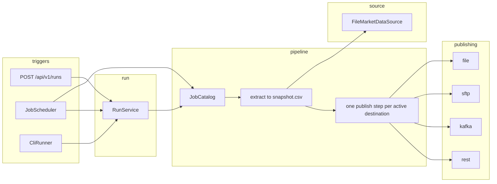
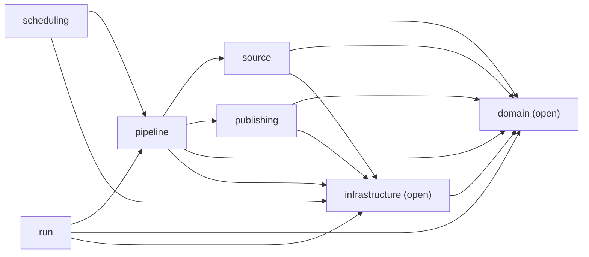
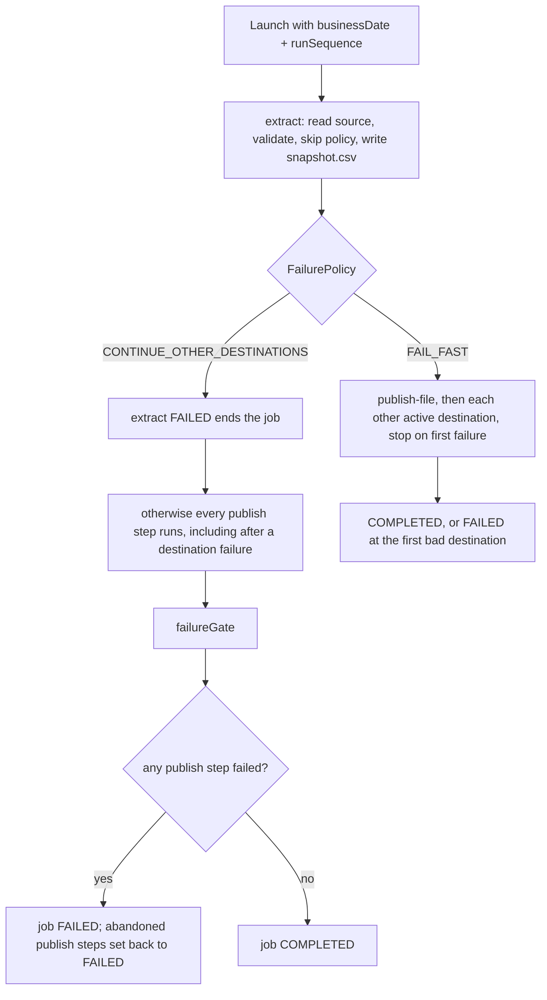

# How Market Data Publisher works

Market Data Publisher takes one instrument family and one business date, reads an end-of-day snapshot (instrument reference data and the closing price), validates it, and publishes that same snapshot to the destinations wired for that job. The design point is about 100,000 instruments per family: the snapshot is read once, staged on disk, and then each destination is its own Spring Batch step.

The vendor Asset Control API is not connected. `FileMarketDataSource` reads a CSV from disk. `AssetControlMarketDataSource` is a non-bean placeholder (`STATUS = "NOT_IMPLEMENTED"`).

The process is one Spring Boot 3.5.16 application (Java 17, Spring Batch 5, Spring Modulith 1.4.14, Maven). Run history lives only in Spring Batch metadata tables: H2 in memory on a workstation, Oracle in production. There is no application schema and no Flyway migration.

## Architecture



`domain` and `infrastructure` sit under every arrow. They are open shared modules (`@Modulithic(sharedModules = {"domain", "infrastructure"})` and `ApplicationModule.Type.OPEN`). Scheduling does not import the run module. It calls `ScheduledRunLauncher`, and `RunService` implements that interface.



`domain` depends on nothing. Nothing depends on `run` or `scheduling`. `source` and `publishing` do not depend on `pipeline`. `ModularityTests` calls `ApplicationModules.verify()` and checks those directions.

| Module | What it holds |
|---|---|
| `domain` | `Instrument`, `EodPrice`, `MarketDataRecord`, `InstrumentType`, `BusinessDate`, `RunId`, `FailurePolicy`, `MissingPricePolicy`. |
| `source` | `MarketDataSource` and `AssetControlSource`. The CSV reader is `internal`. The vendor class is a placeholder and is not a bean. |
| `pipeline` | `JobDefinition`, the catalog, batch and schedule settings, `RunParameters`, and `ScheduledRunLauncher`. Jobs, the extract/publish flow, validation, CSV staging, and listeners are `internal`. |
| `publishing` | `Publication` and the four destination builders (`FileDestination`, `SftpDestination`, `KafkaDestination`, `RestDestination`). Clients and sinks are `internal`. |
| `run` | `RunService` and `RunStatus`. The REST controller, the duplicate-run guard, the per-job launcher, and the CLI are `internal`. |
| `scheduling` | No public type. `JobScheduler` and a no-op `ClusterLock` are `internal`. |
| `infrastructure` | Typed `Connections` and `MdpProperties`, per-job executors, JWT security, MDC, metrics, and two health indicators. |

## Batch flow

Every job is built by `EodJobFactory.create`. Publications with `active() == false` are left out, so a connection with `enabled: false` is never opened.



The staging file is `work/<job>/<businessDate>/seq-<runSequence>/snapshot.csv`. `SnapshotStore` writes a sibling `snapshot.csv.tmp` and moves it into place. Publish steps read that file back through `SnapshotReader`, so every destination sees the same validated rows. The publish processor is `IdentityTransformer` unless another `Transformer` bean replaces it.

Step names:

| Step | When |
|---|---|
| `extract` | Always. Chunk size, fetch size, skip limit, and retry limit come from the merged batch settings. |
| `publish-file` | Local file. Always active. |
| `publish-sftp` | SFTP profile `enabled: true`. |
| `publish-kafka` | Kafka profile `enabled: true`. |
| `publish-rest` | REST profile `enabled: true`. |
| `failureGate` | Only when the job's failure policy is `CONTINUE_OTHER_DESTINATIONS` and at least one publish step was built. |

`fxFuturesEodJob` uses `CONTINUE_OTHER_DESTINATIONS`. `fxForwardsEodJob` and `cmeFuturesEodJob` use `FAIL_FAST`.

On continue, Spring Batch marks a failed step `ABANDONED` when a later step starts. `failureGate` writes those publish steps back to `FAILED` through `JobRepository` and then fails the job, so a restart runs the destination again.

Restart re-executes failed steps and skips completed ones. If extract already completed, the staged snapshot is kept and only the failed publish steps run.

## A run from the API or Autosys

Autosys and Airflow use the same endpoint as any other caller. They obtain a JWT with `MDP_OPERATOR` and `POST /api/v1/runs`. `triggeredBy` is the token subject. The body is only `jobName` and `businessDate`.

```mermaid
sequenceDiagram
  participant Caller as API client, Autosys, or Airflow
  participant API as RunController
  participant Runs as RunService
  participant Guard as ActiveRunGuard
  participant Repo as JobRepository / JobExplorer
  participant Launch as PerJobJobLauncher
  participant Job as extract then publish steps

  Caller->>API: POST /api/v1/runs (jobName, businessDate)
  API->>Runs: launch(job, date, principal, "API")
  Runs->>Runs: JobCatalog.find; unknown job -> 404
  Runs->>Guard: assertNoActiveRun(job, date)
  Guard->>Repo: findRunningJobExecutions
  alt a run for that job and date is running
    Runs-->>Caller: 409 problem+json
  else clear
    Runs->>Guard: nextSequence = max sequence for that date + 1
    Runs->>Launch: run(job, identifying businessDate + runSequence)
    Launch->>Repo: create the execution
    Launch-->>Runs: execution id
    Runs-->>Caller: 202, Location /api/v1/runs/{id}
    Launch->>Job: same job's pool, asynchronous
    Job->>Repo: step updates
  end
```

The in-process scheduler follows the same launch path with `triggeredBy=scheduler` and `triggerSource=SCHEDULER`. A duplicate active run is logged and skipped. The CLI calls `launchAndWait` with `triggerSource=CLI`.

Identifying parameters are `businessDate` and `runSequence`. `triggeredBy` and `triggerSource` are stored and are not identifying, so a restart keeps the same sequence. `RunId` requires `runSequence >= 1`. `BusinessDate` is any calendar date, including a back-date.

`RunService.list` returns at most 200 executions. `ActiveRunGuard.nextSequence` scans at most 5000 job instances.

## Spring Batch, as this application uses it

A **job** is one instrument family. The three jobs are Java `@Configuration` classes. `EodJobFactory` builds one Spring Batch `Job` per `JobDefinition`. Boot will not start them on its own (`spring.batch.job.enabled=false`).

A **step** is `extract`, one `publish-<destination>` per active publication, and sometimes `failureGate`.

A **chunk** is `batch.chunkSize()` records (default 1000, 2000 on FX futures) with the configured `PlatformTransactionManager`. The extract reader asks the source for `fetchSize` rows (default 1000). The file source reads the whole CSV; `fetchSize` is only part of the reader name.

The **JobRepository** is Spring Batch's JDBC repository. Local and dev profiles let Batch create its tables on H2 (`initialize-schema: always` on `local`, `embedded` on `dev` unless `MDP_BATCH_SCHEMA_INIT` is set). `oracle` and `prod` set `initialize-schema` to `never` unless that variable overrides it, and they set `isolation-level-for-create: read_committed` to avoid `ORA-08177`. A DBA applies `schema-oracle.sql` from `spring-batch-core` once. See `docs/batch-schema.md`.

There are no custom tables. Per-destination status is the step execution. Listing runs walks `JobExplorer` rather than a side index.

**Run identity** is the identifying pair `businessDate` + `runSequence`. A second launch of the same job and date, after the first has finished, gets the next sequence. The local file name `{type}_EOD_{businessDate}.csv` has no sequence, so that file is replaced. Shipped SFTP names include `{runSequence}`, so each sequence is a distinct remote object. Kafka keys by instrument id, so a later publish replaces the value for that instrument. REST's `Idempotency-Key` includes the sequence, so a new sequence is a new key.

**Restart** is `JobOperator.restart` on a `FAILED` or `STOPPED` execution. The same parameters, including `runSequence`, are reused. A running execution returns 409. Any other status returns 409 from `InvalidRunStateException`.

**Stop** calls `JobOperator.stop` and returns 202 while the status moves to `STOPPING`. Stopping an execution that is not running returns 409.

**Startup recovery.** A crashed JVM leaves executions in `STARTED`, which blocks that job and date and cannot be restarted. `StartupRecovery` (`@Order(0)`) loads running executions and, in a transaction, marks running steps and the execution `FAILED` with the exit description `Marked FAILED on startup because the previous process exited while this execution was running. Restart it with POST /api/v1/runs/{id}/restart.`

**Threads.** `mdp.batch.*.threads` sizes a pool per job (`JobExecutors`, prefix `mdp-<job>-`, core = max = that count, queue `max(8, threads * 2)`). `PerJobJobLauncher` runs each launch on that job's pool, so two jobs do not share workers. The step builders do not set a chunk task executor, so a single execution processes its chunks on one thread. The scheduler has a separate pool of 2 named `mdp-schedule-`.

Extract retries `IOException` and `ResourceAccessException` only when the merged `retryLimit` is greater than 0. The default is 0. REST has its own Resilience4j retry, separate from the Batch retry limit.

## The three jobs

Defined in `pipeline.internal.jobs`. Each one injects `AssetControlSource` (the file reader) and `Connections`, and passes typed profiles into the destination builders. YAML supplies cron and batch tuning only.

| Job | Instrument | Failure policy | Publications | YAML schedule and tuning |
|---|---|---|---|---|
| `fxFuturesEodJob` | `FX_FUTURE` | `CONTINUE_OTHER_DESTINATIONS` | Local file `{type}_EOD_{businessDate}.csv` (CSV). SFTP `vendorA`, remote dir `/inbound/fx-futures`, name `fx_futures_{businessDate}_{runSequence}.csv`. Kafka `main`, topic `mdp.fx-futures.eod`, JSON. | `0 0 16 * * MON-FRI`, chunk 2000, 4 threads |
| `fxForwardsEodJob` | `FX_FORWARD` | `FAIL_FAST` | Local file, same pattern. REST `riskApi`, path `/api/fx-forwards`, JSON. | `0 0 17 * * MON-FRI`, batch defaults |
| `cmeFuturesEodJob` | `CME_FUTURE` | `FAIL_FAST` | Local file, same pattern. SFTP `internal`, remote dir `/inbound/cme`, name `cme_{businessDate}_{runSequence}.csv`. | `schedule: none` (on demand), 3 threads |

All three use `MissingPricePolicy.SKIP_AND_ALERT`. `JobDefinition` defaults, if a builder omits them, are `SKIP_AND_ALERT` and `FAIL_FAST`. A job with no instrument type, no source, or no publication fails at `build()`.

`{type}`, `{job}`, `{businessDate}`, `{date}`, and `{runSequence}` are replaced by `OutputNames`.

`JobStartupValidator` runs after singletons exist. An `mdp.jobs` key that is not a `JobDefinition` aborts startup. An unparseable cron aborts startup. It also materializes each job's thread pool.

## Configuration

`Connections` is a `@ConfigurationProperties` record bound to `mdp.connections`. The Java accessors are the profile names:

| Accessor | YAML | Secrets and flags |
|---|---|---|
| `source.assetControl` | `mdp.connections.source.asset-control` | `input-dir` from `MDP_INPUT_DIR` (default `sample-data/input`), `file-pattern` `{type}_{businessDate}.csv` |
| `sftp.vendorA` | `mdp.connections.sftp.vendor-a` | `MDP_SFTP_VENDOR_A_HOST`, `_PORT`, `_USER`, `_PASSWORD`, `_KEY`, `_KNOWN_HOSTS`, `_ENABLED`. Default host `sftp-vendor-a`, port 22, user `mdp`, `enabled` false, `allow-unknown-keys` false |
| `sftp.internal` | `mdp.connections.sftp.internal` | `MDP_SFTP_INTERNAL_*`, same shape, default host `sftp-internal`, disabled |
| `kafka.main` | `mdp.connections.kafka.main` | `MDP_KAFKA_BOOTSTRAP` (default `localhost:9092`), `MDP_KAFKA_SECURITY_PROTOCOL` (default `PLAINTEXT`), truststore env vars, `MDP_KAFKA_ENABLED` default false. Client id `market-data-publisher` |
| `rest.riskApi` | `mdp.connections.rest.risk-api` | `MDP_REST_URL` (default `http://localhost:8081`), `MDP_REST_AUTH` (default `none`), `MDP_REST_CLIENT_ID`, `MDP_REST_CLIENT_SECRET`, `MDP_REST_TOKEN_URI`, `MDP_REST_ENABLED` default false |

Other `mdp` keys on `MdpProperties`:

| Key | Env | Default |
|---|---|---|
| `mdp.output-dir` | `MDP_OUTPUT_DIR` | `output` |
| `mdp.work-dir` | `MDP_WORK_DIR` | `work` |
| `mdp.schedule-zone` | `MDP_SCHEDULE_ZONE` | empty, JVM zone |
| `mdp.security.mode` | | `permit-all`; `dev` and `prod` set `jwt` |
| `mdp.batch.defaults.*` | | chunk 1000, threads 1, skip 100, retry 0, fetch 1000 |
| `mdp.jobs.<job>.batch.*` | | overrides those five fields for one job |
| `mdp.jobs.<job>.schedule` | | 6-field cron, or `none` / absent for on demand |
| `mdp.jobs.<job>.enabled` | | default true; false skips cron and still allows the API |
| `mdp.cli.job`, `mdp.cli.business-date`, `mdp.cli.triggered-by` | | empty; CLI runs only when `job` is set |

Nothing secret is committed. A Vault agent, systemd `EnvironmentFile`, or `spring.config.import: vault://` can supply the placeholders. Spring Cloud Vault is not on the classpath. There is no refresh scope, and the run API cannot override these values. A change is a restart.

Profiles:

| Profile | Database | Security |
|---|---|---|
| `local` (the default) | H2 `jdbc:h2:mem:mdp`, Batch schema created | `permit-all`. Every caller is principal `local-operator` with `ROLE_MDP_OPERATOR` and `ROLE_MDP_VIEWER`. Not for a shared host. |
| `dev` | H2 unless `MDP_DB_URL`, `MDP_DB_USER`, `MDP_DB_PASSWORD`, `MDP_DB_DRIVER` are set | JWT. `MDP_JWT_ISSUER` is required. |
| `oracle` | Oracle via `MDP_DB_*`, Hikari pool 5, schema init `never` | Leaves security to the profile it is combined with, for example `oracle,prod`. |
| `prod` | Oracle, same pool and schema rules | JWT, `MDP_JWT_ISSUER` required. Health details `never`. Tracing sample `0.1`. |
| `test` | From the main YAML plus the test overlay | Schedules forced off. Activated by `src/test/resources/application.properties`. |

`KafkaAutoConfiguration` is excluded. Producers are built in `KafkaProducers` on first use from `KafkaProducerConfig`: idempotence on, `acks=all`, max in-flight 5, linger 20 ms, optional SSL truststore.

## Failure and missing-price policies

`MarketDataValidator` checks each row during extract:

- blank `instrumentId`, blank symbol, currency that is not three ASCII capitals, instrument type other than the job's type, or a non-positive price → `InvalidRecordException`
- null close price → `MissingPriceException`

`MdpSkipPolicy`:

- `SKIP_AND_ALERT`: skip the missing price. It does not consume the invalid-record skip limit. `SkipLoggingListener` logs at error (`ALERT missing EOD price for instrument ...`) and increments `mdp.records.skipped` with reason `missing_price`.
- `FAIL_RUN`: a missing price is not skipped, so the extract step fails.
- Other invalid rows and `FlatFileParseException` (a non-numeric price fails CSV parsing) are skipped until `skipLimit` (default 100), then the step fails. Metrics reasons are `invalid` and `parse`.

The shipped jobs all use `SKIP_AND_ALERT`. The FX future sample file includes a blank price, a negative price, and a non-numeric price on purpose.

`FailurePolicy.FAIL_FAST` stops at the first destination failure. Later destinations are not attempted. `CONTINUE_OTHER_DESTINATIONS` runs the remaining destinations, then `failureGate` fails the job if any of them failed. FX futures is the job that continues.

Input header: `instrumentId,instrumentType,symbol,currency,maturityDate,closePrice`. A blank close price becomes a null price. The staged snapshot and the file/SFTP sinks use `businessDate,instrumentId,instrumentType,symbol,currency,maturityDate,closePrice`.

File sink: write `<outputDir>/<name>.tmp`, then an atomic move onto the final path. SFTP: stage under `work/sftp/<job>/seq-<n>/`, upload to `<remoteDir>/<name>.tmp`, delete an existing final remote path, rename the temp into place, delete the local temp. Kafka: one JSON object per instrument (`jobName`, `businessDate`, `runSequence`, `record`), key = instrument id, headers `jobName`, `businessDate`, `runSequence`, `instrumentType`. A restarted publish step sends the snapshot again. REST: one JSON batch per chunk, `Idempotency-Key: <job>:<date>:<sequence>:<chunkIndex>`, retry and circuit breaker from the `RestConnection` defaults (3 attempts, 200 ms wait, 50% failure rate, sliding window 20, minimum 10 calls).

## API and roles

Base path `/api/v1/runs`. Errors are RFC 7807 `application/problem+json` (`spring.mvc.problemdetails.enabled=true`). Bean validation produces 400. `ApiExceptionHandler` maps unknown job and unknown run to 404, and a duplicate active run or a restart/stop in the wrong state to 409. Problem type URIs look like `https://mdp.praxis.com/problems/run-already-active`.

| Method | Path | Role when `mdp.security.mode=jwt` | Result |
|---|---|---|---|
| `POST` | `/api/v1/runs` | `MDP_OPERATOR` | 202, body is `RunStatus`, `Location: /api/v1/runs/{executionId}` |
| `GET` | `/api/v1/runs/{id}` | `MDP_OPERATOR` or `MDP_VIEWER` | One execution, with per-step read, write, filter, skip, and commit counts |
| `GET` | `/api/v1/runs?job&date&status` | viewer or operator | Up to 200 matches. `status` is a `BatchStatus` name; an unknown value is 400 |
| `POST` | `/api/v1/runs/{id}/restart` | operator | 202, same `runSequence`, failed steps run again |
| `POST` | `/api/v1/runs/{id}/stop` | operator | 202 |

`JwtRolesConverter` collects `roles`, Keycloak `realm_access.roles`, and space-separated `scope`, and prefixes `ROLE_` when it is missing. With `permit-all` (the `local` profile and the default), there is no JWT. The anonymous principal is `local-operator` with both roles. 401 and 403 problem bodies are written by the JWT filter chain.

OpenAPI title is "Market Data Publisher API", version `v1`, with an HTTP bearer scheme named `bearer-jwt`. The UI is `http://localhost:8080/swagger-ui.html`. On the JWT chain, `/v3/api-docs/**`, `/swagger-ui/**`, and `/swagger-ui.html` are permitted without a token, as are `/actuator/health`, `/actuator/health/**`, `/actuator/info`, and `/actuator/prometheus`.

`RunStatus` exposes `executionId`, `jobName`, `businessDate`, `runSequence`, `status`, `exitCode`, start and end times, `triggeredBy`, `triggerSource`, and the step list.

## Scheduling, Autosys, and Airflow

`JobScheduler` registers a `CronTrigger` for every catalog job whose schedule is enabled and has a cron. The business date is `LocalDate.now(clock)` in `mdp.schedule-zone`, or the JVM zone when that value is empty. Before launching, it calls `ClusterLock.tryAcquire`. `NoOpClusterLock` always returns true. The comment on `ClusterLock` says a ShedLock or database lease belongs there when more than one node schedules the same jobs.

`RunService.launch` holds `synchronized` on the guard for the duplicate check, the sequence allocation, and the launch call. That lock is inside one JVM. `NoOpClusterLock` does not coordinate a second process. ADR 0004 records that two nodes can both pass the duplicate guard.

External schedulers own calendars, retries, and alerting. This service owns the run. On-demand jobs (`cmeFuturesEodJob`, `schedule: none`) stay off the cron. When Autosys or Airflow owns the calendar, set `mdp.jobs.<name>.enabled=false` or `schedule: none` so the in-process cron does not also fire. They still call `POST /api/v1/runs`.

CLI, for a workstation fallback:

```bash
./mvnw spring-boot:run -Dspring-boot.run.arguments="--mdp.cli.job=fxFuturesEodJob --mdp.cli.business-date=2026-11-11 --mdp.cli.triggered-by=alice"
```

`CliRunner` waits until the execution stops. Success leaves the process up. `FAILED` or `STOPPED` throws and aborts startup. A blank `triggered-by` falls back to the OS user name.

## Observability

Console logs are ECS JSON (`logging.structured.format.console=ecs`). There is no Logback XML in the tree. For the duration of a job, `RunLoggingListener` puts MDC keys `jobName`, `businessDate`, `executionId`, `runSequence`, and `triggeredBy`, and clears them in a `finally`. It logs each step's read, write, and skip counts and every failure exception.

Micrometer counters and timers, all prefixed `mdp`:

| Meter | Tags |
|---|---|
| `mdp.records.read` | `job` (extract read count) |
| `mdp.records.written` | `job`, `destination` |
| `mdp.records.skipped` | `job`, `reason` (`missing_price`, `invalid`, `parse`) |
| `mdp.destination.duration` | `job`, `destination` |
| `mdp.destination.failures` | `job`, `destination` |

Actuator exposes `health`, `info`, `prometheus`, and `metrics`. Liveness and readiness probes are enabled. Health details are `when_authorized`, and `never` on `prod`.

`WorkDirectoryHealthIndicator` creates `mdp.work-dir` and reports down when it is not writable. `BatchMetadataHealthIndicator` calls `JobExplorer.getJobNames()` and reports down when the metadata store throws.

Tracing uses `micrometer-tracing-bridge-otel` and `opentelemetry-exporter-otlp`. Export stays off until `OTEL_EXPORT_ENABLED=true`. The endpoint is `OTEL_EXPORTER_OTLP_ENDPOINT` (default `http://localhost:4318/v1/traces`). `MDP_TRACING_PROBABILITY` defaults to `1.0`, and to `0.1` on `prod`. Metrics are tagged `application=market-data-publisher`.

Shutdown is graceful (`server.shutdown=graceful`, `spring.lifecycle.timeout-per-shutdown-phase=30s`). The schedule pool and the per-job executors wait up to 30 seconds for in-flight work.

## Security

Two filter chains, selected by `mdp.security.mode`:

- `permit-all` (match if missing, and the `local` profile): CSRF off, stateless, every request permitted, anonymous principal `local-operator` with both MDP roles.
- `jwt` (`dev` and `prod`): stateless OAuth2 resource server. `POST /api/v1/runs` and `POST /api/v1/runs/**` require `MDP_OPERATOR`. `GET /api/v1/**` requires `MDP_OPERATOR` or `MDP_VIEWER`. Health, info, Prometheus, and the OpenAPI UI are permitted. Everything else requires an authenticated token. 401 and 403 are problem JSON.

Do not run `permit-all` on a shared or production host. The `local` profile says that in its header comment.

## Deployment

Today the process is one VM under systemd. `deploy/mdp.service` runs `java -jar /opt/mdp/market-data-publisher.jar` as user `mdp`, with `WorkingDirectory=/opt/mdp` and `EnvironmentFile=/etc/mdp/mdp.env`. `KillSignal=SIGTERM`, `TimeoutStopSec=40`, `SuccessExitStatus=143`, `Restart=on-failure`.

The image (`deploy/Dockerfile`) is a layered Eclipse Temurin 17 JRE. The build stage runs `./mvnw -B -DskipTests package`. The runtime user is uid/gid `10001`, home `/app`, with `/app/work` and `/app/output`. `MDP_WORK_DIR` and `MDP_OUTPUT_DIR` point at those directories. The entrypoint is `JarLauncher`.

Compose (`deploy/docker-compose.yml`):

```bash
docker build -f deploy/Dockerfile -t market-data-publisher .
docker compose -f deploy/docker-compose.yml up -d
docker compose -f deploy/docker-compose.yml --profile oracle up -d
docker compose -f deploy/docker-compose.yml --profile app up -d --build
```

Default services are Kafka (`apache/kafka:3.8.1` on port 9092) and SFTP (`atmoz/sftp:alpine` on port 2222, user `mdp`). Oracle Free (`gvenzl/oracle-free:23-slim`, app user `mdp`) is the `oracle` profile. The publisher container is the `app` profile, `SPRING_PROFILES_ACTIVE=local`, `MDP_KAFKA_BOOTSTRAP=kafka:9092`. The compose file also sets `MDP_SFTP_HOST`, `MDP_SFTP_PORT`, `MDP_SFTP_USER`, `MDP_SFTP_PASSWORD`, and `MDP_SFTP_DIR`. Those names are not the placeholders in `application.yml` (`MDP_SFTP_VENDOR_A_*` and `MDP_SFTP_INTERNAL_*`). The `local` profile also leaves both SFTP profiles `enabled: false`, so that container does not turn SFTP publishing on by itself.

Kubernetes is notes only (`deploy/k8s/README.md`), not manifests. The same image runs as one replica. Do not scale past one replica until `ClusterLock` is a real lock. The notes suggest `terminationGracePeriodSeconds: 40`, `runAsUser: 10001`, writable emptyDirs on `/app/work` and `/app/output`, probes on `/actuator/health/liveness` and `/actuator/health/readiness`, Prometheus on `/actuator/prometheus`, and `SPRING_PROFILES_ACTIVE=prod`. The env names that match `application.yml` are `MDP_DB_URL`, `MDP_DB_USER`, `MDP_DB_PASSWORD`, `MDP_JWT_ISSUER`, `MDP_KAFKA_BOOTSTRAP`, and the `MDP_SFTP_*` / `MDP_REST_*` placeholders listed in the configuration section. The Kubernetes note also mentions `MDP_SFTP_PASSWORD` and `MDP_REST_TOKEN`, which are not the property placeholders in `application.yml`.

CI (`.github/workflows/ci.yml`) runs `./mvnw -B verify` on Temurin 17 for every push and pull request. That goal runs tests, Spotless (google-java-format), Checkstyle, and JaCoCo. Kafka and SFTP tests use Testcontainers and are skipped when Docker is not available. The REST sink is tested with WireMock. Oracle Free in Compose is not part of CI.

## Run it locally

JDK 17 or newer. The wrapper downloads Maven 3.9.9; there is no wrapper jar in the tree.

```bash
./mvnw verify
./mvnw spring-boot:run
```

```bash
curl -i -X POST localhost:8080/api/v1/runs -H 'Content-Type: application/json' \
  -d '{"jobName":"fxFuturesEodJob","businessDate":"2026-11-11"}'

curl localhost:8080/api/v1/runs/1
curl 'localhost:8080/api/v1/runs?job=fxFuturesEodJob&date=2026-11-11&status=COMPLETED'
cat output/FX_FUTURE_EOD_2026-11-11.csv
curl localhost:8080/actuator/health
```

On the `local` profile the remote publications are disabled, so this run writes the local CSV and does not open SFTP, Kafka, or REST.

## Known TODOs

These are the unfinished items in the code and the README. They are not implemented.

- Replace `AssetControlMarketDataSource` with the vendor Java API: page instrument ids, store the resume cursor in the step execution context, and select it with `mdp.source.type=asset-control`. That property is named only in the placeholder comment.
- Add a ShedLock (or equivalent) implementation of `scheduling.internal.ClusterLock` before running more than one node. `NoOpClusterLock` always acquires.
- Oracle Free in Compose is not part of CI. The Oracle profile has not been executed against a live database in this repository.
- Kafka restart is last-write-wins on instrument id. There is no transactional outbox.
